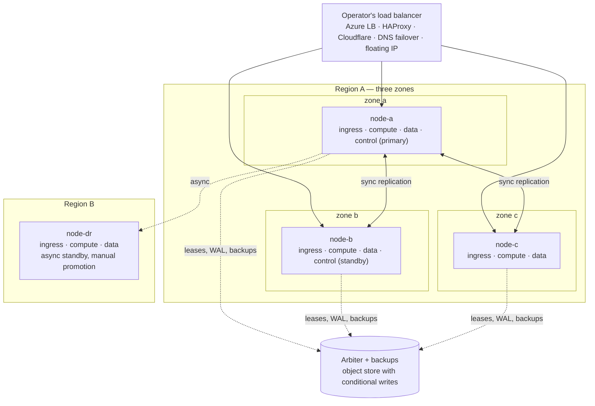
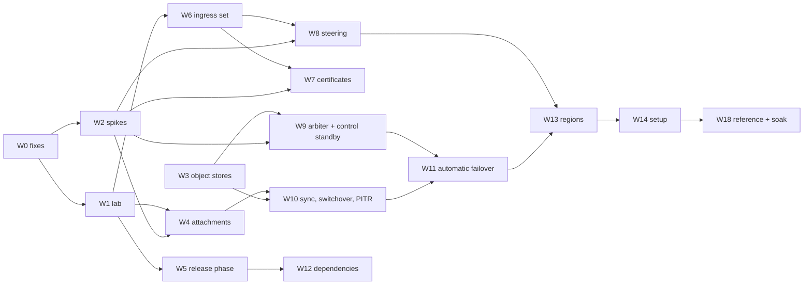

# Yoal — HA execution plan: from 0.15 to a production HA platform

Status: **plan, 2026-11-19.** Audited against `main` at `83d4e469` (platform 0.15.3, migrations to
`0117`). This is the execution plan for the unbuilt half of [CLUSTERING.md](./CLUSTERING.md)
(C5–C8, the rest of C2 and C7), plus the gaps that document does not cover. Where this plan
changes that design it says so and names a new proposal (**H17–H28**); everything else in
CLUSTERING.md stands. "Today" means verified in code at the audit commit; "the plan" means unbuilt.
Estimates are focused days for one maintainer and are rough.

**Contents:** [0 Summary](#0-summary) · [1 Target](#1-the-target) · [2 Today](#2-where-yoal-is-today) ·
[3 Design changes](#3-design-changes-h17h28) · [4 Workstreams](#4-workstreams) ·
[5 Sequence](#5-sequence-and-milestones) · [6 Agents](#6-building-it-with-several-agents) ·
[7 Testing](#7-testing-and-acceptance) · [8 Setup](#8-the-setup-experience) ·
[9 Rollout](#9-flags-compatibility-and-rollout) · [10 Security](#10-security) ·
[11 Risks](#11-risks-open-questions-and-what-is-out) · [12 Done](#12-definition-of-done)

---

## 0. Summary

**The goal.** An operator with three or more machines can run a stateful production app on Yoal
with no single point of failure in the request path, and set it up in five commands. The proving
case is a clinical record system (LynxNet): a container app in three copies, PostgreSQL with no
acknowledged write lost, behind whatever load balancer the operator already has.

**What stops that today** (section 2 has the evidence):

1. **One edge.** Only one node has the full route table, the static sites and the certificates.
   A second `ingress` node behaves as a worker.
2. **No load balancer support.** No health endpoint to probe, no PROXY protocol, no trusted-proxy
   handling, and the steering drivers only record what a person should change in DNS.
3. **Database failover is manual, slow and can lose data.** Replicas are async only, detection is
   one signal after 120 s, and a cut-off primary never stops itself.
4. **A container app cannot reach a database on another node**, so it cannot run in several copies
   against a managed database.
5. **One control plane**, with a lease library that nothing calls and a CAS spike that never ran.
6. **No release phase.** Nothing runs a migration once before a rollout, and a copy is restarted in
   the same step that removes it from the balancer.
7. **No multi-node test lab**, so none of the above can be proven safe.
8. **Setup is per-feature.** There is no HA profile, preflight, drill, or one-file description of
   an HA stack.

**The shape of the answer.**

- The **edge becomes a set**: every node with the `ingress` role is a full edge with the same
  routes, files and certificates (H17, H20).
- **Steering is a driver** with one contract and several built-ins: an external load balancer of
  any kind, DNS failover with pluggable DNS providers, a floating IP for bare metal, a webhook for
  anything else (H18, H19).
- **Database failover moves to the nodes.** Members hold a lease in an arbiter; the primary stops
  itself when it loses it, a synchronous replica promotes itself, and consumers find the primary
  without the control plane. Target: writes back in under 30 s with RPO 0 (H21–H24).
- **Attachments always go through a loopback endpoint**, for containers too, so a URL never changes
  and an app never restarts because a database moved (H24).
- **Releases get a release phase**, readiness, and a drain (H25).
- **Setup is one profile**: `yoal ha init`, `preflight`, `drill`, and a blueprint that declares the
  whole stack (H27).

**Size.** About 160–200 focused days for one maintainer. With the lanes in section 6 (three to five
agents at a time, one human integrating), about 12–14 weeks to milestone M5, then a 30-day soak.

**Order.** Lab and spikes first; then attachments and the release phase (useful on any fleet); then
ingress and load balancers; then the arbiter and control-plane standby; then automatic database
failover, which is the only part that can lose data if it is wrong and is built last, by one
author, against the lab.

---

## 1. The target

### 1.1 Reference deployment (R1)

Every exit criterion in this plan is measured on this shape. It is LynxNet's production plan
(`lynxnet-v3/docs/14-ha-deployment.md` §11) moved onto Yoal.



- **App:** a container project, three copies, one per zone, with a health path and a release
  command that runs database migrations.
- **Database:** PostgreSQL 18, one primary and two synchronous-capable replicas, one per zone,
  point-in-time recovery on, an async standby in region B.
- **Ingress:** all three nodes serve every route; the operator's load balancer probes each.
- **Control plane:** primary on node-a, warm standby on node-b.
- **Smaller shapes that must also work:** two nodes (no automatic database promotion: hold and
  page, R6 in CLUSTERING §21); three nodes in one zone; one node (unchanged).

### 1.2 Bounds

These tighten CLUSTERING §1 where R1 needs it. The old bounds stay as the bounds for the
homelab-style `dns-failover` fleet.

| Failure | Bound in R1 | Conditions | CLUSTERING §1 today |
|---|---|---|---|
| One ingress node | Out of rotation in **≤ 15 s**; in-flight requests on other nodes unaffected | External LB probing every 5 s, 2 failures | 120 s proxied, 240 s DNS-only |
| One app copy or its node | **No failed idempotent request** (retried on another copy); copy re-placed within grace + 2 min | 2+ copies in distinct zones | 10 s |
| Database primary, unplanned | Writes back in **≤ 30 s**, **RPO 0** in `sync` | 3 data nodes in 3 zones, arbiter reachable, `failover: auto` | 120 s auto |
| Database primary, planned | Switchover in **≤ 5 s**, no lost commit | Replica caught up | Not built |
| A whole zone | All of the above together in **≤ 45 s** | R1 | — |
| Control-plane primary | **No effect on serving, load balancing or database failover.** Deploys and settings back in ≤ 60 s (`auto`) or 15 min (manual) | Warm standby in another zone | 60 s / 15 min |
| The arbiter | **No outage.** No promotion while it is away; a healthy primary keeps running (H21 failsafe) | All members can reach each other | Control plane read-only; database primaries stop |
| Region A | Reads from region B in ≤ 3 min; writes after a manual, fenced promotion, ≤ 15 min, RPO = lag | Standby in region B | Not in scope |
| A deploy | **No failed request**; a failed release never takes traffic; migrations run once | Health path, release command, 2+ copies | Rolling, no release phase |
| A single-node install | No behaviour change, no new dependency | — | Same |

### 1.3 New invariants

In addition to I1–I7 (CLUSTERING §1):

| # | Invariant | Enforced by |
|---|---|---|
| I11 | The request path needs no control plane: routing, balancing, TLS and database failover work for 24 h with it down | Lab test; desired state carries everything an ingress and a member need |
| I12 | In `sync`, automatic promotion only ever chooses a replica the arbiter records as synchronous | H23; the sync set is written to the lease before `synchronous_standby_names` changes |
| I13 | A database primary that cannot prove it holds the lease stops accepting writes within one TTL | H22 self-fencing on the node, not a control-plane instruction |
| I14 | An ingress is never offered traffic it cannot serve: routes converged, releases present, certificates loaded | H19 readiness; preflight; the health endpoint answers 503 until then |
| I15 | A copy stops receiving new requests before it is stopped | H25 drain; H19 lame duck for ingress |
| I16 | A release command runs at most once per release, and a rollout does not start if it failed | H25; a run lease on the release id |

---

## 2. Where Yoal is today

Verified in code at `83d4e469`. Paths are in this repository.

### 2.1 Built and usable

| Area | What works | Evidence |
|---|---|---|
| App copies | Scale without a deploy, one copy per node, cluster-wide `replicas.spread` (`node` or `zone`) | `packages/core/src/replicas.ts:97`, `workloads.ts:1220` |
| Load balancing | Edge Caddy `least_conn`, active checks every 5 s when `healthPath` is set, 3 s retry, 30 s passive ejection | `packages/site-config/src/compile.ts:255-266` |
| Deploys | Rolling one copy at a time, surge for one copy, automatic rollback once, 300 s timeout, autoscaling | `workloads.ts` `rolloutTick`; `packages/contracts/src/scaling.ts` |
| Node loss | Offline at 30 s; copies re-placed after 120 s when `failover.enabled`; rate limits and flap protection | `packages/core/src/failover-service.ts` |
| Overlay | Managed WireGuard, hubs, join in one command, verified on two real hosts | `packages/core/src/overlay.ts`; `scripts/install/main.ts` |
| Cross-node attachments | Process apps reach a database on another node on a stable loopback port over pinned mTLS | `apps/agent/src/endpoints.ts:81-156`; `packages/core/src/endpoints.ts:41-80` |
| Postgres replicas | Async streaming, slots, 30 s lag sampling, `<P>_READ_*`, manual fenced promotion with `If-Match` | `apps/helper/src/replication.ts`; `packages/core/src/database-replica-service.ts` |
| Failover controller | SQLite lease with the epoch checked in every write; database `decide` stage; `yoal ha status` | `packages/core/src/lease.ts:102-160`; `failover-service.ts` |
| Control-plane loss | Nodes serve the cached desired state; balancing and health checks continue | `apps/agent/src/state.ts:7`, `main.ts:442-458` |
| Node updates | Waves with drain, soak, failure budget and an on-node rollback guard | `packages/core/src/node-rollouts.ts` |

### 2.2 Missing, by gap

| # | Gap | What the code does today | Evidence |
|---|---|---|---|
| G1 | Edge is one node | `isEdge` is `node.id === edgeId \|\| node.mode === 'edge'`; the `ingress` role is not read. Only the edge gets every project, the upstream lists, placeholder pages and gateways | `packages/core/src/nodes.ts:1213-1214`, `:1270-1279`, `:1414`, `:1583`, `:1650` |
| G2 | The edge check is everywhere | Storage, registry, Kubernetes, gateways, studio and placement each ask "is this the edge?" | `packages/core/src/workloads.ts:2130-2137` and callers |
| G3 | Static sites live on one node | A site goes to its target node only; others proxy to it | `nodes.ts:1262-1267`, `:1376` |
| G4 | Certificates are per node | Each TLS node runs its own ACME; no shared storage or distribution. Only the Cloudflare DNS module is built into Caddy | `apps/agent/src/main.ts:889`, `:997-1010`; `.github/workflows/release.yml:212` |
| G5 | Workers cannot be public | Worker installs set `YOAL_TLS=0` and listen on the overlay only | `scripts/install/main.ts:1973`, `:2030` |
| G6 | Drivers do nothing | `dns-failover` and `cloudflare-lb` keep an intended record set and raise a `manual` event; no probing, no DNS write. `caddyOk` is reported but never read | `failover-service.ts:571-668`, `:1323-1325`; `packages/contracts/src/agent.ts:417` |
| G7 | No load balancer support | No PROXY protocol, no trusted proxies, no public health endpoint (the agent's `/healthz` is on a unix socket). `YOAL_CADDY_LISTEN` is ignored when TLS is on | `apps/agent/src/main.ts:572-595`, `:899`; `compile.ts:269`, `:480` |
| G8 | Per-node session secret | `YOAL_ACCESS_JWT_SECRET` is per-node env; the redeemed-token cache is in memory | `apps/agent/src/verify.ts` |
| G9 | Containers cannot attach across nodes | `crossNodeAllowed()` is false for `runtime === 'container'`; the forwarder binds loopback only; no `AddHost` | `packages/core/src/databases.ts:3636-3641`; `apps/agent/src/endpoints.ts:82` |
| G10 | Apps restart on promotion | Apps on the old or new primary's node get a new host and port | `databases.ts:2943-2963` |
| G11 | No pooled URL across nodes | `_POOL_URL` only for same-node consumers | `databases.ts:3628` |
| G12 | No synchronous replication | `mode: 'sync'` is refused; nothing renders `synchronous_standby_names` | `database-replica-service.ts:104-107` |
| G13 | One detection signal, 120 s | Heartbeat age only | `failover-service.ts:283-300`, `:718` |
| G14 | No database self-fencing | Run leases exist only for lone workers. An unreachable primary is "fenced" on paper at once | `workloads.ts:1144-1157`; `database-replica-service.ts:1064` |
| G15 | Old primary is thrown away | No `pg_rewind`, no switchover | `apps/helper/src/systemd.ts:1358-1392` |
| G16 | Replicas or PITR, not both | Refused in both directions; the replica image has no pgBackRest | `database-replica-service.ts:108-111`; `databases.ts:2160-2162` |
| G17 | Object stores are S3 only | Platform store, Litestream, backup targets and PITR all assume the S3 API; the region is hard-coded `auto`. No Azure Blob or GCS | `packages/contracts/src/platform-config.ts:44`, `:133-145`; `apps/helper/src/pitr.ts:213-220` |
| G18 | No control-plane standby | `YOAL_STANDBY=1` is the same-host update slot. `ControlLease` is exported and unused. No agent epoch, no 503 fence, one `YOAL_CONTROL_URL` | `packages/core/src/ha-lease.ts:86`; `apps/agent/src/config.ts:265-276`; `hooks.server.ts:74-79` |
| G19 | Spikes not run | S1–S6 have no results; `spikes/s3-cas` is a harness only | `docs/SPIKES.md:15` |
| G20 | Singletons on the control host | ClickHouse, the local object store, identity, mail and the registry each sit on one node | `scripts/systemd/clickhouse.ts:9`; `packages/core/src/registry.ts:341` |
| G21 | No release phase | Job triggers are `schedule`, `manual`, `retry` only | `packages/contracts/src/job.ts:70` |
| G22 | No drain, one health path | A copy leaves the upstream list in the same version that restarts it; `TimeoutStopSec=30` is hard-coded; no readiness/liveness split | `apps/helper/src/units.ts:463-464`; `packages/contracts/src/workload.ts:169` |
| G23 | No canary for apps | Soak and canary exist only for node rollouts | `node-rollouts.ts:432` |
| G24 | HA level is a constant | `haLevel` is hard-coded `'L0'` | `packages/core/src/topology.ts:124` |
| G25 | Blueprints cannot describe HA | No spread, zones, database replicas, autoscaling, jobs, volumes or cluster settings | `packages/contracts/src/blueprint.ts` |
| G26 | No HA commands | `yoal ha` has `status` only; no preflight, doctor or drill | `apps/cli/src/commands/ha.ts:30` |
| G27 | No lab | No multi-node harness, fault injection, `tests/ha`, or HA CI jobs | `docs/TESTING.md`; CLUSTERING §19 |
| G28 | No regions | A zone is free text; nothing groups zones or models a standby region | `packages/contracts/src/cluster.ts:126` |

### 2.3 Fix now (before any new work)

| # | Problem | Why it matters | Fix |
|---|---|---|---|
| F1 | `DB_AUTO_PROMOTE` defaults **on** in code; its comment, OPS.md and D142 say off | Turning on `failover.enabled` today gives automatic promotion with no self-fencing: two primaries are possible | Default off; refuse to register the handler unless H22 self-fencing is active (`packages/contracts/src/features.ts:204`, `hooks.server.ts:95-96`) |
| F2 | The stable read-port range 22000–22999 (CLUSTERING §9.2) now belongs to k3s (D226) | The plan would collide with a shipped feature | Reserve a new range in the port registry (proposed 23000–23999) and amend §4.3, §9.2, §9.5 |
| F3 | Docs disagree with code | OPS.md:227 says process apps do not spread with endpoints on (D218 and the code say they do); CLUSTERING's status table predates the S3 lease client; ROADMAP has C0–C4 unticked; plan 23 still says "Proposal" | One truth pass over CLUSTERING status, OPS, ROADMAP and plan 23 |
| F4 | Process apps spread over endpoints is untested | `replicas-multinode.test.ts:28` turns `SERVICE_ENDPOINTS` off | Add the test; it is the base of H24 |
| F5 | The CLI's bundled docs are a release behind the platform (CLI 0.2.0, platform 0.15.3) | Operators and agents read stale HA limits | Cut a CLI release; `yoal docs` warns when the platform is newer; serve the docs at `GET /api/v1/docs` so the CLI can read the platform's own |
| F6 | Five cluster keys are accepted and read by nothing | An operator can set `database.defaultMode` and believe it did something | Reject them until they are wired, or wire them in the workstream that owns them |

---

## 3. Design changes (H17–H28)

Each is a proposal in the sense of CLUSTERING §16: it becomes a D-number when its spike passes and
it is built. Next free decision id is D235.

### H17 — The edge is a set

Every node with the `ingress` role gets the edge payload, unreduced: every route and upstream list,
every static release, placeholder pages, the platform route, the gateways. `mode: 'edge'` and
`YOAL_EDGE_NODE_ID` become "the first ingress" for compatibility and are no longer read by anything
else. One helper, `ingressNodes()`, replaces every "is this the edge?" check (G2); services that
really mean "the node that hosts this singleton" (registry, studio, identity) get their own named
node setting. This is CLUSTERING H11 with the scattered check made explicit. Workers that gain the
role get TLS and public listeners through desired state, not a hand-edited env file (G5).

### H18 — Steering is one contract with many drivers

A steering driver answers one question: *which ingress nodes should receive traffic, and how is
that made true?* The contract:

```ts
interface SteeringDriver {
  kind: string;
  capabilities: { probes: 'yoal' | 'external' | 'none'; writes: boolean; preservesClientIp: 'native' | 'proxy-protocol' | 'header' };
  preflight(ctx): Finding[];                      // refuses to enable with a reason per node
  desired(set: IngressSet): Promise<Applied>;      // idempotent; called under the controller lease
  observe(): Promise<Observed>;                    // what the provider currently has
}
```

| Driver | What Yoal does | Who detects failure | Typical bound | Use when |
|---|---|---|---|---|
| `direct` | Nothing (today) | A person | None | One node |
| `external-lb` | Serves the health endpoint and lame-duck drain (H19). **Writes nothing.** Works with anything that can probe HTTP | The balancer | Probe interval × threshold (10–15 s) | Azure LB, AWS NLB, GCP LB, Hetzner LB, HAProxy, F5, Cloudflare LB. **The default for clouds** |
| `dns-failover` | Probes ingress nodes and edits records through a DNS provider plugin: `cloudflare`, `azure-dns`, `route53`, `rfc2136` | Yoal (quorum, hold-down, CLUSTERING §7.2) | 120–240 s | No balancer; nodes in different providers |
| `vip` | Runs keepalived (VRRP) through fixed helper verbs; one floating address moves between ingress nodes | VRRP | 3–5 s | Bare metal or on-prem with ingress nodes on one L2 segment |
| `cloud-lb` | Creates and reconciles the provider's balancer through its API (`azure`, `hetzner`, `aws`) | The balancer | 10–15 s | The operator wants Yoal to own the balancer. Later; never required |
| `cloudflare-tunnel` | Runs `cloudflared` connectors | Cloudflare | Seconds | No public address |
| `webhook` | POSTs the signed desired set to an operator URL and reads back an acknowledgement | The operator's system | Theirs | Anything else |

Rules: drivers can be **stacked** (for example `external-lb` in each region and `dns-failover`
across regions; R1 uses exactly that); a driver never removes the last healthy ingress; every write
is made under the controller lease and recorded in `failover_events`; and a driver with
`probes: 'external'` still feeds Yoal's own probe results to alerts, so "the balancer thinks it is
up and we do not" is visible. `vip` reverses the rejection in CLUSTERING §22.1 for the case that
table names as the trigger: one segment.

### H19 — An ingress says whether it is ready, and says goodbye before it leaves

- **Health endpoint.** `GET /.well-known/yoal/health` on 80 and 443, and a plain HTTP listener on a
  dedicated port (default to be reserved in the port registry) for L4 balancers. It answers `200`
  only when the node's Caddy is up, its routes are at the current desired-state version or within
  the drift window, every release it must serve is on disk, and the certificates are loaded with
  the fleet's fingerprint. Otherwise `503` with a one-word reason. It reveals nothing else.
- **Lame duck.** Before an ingress stops for a drain, an update or a role removal, the endpoint
  answers `503` for `ingress.drainSeconds` (default 20 s, validated against the driver's probe
  settings) while requests are still served; then Caddy stops gracefully.
- **Client address.** `ingress.proxyProtocol: off | v1 | v2` and `ingress.trustedProxies: [cidr]`
  render Caddy's `proxy_protocol` listener wrapper and `trusted_proxies`, accepted only from the
  listed ranges. Access rules, the Kubernetes allowlist and analytics read the resolved client
  address, never `remote_ip` directly.
- **Listen addresses.** `YOAL_CADDY_LISTEN` is honoured with TLS on, so an ingress can bind the
  addresses a balancer or a floating IP needs.

### H20 — One certificate, issued once, on every ingress

CLUSTERING H13 with three additions:

1. **DNS provider plugins** for DNS-01: `cloudflare` (today), `azure-dns`, `route53`, `rfc2136`.
   Either as Caddy DNS modules in the build or as a control-plane issuer; spike S4 decides.
2. **HTTP-01 behind a balancer.** Every ingress forwards `/.well-known/acme-challenge/*` to the
   current ACME lease holder over the overlay, so a challenge that lands on any node succeeds.
3. **Bring your own certificate.** Upload a PEM pair (or reference a sealed one) per hostname; it is
   distributed exactly as an issued one and never renewed by Yoal, which alerts at 30, 14 and 3
   days. Needed where an organisation issues certificates itself.

The shared secrets an ingress needs (`YOAL_ACCESS_JWT_SECRET`, the site-cookie secret) are
delivered through the node-authenticated activation endpoint, not env files (G8), and the
redeemed-token cache is persisted.

### H21 — The arbiter is an interface, and its outage is not an outage

`LeaseStore` (already an interface in `packages/core/src/lease.ts`) gains backends: `s3`
(conditional PUT; the existing client), `azure-blob` (ETag conditions), `gcs` (generation
preconditions). A built-in `witness` quorum for installs with no object store is deferred with a
trigger (section 11). One arbiter serves the control-plane lease, the ACME lease and every database
lease.

**Failsafe.** CLUSTERING §9.3 stops a primary that cannot renew for one TTL, which makes the
arbiter a write dependency. The plan adds: a primary that cannot reach the arbiter keeps running
only while **every** member answers an authenticated keep-alive each renew interval; a member that
has answered a keep-alive within one TTL **does not acquire the lease**, even if it can reach the
arbiter. Promotion always needs the arbiter. So an arbiter outage causes no failover and no
stop; an arbiter outage *plus* a member unreachable stops the primary, as today. This is the
Patroni failsafe rule, and it is safety-critical: it is specified, model-checked and tested before
any code (section 6.4).

### H22 — Database failover is decided on the nodes

Amends CLUSTERING §9.3. The control plane no longer orchestrates fence → promote → re-point; it
sets policy in desired state and records what happened.

- **Primary.** Its agent renews `yoal/ha/db/<id>` every 5 s (TTL 15 s). If it cannot prove it holds
  the lease (H21) it stops Postgres (or sets it read-only, per `fence`) before the TTL ends.
- **Replica.** Its agent watches the WAL receiver and the lease. When the stream is down **and**
  the lease has expired by the arbiter's clock, an eligible replica (H23) acquires the lease at
  `generation + 1` with a conditional write and runs `pg_ctl promote`. Losing the write means
  another replica won; it re-follows.
- **Consumers.** Each endpoint knows every member (from desired state) and asks them, over the
  mTLS it already has, "what is your role and generation?" every 1–2 s. It forwards to the member
  that answers `primary` with the highest generation. No control plane, no restart, no new URL.
- **Control plane.** Reads the result from heartbeats, updates the row, rebuilds replicas, alerts,
  audits. If it is down, failover still happens (I11) and it catches up later.
- **Detection signals** (CLUSTERING's three, moved to where they are observed): the replica's own
  stream, the lease, and a peer's view through the keep-alive.

Budget: lease expiry ≤ 15 s + acquire ≤ 2 s + promote ≤ 5 s + endpoint discovery ≤ 2 s ≈ **25 s**,
against 105 s in CLUSTERING §9.3. A two-data-node fleet still holds and pages (R6).

### H23 — `sync` means a recorded synchronous replica

Durability `sync` renders `synchronous_standby_names` with one named synchronous replica and
`synchronous_commit = on`. The name of the current synchronous replica is stored **in the lease
object**, and the primary changes it in two steps under the lease: record the new set, then change
the setting. A replica promotes automatically only if the lease names it (I12), so no acknowledged
commit can be missing from the new primary. Losing the synchronous replica: the primary's agent
picks the other replica the same two-step way; with none left it follows `on_sync_loss`
(`downgrade` after `sync_timeout`, with an alert and `durability_effective = async`, or `block`).
The downgrade is also recorded in the lease, so a replica that was dropped from the set cannot
promote itself with RPO > 0 without `accept_data_loss`.

### H24 — Every attachment is a loopback endpoint

- **Containers.** The forwarder also listens on the node's container gateway address, and the unit
  gets `AddHost=db-<id>:<gateway>`, so `db-<id>:<port>` works wherever the database runs. The
  runtime gate in `crossNodeAllowed()` and `nodePin()` goes.
- **Same node too.** An app on the database's own node also goes through its endpoint, so a
  promotion never changes its environment and never restarts it (G10).
- **Pooler.** `_POOL_URL` and `_READ_POOL_URL` are offered through endpoints (G11); the pooler
  follows the primary because the endpoint does.
- **Ports.** Primary endpoints stay in 21000–21999; read endpoints take the new range from F2.
- **Trust.** The per-install CA replaces pinned self-signed certificates (the unbuilt part of C2),
  so adding a node does not mean re-pinning every peer.

With H24, an HTTP app in N copies on N nodes attached to one database is the normal case, not a
refused one.

### H25 — Releases have a release phase, readiness and a drain

- **Release command.** `release.command` (and `release.timeoutSeconds`) on a workload: run once per
  release, on one node, against the new release with the app's environment, before the first copy
  rolls. It holds a run lease on the release id (I16). Failure fails the deployment and nothing
  rolls. It is a job with trigger `release` (extends `packages/contracts/src/job.ts`).
- **Readiness and liveness.** `readinessPath` gates traffic (edge checks and the rollout gate);
  `healthPath` remains liveness. One path set means both, as today.
- **Drain.** A copy is removed from every ingress's upstream list one desired-state version before
  it is stopped, then waits `drainSeconds` (default 10). `stopTimeoutSeconds` replaces the
  hard-coded 30.
- **Canary.** `rollout: { canary: 1, soakSeconds, maxUnavailable }`; the first copy soaks and is
  judged on error rate and latency from the edge's own counters before the rest roll.
- **Per-app spread** (`placement.spread`), **image pre-pull** on every node in the spread set and
  the failover reserve before a rollout starts, and a real **HA level** computed from placement
  and shown everywhere (G24).

### H26 — Regions

A zone belongs to a **region** (a new optional node field; default one region). Placement gains
`spread: region`; `sync` replication is only offered inside a region; a database can have a
**standby region** whose replica is async and never auto-promotes. `yoal ha region promote <region>`
runs the fenced, human-confirmed promotion of everything in the standby region, in dependency
order: control plane, databases, then steering. The lease generation is the fence.

### H27 — HA is a profile, not a checklist

- `yoal ha init --profile ha|ha-dr` turns on the right flags and cluster settings together, after a
  preflight that names every reason it cannot.
- `yoal ha preflight` and `yoal doctor` check nodes, zones, clocks, overlay links, arbiter
  conditional writes, certificates, steering, backups and headroom, and print the exact fix.
- `yoal ha drill <scenario>` injects one fault on a named resource, measures RTO and RPO, records
  the result in `ha_drills`, and restores. The same scenarios run in the lab.
- **Blueprints** declare the stack: nodes' zones and roles (as assertions, not provisioning),
  cluster settings, spread, rollout, release command, database replicas, durability, failover,
  backups, steering and domains.
- **Provisioning is optional and outside the core:** cloud-init templates and Terraform modules
  that create machines, a balancer, DNS and a bucket, then call the same join command.

Section 8 shows the result.

### H28 — Nothing the request path or a failover needs lives on one host

| Dependency | Today | Plan |
|---|---|---|
| Container images | Registry on one node | Pre-pull (H25) covers failover and rollouts; registry storage moves to the object store with a second replica (REGISTRY.md §13) |
| Platform object store | Local disk on the control host by default | The `ha` profile requires an external store; preflight refuses `local` |
| Telemetry (ClickHouse) | Control host | Stays single; agents buffer to disk during a control-plane outage; edge counters for H25 canaries do not depend on it |
| Identity, mail | One chosen node each | Movable by `yoal fleet move`; identity gets an HA level when its SQLite follows by Litestream (after W8) |
| Cron and jobs | Scheduled by the control plane | Unchanged; they pause while the control plane is away and catch up under the existing skip rules. Documented |

---

## 4. Workstreams

Each workstream ships behind a flag, carries the single-node regression gate (flag off, one node,
same behaviour), lands its migration before the code that reads it, and is not done until its
operator surface exists (REST, CLI, MCP read tools, dashboard, OPS runbook, user docs). Those are
the CLUSTERING §14 rules, unchanged.

| # | Workstream | Closes | Depends on | Flag | Days |
|---|---|---|---|---|---|
| W0 | Truth and safety fixes | F1–F6 | — | — | 2–3 |
| W1 | Lab and fault harness | G27 | — | `YOAL_FAULT_INJECTION` (test builds only) | 8–10 |
| W2 | Spikes | G19 | W1 (partly) | — | 15 |
| W3 | Object-store portability | G17 | — | per backend | 6–8 |
| W4 | Attachments everywhere (C2 finish) | G9–G11, F2, F4 | S10 | `SERVICE_ENDPOINTS` (existing) | 8–10 |
| W5 | Release phase, readiness, drain | G21–G24 | — | `RELEASE_PHASE` | 8–10 |
| W6 | The ingress set (C5a) | G1–G3, G5, G8 | W1 | `INGRESS_SET` | 10–12 |
| W7 | Certificates (C5b) | G4 | W6, S4 | `INGRESS_SET` | 6–8 |
| W8 | Steering and load balancers (C5c) | G6, G7 | W6, S9 | per driver | 10–14, +2–3 per provider |
| W9 | Arbiter and control-plane standby (C6) | G18 | W3, S2, S3, S7 | `CONTROL_STANDBY` | 15–20 |
| W10 | Postgres: sync, switchover, PITR with replicas (C7 finish) | G12, G15, G16 | W3, W4, S6 | `DB_SYNC`, `PITR` | 10–12 |
| W11 | Postgres: member-driven failover (C8 for databases) | G13, G14 | W1, W9 (arbiter), W10, S8 | `DB_AUTO_FAILOVER` | 12–15 |
| W12 | Platform dependencies | G20 | W3, W5 | — | 6–8 |
| W13 | Regions and DR | G28 | W8, W9, W11 | `REGIONS` | 8–10 |
| W14 | Setup: profile, preflight, doctor, drill, blueprint, provisioning | G25, G26 | Each feature's own surface | — | 10–12 |
| W15 | Observability and SLOs | — | W8, W11 | — | 6–8 |
| W16 | Security hardening | — | Continuous | — | 5–6 |
| W17 | Docs, runbooks, releases | F3, F5 | Continuous | — | 5–6 |
| W18 | Reference deployment and soak | — | All | — | 5 + 30-day soak |

### W0 — Truth and safety fixes

F1–F6 exactly as listed in section 2.3. Exit: `failover.enabled` cannot cause an automatic database
promotion; `bun run check` and the docs checker pass; the CLI's `yoal docs read
self-hosting/clustering` matches the platform it is logged into.

### W1 — Lab and fault harness

Built first because nothing with `auto` in its name may merge without it (CLUSTERING §14 rule 4).

- **The lab.** Four systemd-capable machines (`lab-a`, `lab-b`, `lab-c`, `lab-ctl`) plus `s3lab`
  (an S3 server that can inject 412, 5xx and delay). Two forms from one definition: nested
  containers for CI (minutes, every PR that touches HA paths) and real VMs for the nightly run
  (Lima locally; a cloud project for the weekly run on the reference shape).
- **Faults**, as fixed helper verbs compiled only into test builds: partition a node or a pair
  (nftables), add latency and loss (`tc netem`), skew the clock, freeze a process (`SIGSTOP`),
  kill a unit, fill a disk, block the arbiter, pause a heartbeat.
- **The checker.** A client that writes numbered rows and reads them back through the public
  route during every scenario, so each run reports: failed requests, longest write gap, lost
  acknowledged writes, duplicate singleton runs. Invariants I1–I7 and I11–I16 are assertions in it.
- **Deterministic simulation** for the lease and failover state machines: the logic in
  `packages/core/src/ha-lease.ts` and the new database member logic run against a fake clock, fake
  store and fake network with seeded random schedules, thousands of runs per CI job.
- **CI jobs:** `ha-sim` (every PR), `ha-integration` (PRs touching HA paths), `ha-chaos` (nightly),
  `ha-soak` (weekly, 24 h).

Primary files: `tests/ha/**`, `tests/lab/**`, `apps/helper/src/faults.ts` (test builds),
`.github/workflows/ha.yml`. Exit: a scripted "kill node-b" run on the current tree reports its
numbers, and the simulation finds a planted bug in a copy of the lease code.

### W2 — Spikes

Run in parallel, one agent each, by the CLUSTERING §15.1 rules (question and pass criterion first,
real dependency, numbers into SPIKES.md, rig deleted).

| # | Question | Blocks | Fallback |
|---|---|---|---|
| S2 | Litestream follow lag (CLUSTERING §15.2) | W9 | Restore-and-swap, RPO = interval |
| S3 | S3 conditional writes on R2, AWS S3, MinIO, Garage, RustFS (CLUSTERING §15.2) | W9, W11 | Per store: not offered as an arbiter |
| S4 | One certificate distributed; Caddy holder versus control-plane issuer; DNS-01 on Azure DNS and Route 53; HTTP-01 relayed through a balancer | W7 | Per-ingress ACME with HTTP-01 relay; BYO certificates only for wildcard |
| S6 | Streaming, `pg_rewind` and `sync` commit latency over the overlay, within a region and across two | W10 | `sync` inside one region only (already the H26 rule) |
| **S7** | Azure Blob and GCS as arbiters: exactly one winner per generation under 200 contending writers, clock from the store's `Date`, behaviour under throttling | W9, W11 on those clouds | S3-compatible store only |
| **S8** | Member-driven failover (H21–H23) as a prototype on the lab plus a model check (TLA+ or the W1 simulator): no schedule produces two primaries or a lost acknowledged write; measured time to writable | W11 | Control-plane-orchestrated failover as CLUSTERING §9.3, with the 105 s budget |
| **S9** | Health endpoint, lame duck, PROXY protocol v2 and client address through Azure LB, AWS NLB, Hetzner LB and HAProxy; `vip` with keepalived on one segment; reload with 1,000 keep-alive connections | W8 | Per balancer: documented as unsupported |
| **S10** | Container reaches the forwarder on the gateway address with `AddHost`, rootless Podman, across a 24 h reload soak; decides `caddy-l4` versus the Bun forwarder for good (closes S1, Q7) | W4 | Host-network sidecar per attached container |

### W3 — Object-store portability

One `ObjectStore` interface, three backends (`s3` with region and path-style options, `azure`,
`gcs`), used by the platform store, Litestream configuration (it supports all three natively),
backup targets, the pgBackRest repository (`repo1-type=azure|gcs`) and the arbiter. Immutability
is recorded per target (`--object-lock`, Azure immutable policy). Exit: the managed-data e2e passes
on each backend; a restore drill passes from Azure Blob.

### W4 — Attachments everywhere

H24 in full. Primary files: `apps/agent/src/endpoints.ts`, `apps/helper/src/units.ts`,
`packages/core/src/{databases,service-endpoints,endpoints,workloads}.ts`, a `node_ca` migration.
Exit, in the lab: a container app in three copies on three nodes serves from one Postgres on a
fourth; a manual promotion changes no app's environment and restarts none; a port scan from
outside the overlay finds nothing; the single-node gate passes.

### W5 — Release phase, readiness, drain

H25 in full. Primary files: `packages/contracts/src/{workload,job,scaling}.ts`,
`packages/core/src/workloads.ts` (`rolloutTick`), `apps/agent/src/{jobs,runtime}.ts`,
`apps/helper/src/units.ts`, `packages/site-config/src/compile.ts`. Exit: 10,000 requests a minute
through a rolling deploy with zero non-2xx; a failing release command leaves every copy on the old
release; a release command never runs twice under a partition (I16).

### W6 — The ingress set

H17, then the payload. Step one is a **refactor with no behaviour change**: introduce
`ingressNodes()` and move every edge check behind it, with the set still of size one. It merges
alone, before any lane starts (section 6.2). Then: full route tables, releases and placeholders for
every ingress; public listeners and TLS for a worker that gains the role; shared secrets through
activation; the persisted redeemed-token cache; drift detection from `actualStateVersion`.
Exit: with two ingress nodes, the same request to either address returns the same response for
every route type (static, app, preview, custom domain, S3, platform); `setEdge` still works.

### W7 — Certificates

H20 on the S4 outcome: the ACME lease, custody (sealed with the master key), distribution through
activation, fingerprint in the heartbeat, DNS provider plugins, the HTTP-01 relay, BYO certificates,
reissue on ingress removal. Exit: all ingress nodes report one fingerprint; a forced renewal drops
≤ 0.1% of 1,000 keep-alive connections; removing an ingress reissues.

### W8 — Steering and load balancers

H18 and H19. Order inside the workstream: the health endpoint, lame duck, PROXY protocol and
trusted proxies (useful to every driver) → the driver contract and a conformance suite →
`external-lb` → `dns-failover` with `cloudflare` → the other DNS providers → `vip` → `webhook`.
`cloud-lb`, `cloudflare-lb` and `cloudflare-tunnel` follow after M5. Each driver is a directory
under `packages/core/src/steering/<kind>/` with its own tests and passes the same conformance
suite, which is what makes one-agent-per-driver safe (section 6.3).
Exit: in the lab, HAProxy and (weekly, on cloud) Azure LB take a killed ingress out within 15 s and
a drained one with zero failed requests; client addresses are correct in Access rules; the last
healthy ingress is never removed in the driver simulation.

### W9 — Arbiter and control-plane standby

C6 as designed in CLUSTERING §6, with: the arbiter backends from W3/S7; agents holding a list of
control-plane addresses and the highest epoch seen; the platform route as an upstream list in
desired state (`lb_policy first` on each control node's `/readyz`); the master key, `yoal.env` and
auth secret distributed to the standby by an enrolment ceremony that needs a second factor;
`yoal ha control promote|status|enrol`; run-lease TTLs validated against promotion time (the trap
in the audit: lone workers stop themselves after 60 s without contact).
Exit: CLUSTERING's C6 criteria, plus I11 proven by a 24 h control-plane outage in the soak.

### W10 — Postgres: sync, switchover, PITR with replicas

- `sync` and the recorded synchronous set (H23), with the downgrade on the node.
- Switchover: checkpoint, stop writes, wait for LSN equality, promote; refused on a gap.
- `pg_rewind` to re-attach the old primary, falling back to a rebuild; data checksums on new
  databases.
- pgBackRest in the replica image; the stanza follows the primary across promotions; backups can
  run from a replica.
- `db_replica_metrics_1m`, lag and sync-loss alerts, stable read ports, replica-based moves.

Exit: 100 switchovers under load lose no commit and each takes ≤ 5 s; a database with PITR and two
replicas restores to a point after a promotion; the sync downgrade fires at 30 s and is visible.

### W11 — Postgres: member-driven failover

H21 failsafe and H22, built after S8 passes, by one author (section 6.4). Agent-side member logic
(`apps/agent/src/database-member.ts`), helper verbs for fence and promote, endpoint role
discovery, the control plane's reconciling reader, `failover: auto|manual` per database, refusal of
`auto` on fewer than three data nodes or without a tested arbiter.
Exit: the fault catalogue in section 7.2 passes 20 times each with I3, I12 and I13 intact; median
time to writable ≤ 25 s and worst ≤ 30 s; zero lost acknowledged writes in `sync`; an arbiter
outage alone causes no failover and no stop.

### W12 — Platform dependencies

H28: pre-pull, registry storage on the object store, disk-buffered telemetry on agents, preflight
refusal of `local` platform storage under the `ha` profile, movable identity and mail.

### W13 — Regions and DR

H26: the region field and `spread: region`; standby-region replicas; stacked steering; `yoal ha
region promote`; the control-plane standby in the other region as a third, manual-only member.
Exit: in the weekly cloud run, region A is cut off; reads serve from B within 3 minutes; a human
promotes B; the checker reports RPO equal to the measured lag and no divergent write.

### W14 — Setup

H27. `yoal ha init|preflight|drill`, `yoal doctor`, blueprint keys with `plan` showing an HA diff,
the dashboard's **Settings → High availability** becoming a guided setup with the same checks,
cloud-init templates, Terraform modules for Azure first (the reference), then Hetzner and AWS, and
a recipe page per balancer. Exit: section 8's walkthrough, timed, from four empty machines to a
passing `yoal ha drill --all` in under 30 minutes by someone who has not done it before.

### W15 — Observability and SLOs

An optional external prober (a tiny agent run outside the fleet that reports to the control plane);
SLO objects per project with error budgets and burn alerts; `ha.effective_below_target` when a
resource's real HA level is under its declared one; the failover and drill history as a timeline;
replication, lease and steering metrics on `/metrics`.

### W16 — Security hardening

Section 10. Runs alongside every wave; each wave ends with a security review of its diff.

### W17 — Docs, runbooks, releases

Every workstream updates CLUSTERING (status and the amended sections), OPS runbooks, ROADMAP,
DECISIONS when an H is promoted, and the user docs in `packages/docs/content` under WRITING.md's
rules. A CLI release goes out with every platform minor so bundled docs never trail (F5).

### W18 — Reference deployment and soak

R1 on real cloud machines with LynxNet deployed from one blueprint. The full drill catalogue weekly
and a 30-day soak with the checker running. The measured availability, RTOs and RPOs are published
in the docs; the bounds in section 1.2 are corrected to what was measured.

### Later, with triggers

| Item | Trigger |
|---|---|
| Object-storage replication (C9) | An app in the reference class stores objects it cannot lose |
| Other engines (C10), NATS broker HA | A paying use of that engine at `L2` |
| `witness` arbiter (built-in quorum) | An install with no object store that supports conditional writes |
| `cloud-lb`, `cloudflare-lb`, `cloudflare-tunnel` drivers | After M5; one agent each against the conformance suite |
| Automatic region failover | Never by default; needs a third site as arbiter |

---

## 5. Sequence and milestones



| Wave | Weeks | Work | Milestone and demo |
|---|---|---|---|
| 0 | 1 | W0; W1 starts; all spikes start | **M0.** Fixes merged; spike results in SPIKES.md; the lab runs one scenario |
| 1 | 2–4 | W1 finishes; W3; W4; W5; the W6 refactor | **M1 — stateful apps scale out.** A container app in three copies on three nodes uses one Postgres; a deploy with a release command drops no request; the lab kills a node and the checker is clean |
| 2 | 4–6 | W6; W7; W8 (endpoint, `external-lb`, `dns-failover`) ; preflight from W14 | **M2 — no single edge.** Kill any ingress behind HAProxy or Azure LB: out in ≤ 15 s; drain: zero failures |
| 3 | 6–9 | W9; W10; W12; remaining W8 drivers | **M3 — planned work is invisible.** Switchover ≤ 5 s with no lost commit; manual control-plane promote; 24 h with the control plane down and traffic unaffected |
| 4 | 9–12 | W11; W15 | **M4 — unplanned failure is survivable.** Kill the primary's node: writable in ≤ 30 s, RPO 0, 20 times per scenario |
| 5 | 12–14 | W13; W14; W17 | **M5 — five commands.** A new HA cluster from empty machines in under 30 minutes; region failover drill passes |
| 6 | 14–18 | W18 | **M6 — measured.** 30-day soak on R1; numbers published; `ha` profile out of preview |

M1 and M2 are useful to every multi-node install and carry little risk. M4 is the one that can lose
data if wrong; nothing in it is on by default before M6.

---

## 6. Building it with several agents

The build-plan rules ([build-plan/README.md](./build-plan/README.md) §2 invariants, lanes, file
ownership, migration reservations as in [WAVE-1.md](./build-plan/WAVE-1.md)) apply. This section
says where parallel agents help, where they hurt, and how each wave is cut.

### 6.1 Rules

1. **One agent, one lane, one worktree, one branch.** A lane owns named files; it touches another
   lane's files only through the contract step below.
2. **Contracts first, by one agent.** Each wave opens with a single foundation PR: zod contracts,
   schema, the reserved migration block, feature flags, desired-state field names, and empty
   service functions with their signatures. Lanes start only after it merges.
3. **Migrations are reserved up front** in the wave file (as Wave 1 did) and renumbered only by
   the integrator.
4. **Agents do not bump `VERSION`.** The pre-commit hook bumps the patch version on every commit,
   which conflicts across worktrees. Lane branches commit with the hook disabled; the integrator
   bumps once per merge.
5. **The author never reviews.** Every lane gets a review from an agent that has not seen the
   author's reasoning: it is given the diff, the contract and the exit criteria, not the
   conclusion.
6. **Agents work in the lab, never on a live fleet.** No agent holds credentials for a production
   control plane, real DNS zones or the release keys. Cloud spend, DNS on real domains, publishing
   and changing a default are human steps.
7. **At most five implementation agents at once.** Beyond that the integrator is the bottleneck
   and the hot files (below) conflict.
8. **A lane is done when its exit criteria pass in the lab**, not when its unit tests pass.

**Hot files.** `packages/core/src/nodes.ts` (the desired-state builder), `workloads.ts`,
`databases.ts` and `packages/site-config/src/compile.ts` are touched by most workstreams. Before
wave 1 fans out, one agent splits the desired-state builder into one module per concern (routes,
releases, endpoints, databases, ingress) with no behaviour change, so lanes edit different files.

### 6.2 What must be one agent

| Work | Why |
|---|---|
| Foundation PRs (contracts, schema, migrations) | Everything else compiles against them; two authors means two vocabularies |
| The `ingressNodes()` refactor and the desired-state split | Mechanical but cross-cutting; must merge alone with the suite green |
| The lease, failsafe, fencing and member state machines (W9 core, W11) | One coherent model of time and ownership. Parallel authors produce code that is individually right and jointly unsafe |
| Helper verbs that run as root | A small, security-reviewed surface with fixed verbs; one owner |
| The installer and `yoal ha init` | One operator story |
| Integration and merge | One orderer of merges, migrations and versions |

### 6.3 Where many agents help

| Work | Agents | How |
|---|---|---|
| Audits before a wave | 3–5 read-only | One per area, each told the docs may be stale and to cite `path:line`. (Section 2 was produced this way) |
| Spikes | One per spike, up to 6 at once | Independent rigs and credentials; each ends with numbers and a recommendation |
| Surfaces for one feature | 4 | After the service layer merges: REST + OpenAPI, CLI, MCP read tools, dashboard. Same contract, different directories |
| Provider plugins | One per provider | Steering drivers, DNS providers, object-store backends, balancer recipes. Each passes the shared conformance suite, so the reviewer checks the suite's result, not the provider's API |
| Fault scenarios | One per scenario family | After W1 exists: network, process, clock, disk, arbiter. Each adds scenarios and reports the numbers |
| Docs | One per page | Writer agents under WRITING.md, then a separate verifier that checks every claim against code |
| Reviews | 3 per risky diff | Correctness, security, and an operator reading only the runbook |

Provider plugins, fault scenarios and docs are pipelines with the same stages for every item
(implement → conformance → review → fix), so run them as a scripted workflow rather than by hand:
the item list is known up front and no stage needs the others' results.

### 6.4 The safety-critical path (W9 core, W11)

1. **Specify.** One agent writes the state machines for H21–H23 as a spec: states, transitions,
   timers, what is read from where. A human approves it.
2. **Model.** A second agent, given only the spec, writes the model (TLA+ or the W1 simulator) and
   the properties I3, I12, I13. It reports counterexamples; the spec is fixed until there are none.
3. **Implement.** One author writes the code against the spec, with the simulator in CI.
4. **Prosecute.** Three agents that have never seen the implementation's reasoning each try to
   break one invariant in the lab, with a different fault family each. A found violation goes back
   to step 1, not to a patch.
5. **Soak.** 24 h of random faults with the checker. A human turns the flag on.

No other part of the plan needs this much ceremony, and this part must not get less.

### 6.5 Lanes per wave

| Wave | Opens with (one agent) | Parallel lanes | Reviewers |
|---|---|---|---|
| 0 | W0 fixes | **A** lab VMs and faults · **B** checker and simulator · **S2, S3, S4, S7, S9, S10** spikes (six agents) | One reviewer for W0; spike results read by a human |
| 1 | Desired-state split; foundation PR 1 (endpoints, release, object-store kinds, CA) | **A** W4 agent and helper · **B** W4 core and placement · **C** W5 rollout and release command · **D** W5 runtime, drain, canary · **E** W3 backends (three sub-agents, one per backend) | Correctness + security per lane; lab run by the harness agent |
| 2 | `ingressNodes()` refactor; foundation PR 2 (ingress, steering, certificates) | **A** W6 payload · **B** W7 certificates · **C** W8 health, lame duck, PROXY · **D** W8 driver contract + `external-lb` · **E** DNS providers (one agent each) | As above, plus an operator-reader for the balancer recipes |
| 3 | Foundation PR 3 (control nodes, epoch, replica durability) | **A** W9 (single author) · **B** W10 sync and switchover · **C** W10 PITR and rewind · **D** W12 · **E** remaining drivers (`vip`, `webhook`) | W9 gets the section 6.4 treatment for its lease core |
| 4 | Spec and model for W11 | **A** W11 (single author) · **B** W15 · three prosecutors after implementation | Section 6.4 |
| 5 | Foundation PR 5 (regions, blueprint keys, drills) | **A** W13 · **B** CLI `ha` commands · **C** blueprint · **D** dashboard setup · **E** Terraform and cloud-init (one agent per cloud) · docs pipeline | Timed walkthrough by a human who did not build it |
| 6 | — | One agent runs the weekly drill catalogue and files what it finds | Human reads the soak |

### 6.6 The brief every lane gets

State the goal and exit criteria from section 4; name the files the lane owns and the files it must
not touch; link the foundation PR and the CLUSTERING sections it implements; list what is already
built (section 2.1) so it is not rebuilt; give the flag and the migration reservation; require the
single-node gate and a lab run; require a hand-back that lists what was verified, what was not,
and every deviation from the contract.

---

## 7. Testing and acceptance

### 7.1 Layers

| Layer | Runs | Proves |
|---|---|---|
| Unit and contract | Every PR (today's `bun test`, about 95 s) | Logic, schemas, refusals |
| Deterministic simulation | Every PR | Lease, failsafe and member machines under thousands of schedules |
| Driver and backend conformance | PRs touching them | Every steering driver, DNS provider and object store meets one contract |
| Lab integration | PRs touching HA paths | Each exit criterion in section 4, in nested containers |
| Chaos | Nightly, on VMs | The fault catalogue, 20 repetitions |
| Cloud reference | Weekly | R1 on real zones and a real balancer; region failover |
| Soak | 24 h weekly; 30 days at M6 | Leaks, drift, rare schedules |
| Drills | By operators, any time | The same scenarios on their own fleet, with recorded RTO and RPO |

### 7.2 Fault catalogue

Each is run against R1 with the checker; pass means the section 1.2 bound and every invariant hold.

| Family | Scenarios |
|---|---|
| Node | Power off the node holding: the database primary; the synchronous replica; the control-plane primary; all three at once (zone loss); an ingress mid-request; a node mid-rollout |
| Network | Partition one zone from the others; partition the primary from the arbiter only; from the replicas only; asymmetric (A reaches B, B does not reach A); 500 ms latency and 5% loss between zones; overlay hub loss |
| Process | Kill or freeze Postgres, the agent, Caddy, the forwarder, the control plane; freeze the primary's agent for 60 s then resume (the classic stale-leader case) |
| Clock | Skew one node ±5 s, ±60 s; step the clock back during a lease |
| Disk | Fill the primary's data disk; fill the WAL volume; slow disk on the synchronous replica |
| Arbiter | Unreachable for 10 min; returns 5xx; returns stale reads; throttles |
| Change | Deploy a release that fails readiness; a release command that fails or hangs; a node update during a rollout; a certificate renewal during a drain |
| Operator | Promote with a stale generation; promote the wrong node; remove the last ingress; turn HA off with replicas present |
| Region | Lose region A; lose the link between regions; bring A back after B was promoted |

### 7.3 Gates

- No `auto` mode merges without its scenarios passing 20 times in chaos.
- No flag defaults on before a 24 h soak with it on.
- No phase merges without the single-node gate.
- The `ha` profile leaves preview only after M6's numbers are published.

---

## 8. The setup experience

What the operator does when this plan is finished. Every command here is **proposed**; none of the
`ha` subcommands beyond `status` exists today.

```sh
# 1. First machine: control plane, ingress, compute, data
curl -fsSL https://<yoal>/install.sh | sudo sh -s -- \
  --profile ha --domain control.example.org --content-domain apps.example.org \
  --zone uksouth-1 --object-store azure://lynxnet-platform

# 2. Every other machine: one line, printed by `yoal nodes enrol`
curl -fsSL https://control.example.org/install/node.sh | sudo sh -s -- \
  --token <one-use> --zone uksouth-2 --roles ingress,compute,data,control

# 3. Turn HA on. Refuses with a list if anything is missing.
yoal ha init --profile ha --steering external-lb
yoal ha preflight

# 4. The whole stack from one file
yoal blueprint apply lynxnet.yaml

# 5. Prove it
yoal ha drill --all
```

`yoal ha init` asks at most four questions (steering, arbiter, certificate source, standby region),
each with a default that preflight has already checked. Everything it sets is visible in
**Settings → High availability** and reversible with `yoal ha init --profile single`.

The blueprint (new keys marked):

```yaml
name: lynxnet
cluster:                              # new: assertions, checked by plan; nothing is provisioned
  requires: { zones: 3, ingressNodes: 2, dataNodes: 3 }
  steering: { driver: external-lb, drainSeconds: 20 }        # new
projects:
  lynxnet:
    runtime: container
    image: registry.apps.example.org/nhs/lynxnet:1.4.0
    port: 3460
    healthPath: /healthz
    readinessPath: /readyz             # new
    replicas: 3
    placement: { spread: zone }        # new: per app
    release: { command: ["bun", "run", "db:migrate"], timeoutSeconds: 300 }   # new
    rollout: { canary: 1, soakSeconds: 900, maxUnavailable: 1 }               # new
    drainSeconds: 15                   # new
    domains: [lynxnet.example.org]
    secrets: [BETTER_AUTH_SECRET]
databases:
  main:
    engine: postgres
    version: 18
    replicas: 2                        # new
    durability: sync                   # new
    failover: auto                     # new
    spread: zone                       # new
    pitr: true
    backups: { target: azure-uksouth, immutable: true }
    standbyRegion: ukwest              # new
attachments:
  - { project: lynxnet, database: main, prefix: DATABASE }
```

**Balancer recipes** (one docs page each, each tested in S9 or the weekly run): Azure Load Balancer,
AWS NLB, Hetzner Load Balancer, HAProxy, Cloudflare proxied DNS, Cloudflare Load Balancing, Azure
Traffic Manager in front of a regional balancer, keepalived floating IP. Each gives the probe path
and port, the interval and threshold that meet the 15 s bound, whether PROXY protocol is needed,
and the Terraform snippet.

**What stays simple for everyone else.** A single-node install sees none of this: no arbiter, no
lease, no new unit, no new question in the installer.

---

## 9. Flags, compatibility and rollout

- **Flags.** One per workstream (section 4), registered in `packages/contracts/src/features.ts`,
  off until its lab criteria pass. `ha init` sets them as a group; they can still be set one by one.
- **Capabilities.** Each agent-side feature has a capability string (`ingress-set`,
  `endpoints-gateway`, `db-member`, `ha-epoch`, `release-phase`). A node without it is ineligible
  for that work, and `preflight` names the node. Enabling a feature is refused while an involved
  node lacks the capability (CLUSTERING §13.7).
- **Mixed versions.** The control plane renders new desired-state fields only to nodes that
  advertise the capability. An older agent drops unknown object keys when it parses desired state
  (`desiredStateSchema` is not strict), but it rejects an unknown enum value, so a new value of an
  existing field must never reach a node without the capability.
- **Existing installs.** Nothing changes until `ha init`. The first ingress is today's edge.
  Existing async replicas stay async. Existing attachments move onto endpoints one project at a
  time on that project's next deploy, or all at once with `yoal ha migrate attachments`, which
  shows the plan first.
- **Rolling it onto a live fleet** (CLUSTERING §20.6): observe-only for each driver for 24 h;
  second ingress warmed before it is offered traffic; `sync` enabled per database after a
  switchover drill passes; `auto` per database after a failover drill passes.
- **Turning it off.** Each feature has a documented way back: steering to `direct`, `failover` to
  `manual`, durability to `async`, the standby demoted. The epoch and generations never decrease.

---

## 10. Security

Additions to CLUSTERING §17:

| Topic | Rule |
|---|---|
| Wildcard key on every ingress | An ingress is as trusted as the certificate. Files 0640 root:caddy, sealed at rest, delivered only through activation. Removing an ingress reissues |
| Shared session secrets | Delivered through activation, never env files or desired state; rotation is a fleet-wide operation with a stated sign-out effect |
| Health endpoint | Unauthenticated, constant-size answers, no version or topology in the body; rate-limited |
| PROXY protocol and forwarded headers | Accepted only from `trustedProxies`; with none configured, never trusted |
| Arbiter credentials | Scoped to the `yoal/ha/` prefix; every data node holds them, so they grant nothing but lease writes; object versioning on for forensics |
| Member keep-alives and role probes | Over the existing mTLS between members; a role claim is believed only with a generation the arbiter has recorded |
| Standby enrolment | Copies the master key: needs a platform owner, a second factor and a typed confirmation; audited; the recovery kit is regenerated |
| `vip` driver | keepalived configuration is rendered from validated fields by fixed helper verbs; VRRP authentication on; no script hooks |
| `webhook` driver | Signed payloads, an allowlisted URL, no secrets in the body |
| Fault verbs | Compiled only into test builds; a release build has no fault endpoint to call |
| Release commands | Run as the app's own unprivileged identity with the app's environment, never as the agent |
| Drills | Need a platform admin and name the resource; destructive scenarios need a typed confirmation and are refused on a resource below its declared HA level |

Each wave ends with a security review of its diff and an update to the threat model; W11 and the
standby enrolment get an external review before the flag can be turned on outside the lab.

---

## 11. Risks, open questions and what is out

### Risks

| # | Risk | Likelihood | Impact | Mitigation |
|---|---|---|---|---|
| P1 | Member-driven failover has a schedule that makes two primaries | Low | Critical | S8 model check before code; section 6.4; `auto` off by default until M6 |
| P2 | An object store's conditional writes are weaker than documented | Medium | Critical | S3 and S7 per store; a store that fails is not offered as an arbiter |
| P3 | The failsafe rule is implemented subtly wrong | Medium | Critical | It is in the model and has its own fault scenarios (primary cut off from the arbiter only) |
| P4 | Splitting `nodes.ts` and the edge check breaks single-node installs | Medium | High | Refactors merge alone, behaviour-neutral, with the full suite and the single-node gate |
| P5 | Balancers differ in ways the contract hides (probe source addresses, connection draining, PROXY versions) | High | Medium | S9 on real balancers; one tested recipe each; anything untested is labelled so |
| P6 | Parallel lanes conflict in hot files and the integrator becomes the bottleneck | High | Medium | The desired-state split; five-lane cap; contracts first |
| P7 | The lab is slow or flaky and gets skipped | Medium | High | Simulation on every PR; nested-container lab in minutes; flaky scenarios are bugs with an owner, never retried silently |
| P8 | Scope: eighteen workstreams, one maintainer reviewing | High | High | M1 and M2 ship value alone; everything after M2 is opt-in; "later" list in section 4 |
| P9 | `sync` latency across zones hurts the app | Medium | Medium | S6 numbers published per region pair; `durability` is per database |
| P10 | Operators enable `auto` on two data nodes | Medium | High | Refused in code, not just documented |

### Open questions

| # | Question | Default if unresolved | Settled by |
|---|---|---|---|
| O1 | Caddy holder or control-plane issuer for certificates? | Caddy holder (it exists) | S4 |
| O2 | `caddy-l4` or the Bun forwarder for endpoints? | The Bun forwarder (it exists and pins certificates) | S10 |
| O3 | One arbiter object per database, or one per cluster with a map? | Per database (CLUSTERING Q3) | S8 |
| O4 | Does the control-plane lease also get the failsafe rule? | No: a control-plane outage is not a serving outage (I11), so it fails closed | W9 |
| O5 | Should `ha init` create the balancer by default where a `cloud-lb` driver exists? | No: bring your own; offer it | W14 |
| O6 | Is a region a registry or free text? | Free text with a warning when zones in one region have > 10 ms RTT | W13 |
| O7 | Does the release command run on the primary's node or any node? | Any node in the spread set; it reaches the database through its endpoint | W5 |

### Out of scope

Active–active control planes; multi-writer databases; distributed block or file storage; automatic
region failover; using Kubernetes as Yoal's scheduler; a service mesh. Each for the reasons in
CLUSTERING §22, which this plan does not reopen except for `vip` (H18).

---

## 12. Definition of done

The plan is finished when all of these are true:

1. R1 is running on real cloud machines from the five commands in section 8, with LynxNet deployed
   from one blueprint.
2. Every row of section 1.2 has a measured number from the weekly run, and the published bound is
   no better than the worst measured.
3. The fault catalogue has passed 20 times per scenario with I1–I7 and I11–I16 intact, and the
   30-day soak shows no lost acknowledged write and no duplicate singleton run.
4. An arbiter outage, a control-plane outage and a whole-zone loss have each been drilled on R1 by
   someone following only the runbook.
5. H17–H28 are promoted to D-numbers or withdrawn; CLUSTERING's status table, OPS, ROADMAP and the
   user docs describe what is built and nothing else.
6. A single-node install on the same release behaves exactly as it does today.
