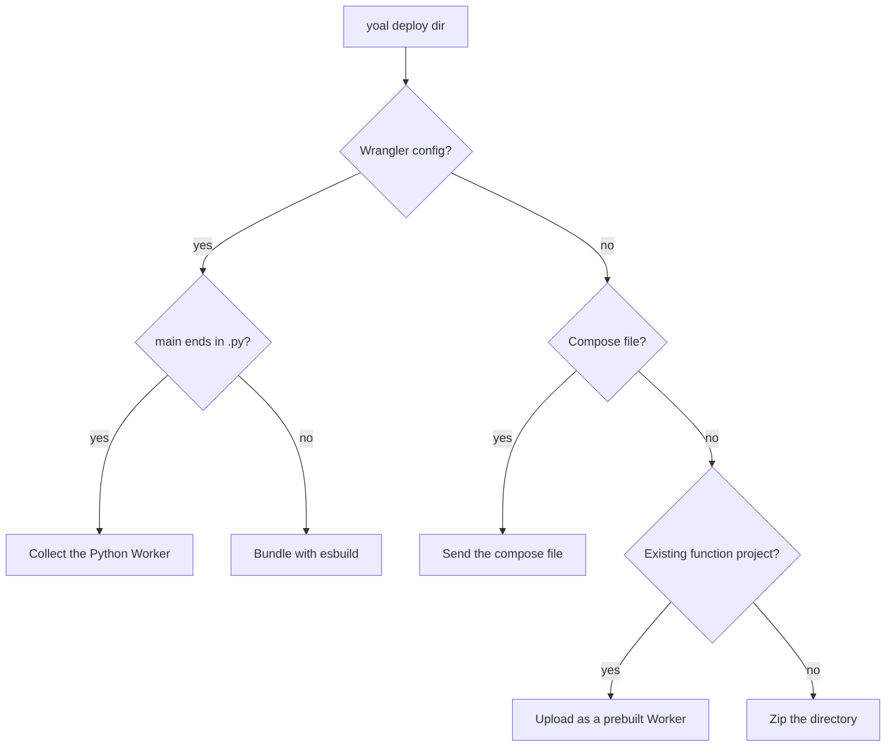

These commands ship code to Yoal and manage what happens to it afterwards: deploying a directory, listing and cleaning up projects, moving production between deployments, named environments, custom domains, and reading logs. Global options such as `--profile`, the `YOAL_URL` and `YOAL_TOKEN` environment variables, JSON error output and the general exit codes are covered in [the CLI overview](/clients/cli).

Arguments in angle brackets are required, and arguments in square brackets are optional. Every command accepts `-h, --help`. Boolean flags also accept an explicit value, such as `--promote=false`.

## deploy

```sh
yoal deploy [dir] [options]
```

Packages a directory, uploads it and creates a deployment. `dir` defaults to the current directory. Depending on what it finds, `deploy` builds a function bundle, sends a compose file, or zips the directory as it is (see [what deploy detects](#what-deploy-detects)). Unless you pass `--no-promote`, the new deployment becomes production.

| Flag | Description |
| --- | --- |
| `-p`, `--project <slug>` | Target project. Defaults to a slug made from `--name`, or from the directory name. |
| `-n`, `--name <name>` | Display name for a project this deploy creates. Also used to derive the slug when `--project` is not set. |
| `--no-promote` | Create a preview only. Production does not move. |
| `-m`, `--message <text>` | Note stored with the deployment, up to 500 characters. |
| `--spa` | Add `"spa": true` to the uploaded copy of `yoal.json`, merging with any existing file. Static sites only; ignored with a note for functions. |
| `--no-create` | Fail with `project_missing` if the project does not exist, rather than creating it. |
| `--wrangler <path>` | Use this Wrangler config instead of searching for one. Must end in `.jsonc` or `.json`. Relative paths resolve against the current directory. |
| `--no-wrangler` | Ignore any Wrangler config and deploy the directory as it is. Cannot be combined with `--wrangler`. |
| `--compose <path>` | Deploy this compose file as a compose stack. |
| `--no-compose` | Ignore a compose file in the directory. |
| `--wrangler-bin <path>` | Accepted for older scripts and ignored, with a note. Deploys never run Wrangler. |
| `--json` | Print the server's response as JSON instead of the summary. |

Progress lines go to stderr, so stdout carries only the result. The summary shows the project, the deployment ID, the preview and production URLs, whether production was `(promoted)` or `(unchanged)`, and suggested next steps.

```sh
yoal deploy ./dist --project my-site -m "Spring menu"
yoal deploy . --project api --no-promote
yoal deploy ./dist --project my-site --no-create --json
```

### Project slug and creation

The target slug is `--project` if given. Otherwise the CLI derives one from `--name`, or from the directory's name: lower-cased, with runs of other characters turned into single hyphens, trimmed to 40 characters, and prefixed with `site-` if shorter than 3. A valid slug is 3 to 40 lowercase letters, digits and single hyphens. Without `--project`, `yoal deploy ./dist` targets a project called `dist`, so pass `--project` in scripts.

If the project does not exist, `deploy` creates it with production access `public` and preview access `platform`. The runtime is `function` for a Wrangler project, `compose` for a compose file, and `static` otherwise. Creating a project needs `project:create`; every deploy needs `deployment:create` on the project. See [project slugs](/deploying/static-sites#project-slugs) and [access modes](/deploying/access-and-sharing#access-modes).

### What deploy detects



`deploy` checks, in this order:

1. **Wrangler config.** `--wrangler <path>` names one directly. Otherwise, unless you pass `--no-wrangler`, the CLI looks for `wrangler.jsonc`, then `wrangler.json`, in the directory and then in each parent directory up to the filesystem root. File names are case-sensitive. A `wrangler.toml` found before any JSON config is an error: convert it to JSONC. When a config is found, the deploy is a [function](/compute/functions). Because the search walks up, `yoal deploy ./dist` inside a function project still bundles from the config at the project root; pass `--no-wrangler` to upload `./dist` as it is.
2. **Compose file.** `--compose <path>` names one directly. Otherwise, if no Wrangler config was found and you did not pass `--no-compose`, the CLI looks in the directory itself (not its parents) for `docker-compose.yml`, `docker-compose.yaml`, `compose.yml` or `compose.yaml`, in that order. Passing `--compose` when a Wrangler config is also found is an error; add `--no-wrangler`.
3. **Plain directory.** Anything else is zipped and uploaded as it is. For a new or static project this is a [static site](/deploying/static-sites). For an existing process app the zip is the app's source.

The CLI also checks the project's runtime before uploading. A Wrangler deploy to a project whose runtime is not `function`, or a compose deploy to a project whose runtime is not `compose`, fails with `runtime_mismatch`, as does a deploy without a compose file to a `compose` project. If the target is a `function` project and no Wrangler config was found, the directory must already contain a built Worker module (`.js`, `.mjs`, `.cjs` or `.wasm`); it is uploaded as a prebuilt bundle, and the deploy fails with `function_bundle_missing` otherwise.

### Function bundles

For a Wrangler project, the CLI reads the config but never runs Wrangler. It:

1. Runs `build.command` first, if set, in a shell in `build.cwd` (default: the config's directory). A non-zero exit fails the deploy.
2. Builds the Worker from `main`, resolved relative to the config file:
   - A JavaScript or TypeScript `main` is bundled with Yoal's own bundler, esbuild pinned inside the CLI, as ES modules. Imports of `.txt`, `.html` and `.sql` files become text modules, `.bin` data modules and `.wasm` compiled WebAssembly modules, plus any `rules` in the config. This is how Rust, Go, C and Zig Workers that compile to WebAssembly are deployed. With `nodejs_compat`, or a `compatibility_date` of 2026-08-04 or later, Node built-ins stay as `node:` imports.
   - A `main` ending in `.py` is a Python Worker. Every `.py` file in `main`'s directory is included, plus everything in `python_modules/` next to the config (run `uv run pywrangler sync` to fill it, or set it as `build.command`). A Python Worker can have at most 512 files.
3. Copies the `assets.directory`, if configured, skipping `.git`, `node_modules`, `.DS_Store` and symlinks.
4. Maps the config's bindings, crons and queue consumers to Yoal's, and binds every secret scoped to this project automatically. Organisation secrets are bound only when listed in `yoal.secrets`.

`compatibility_date` and `main` are required. Service-worker syntax, `no_bundle`, `find_additional_modules`, `node_compat`, and the `ai`, `browser`, `vectorize`, `images`, `send_email`, `containers`, `mtls_certificates`, `dispatch_namespaces` and `workflows` keys are refused with a message naming the problem. The config format, bindings and the `yoal` section are described in [functions](/compute/functions#configuration).

### Compose stacks

With a compose file, the CLI sends the file (at most 512 KB) to the project rather than uploading a zip. The server validates it before storing anything: `build`, `privileged`, host networking, capabilities, devices and bind mounts are rejected, never silently ignored. The result is a normal deployment, so `promote` and `rollback` work on it. On success the CLI prints the preview URL; `--json` prints the deployment and the resulting workload.

### What gets uploaded

For a plain directory, `.git`, `node_modules` and `.DS_Store` are always skipped, and `.gitignore` files in the directory and its subdirectories are honoured. Symlinks and special files are skipped with a note. The CLI enforces the platform limits before uploading: 25 MB per file, 500 MB in total and 20,000 files. An empty result is an error. See [upload paths and limits](/deploying/static-sites#upload-paths-and-limits).

## wrangler

```sh
yoal wrangler [args…]
```

Runs Cloudflare's Wrangler in the current directory and passes every argument through unchanged, so `yoal wrangler --help` shows Wrangler's own help. Use it for the local development loop, such as `yoal wrangler dev`. Deploying does not need it, because `yoal deploy` bundles the Worker itself. The only argument the CLI keeps for itself is the global `--profile`, which is removed before Wrangler runs.

The CLI looks for Wrangler in `node_modules/.bin` in the current directory and its parents, then on your `PATH`. If it is not found:

- **With a `package.json`**, Wrangler is installed as a dev dependency with the package manager its lockfile indicates: `bun.lock` or `bun.lockb` for Bun, `pnpm-lock.yaml` for pnpm, `yarn.lock` for Yarn, otherwise npm. On a terminal the CLI asks first (`[Y/n]`, default yes). Off a terminal, or when `CI` is set, it installs without asking. Declining stops with the install command to run yourself.
- **Without a `package.json`**, nothing is installed. Wrangler runs through `bunx` if Bun is available, otherwise `npx`.

Wrangler runs with `CI=1` so it never waits for a prompt, and `yoal wrangler` exits with Wrangler's exit code.

```sh
yoal wrangler dev
yoal wrangler types
```

See [local development](/compute/functions#local-development).

## projects

```sh
yoal projects [list|delete|restore|purge|trash] [options]
```

Lists projects, and moves them to and from the trash in bulk. With no subcommand, `yoal projects` lists projects.

### projects list

```sh
yoal projects [list] [--json]
```

Lists the projects you can see, with slug, name, production URL, production and preview access modes, and creation time. `ls` is an alias.

| Flag | Description |
| --- | --- |
| `--json` | Print the API response as JSON. |

```sh
yoal projects
yoal projects list --json
```

### projects delete

```sh
yoal projects delete [slug…] [selectors] [-y] [--json]
```

Moves projects to the trash. A trashed project stops serving straight away and can be restored until it is purged automatically, after 7 days by default (the platform can set 1 to 90 days). `rm` is an alias. Needs `project:delete`.

| Flag | Description |
| --- | --- |
| `--match <glob>` | Select projects whose slug matches a glob. See [selectors](#selectors). |
| `--not-deployed` | Select only projects with nothing in production. |
| `--older-than <duration>` | Select projects created more than this long ago. |
| `--stdin` | Read slugs from stdin, one per line. |
| `-y`, `--yes` | Skip the confirmation prompt. Required off a terminal. |
| `--json` | Print NDJSON events instead of tables. |

When it finishes, `delete` prints an `Undo:` line with the matching `yoal projects restore` command.

```sh
yoal projects delete blog old-demo
yoal projects delete --match 'test-*' --not-deployed --yes
```

### projects restore

```sh
yoal projects restore [slug…] [selectors] [-y] [--json]
```

Brings projects back from the trash. Selectors are matched against the trash, and `--older-than` measures from when each project was deleted. Projects not in the trash are skipped. Needs `project:update`. Takes the same flags as `delete`.

```sh
yoal projects restore blog
yoal projects restore --match 'test-*' --yes
```

### projects purge

```sh
yoal projects purge [slug…] [selectors] [-y] [--json]
```

Permanently deletes projects that are already in the trash. This cannot be undone. A project that is not in the trash is blocked rather than purged, so delete it first. Purging more than 10 projects asks you to type the number of projects instead of `y`. Needs `project:delete`. Takes the same flags as `delete`.

```sh
yoal projects purge old-demo
yoal projects purge --older-than 3d --yes
```

### projects trash

```sh
yoal projects trash [--json]
```

Lists projects in the trash, with when each was deleted and how long until it is purged.

| Flag | Description |
| --- | --- |
| `--json` | Print the API response as JSON. |

### Selectors

`delete`, `restore` and `purge` take project slugs as arguments, selectors, or both.

| Selector | Meaning |
| --- | --- |
| `--match <glob>` | Whole-slug glob: `*` matches any run of characters, `?` one character, `[abc]` or `[a-z]` a class, `[!abc]` a negated class. Quote it so the shell doesn't expand it. |
| `--not-deployed` | Only projects with no production deployment. |
| `--older-than <duration>` | Older than a duration: a number and a unit (`s`, `m`, `h`, `d`, `w`), or a combination such as `1w2d`. Measured from creation, or from deletion in the trash. |
| `--stdin` | Read slugs from stdin, one per line. Blank lines and `#` comments are ignored. Fails if stdin is a terminal. |

Selectors combine with AND, and the CLI resolves them against your project list (or the trash) before anything is sent. Named slugs and slugs from `--stdin` are added on top, even if they don't exist; the plan then marks them `not_found`. One run covers at most 100 projects, so narrow the selection and run again for the rest.

```sh
cat slugs.txt | yoal projects delete --stdin --yes
yoal projects delete --match 'pr-[0-9]*' --older-than 2w
```

### Plans, confirmation and exit codes

Every bulk command asks the server for a plan first and prints it as a table with one row per project:

| Column | Values |
| --- | --- |
| `VERDICT` | `ok` (will run), `skip` or `blocked`. |
| `FLAGS` | `live` (has a production deployment), `workload` (not a static site), `custom_domain`. |
| `REASON` | Why a row was skipped or blocked: `not found`, `already in trash`, `not in trash` or `forbidden` (you lack the permission). |

If nothing is `ok`, the plan is discarded and nothing changes. Otherwise the CLI asks, for example `Delete 12 projects (3 live)? They stay restorable for 7 days. [y/N]`. Any answer other than `y` or `yes` cancels the plan and exits `1`. Off a terminal there is no one to ask, so without `--yes` the CLI cancels the plan and exits `1` with `confirmation_required`.

Once confirmed, the run is an [operation](/cli/operations-and-config#operations), with live progress on stderr. The command exits `0` when every item succeeded, `3` when some failed, and `1` when the run failed or was cancelled. Ctrl-C detaches with exit code `130`: the run keeps going on the server and `yoal operations watch <id>` picks it up again. On partial failure the CLI prints the `yoal operations show` command for the details.

With `--json`, the command prints one JSON event per line on stdout: `plan` (the operation and its items), then `nothing_to_do` or `declined`, or `progress`, `items` and `done` while it runs. `reconnecting` and `detached` mark stream drops and Ctrl-C.

See [delete and restore projects](/deploying/static-sites#delete-and-restore-projects).

## deployments

```sh
yoal deployments <project> [--json]
```

Lists a project's most recent deployments (up to 50), newest first, with ID, status, message, creation time and preview URL. The header shows the production URL and the production deployment ID, and the production deployment is marked with `*` in the table. Use these IDs with [`promote`](#promote) and [`environments promote`](#environments-promote). Needs `deployment:read`.

| Flag | Description |
| --- | --- |
| `--json` | Print `{ "project": …, "deployments": … }` as returned by the API. |

```sh
yoal deployments my-site
```

## promote

```sh
yoal promote <project> <deploymentId> [--json]
```

Points production at an existing deployment, for example a preview you have tested. `deploymentId` is the full ID or the short ID from [`deployments`](#deployments). Only deployments with status `active` can be promoted. Needs `deployment:promote`. The output has the same shape as `deploy`'s.

| Flag | Description |
| --- | --- |
| `--json` | Print the API response as JSON. |

```sh
yoal deploy ./dist --project my-site --no-promote
yoal promote my-site dep_abc123
```

To move a named environment instead of production, use [`environments promote`](#environments-promote). See [promote and roll back](/deploying/static-sites#promote-and-roll-back).

## rollback

```sh
yoal rollback <project> [--json]
```

Moves production back to the deployment that was in production before the current one. It follows promotion history, so a preview that was never promoted is never chosen, and running `rollback` again keeps walking further back rather than toggling between two deployments. If there is no earlier production deployment, the command fails; promote a specific deployment instead. Needs `deployment:rollback`.

| Flag | Description |
| --- | --- |
| `--json` | Print the API response as JSON. |

```sh
yoal rollback my-site
```

For a process or container app, rolling back changes the running release. See [promote and roll back](/deploying/static-sites#promote-and-roll-back).

## environments

```sh
yoal environments [list|create|update|remove|promote] [options]
```

Aliases: `environment`.

Manages a project's named environments, such as `staging`. Each environment has its own host, `<project>--<env>.<content domain>`, its own access mode, and its own pointer to a deployment. Production is built in. With no subcommand, `yoal environments` lists environments. The concepts are in [named environments](/deploying/domains-and-environments#named-environments).

`yoal deploy` always deploys to production or a preview. To put a deployment in another environment from the CLI, deploy it as a preview and then use [`environments promote`](#environments-promote).

### environments list

```sh
yoal environments [list] <project> [--json]
yoal environments [list] -p <project> [--json]
```

Lists the project's environments with name, slug, host, access mode and current deployment. Production appears with the slug `production`. `ls` is an alias. Needs `project:read`.

| Flag | Description |
| --- | --- |
| `-p`, `--project <slug>` | The project, instead of the positional argument. |
| `--json` | Print the API response as JSON. |

```sh
yoal environments list shop
```

### environments create

```sh
yoal environments create <project> <name> [options]
```

Adds a named environment. `name` is the display name, up to 60 characters. The slug, up to 30 characters, is derived from the name unless you pass `--slug`; `production` is reserved. `add` is an alias. Needs `project:update`.

| Flag | Description |
| --- | --- |
| `--slug <slug>` | Explicit slug for the environment's host. |
| `--access <mode>` | `public`, `password`, `platform` or `access`. Defaults to the project's preview access mode. |
| `--password <value>` | Password for `password` mode, at least 8 characters. Required for `password` unless the environment inherits password-protected previews, in which case it copies their password. |
| `--policy <id>` | Yoal Access policy for `access` mode. Required for `access` unless the project's previews already use a policy. |
| `--json` | Print the API response as JSON. |

```sh
yoal environments create shop staging
yoal environments create shop "QA preview" --slug qa --access password --password 'correct horse'
```

### environments update

```sh
yoal environments update <project> <env> [options]
```

Renames an environment or changes its access. `env` is the environment's slug. At least one of `--name`, `--access`, `--password` or `--policy` is required. The production environment cannot be changed here. Needs `project:update`.

| Flag | Description |
| --- | --- |
| `--name <name>` | New display name. The slug and host do not change. |
| `--access <mode>` | `public`, `password`, `platform` or `access`. |
| `--password <value>` | New password, at least 8 characters. Required when switching to `password` mode from another mode. |
| `--policy <id>` | Yoal Access policy for `access` mode. `none` (or an empty value) clears it. |
| `--json` | Print the API response as JSON. |

```sh
yoal environments update shop staging --access platform
yoal environments update shop staging --name "Staging (EU)"
```

### environments remove

```sh
yoal environments remove <project> <env> [-y] [--json]
```

Deletes an environment, so its host stops serving. Every deployment in the environment must be deleted first, and production cannot be removed. `rm` and `delete` are aliases. The CLI asks before removing; off a terminal it refuses without `--yes`. Needs `project:update`.

| Flag | Description |
| --- | --- |
| `-y`, `--yes` | Skip the confirmation prompt. Required off a terminal. |
| `--json` | Print the API response as JSON. |

```sh
yoal environments remove shop staging --yes
```

### environments promote

```sh
yoal environments promote <project> <env> <deploymentId> [--json]
```

Points an environment at an existing deployment without touching production. Promoting into `production` is the same as [`promote`](#promote). The deployment must be `active`; the full or short ID both work. Needs `deployment:promote`.

| Flag | Description |
| --- | --- |
| `--json` | Print the API response as JSON. |

```sh
yoal deploy ./dist --project shop --no-promote
yoal environments promote shop staging dep_abc123
```

## domains

```sh
yoal domains [list|add|check|remove] [options]
```

Aliases: `domain`.

Attaches custom hostnames to projects and checks their DNS and certificate state. With no subcommand, `yoal domains` lists domains. The DNS steps are explained in [custom domains](/deploying/domains-and-environments#custom-domains).

A new domain is `pending` until a check finds its TXT record. It then becomes `verified` and starts serving, and `active` once an edge node reports a valid certificate. A domain still unverified after 72 hours becomes `failed`. Yoal re-checks pending domains about every 10 minutes and failed ones every 6 hours on its own.

### domains list

```sh
yoal domains [list] [-p <project>] [--json]
```

Lists custom domains with hostname, project, kind (`custom` or `apex`), status, the `www` hostname if it redirects, and when DNS was last checked. Without `--project`, it lists every domain you can read in the organisation. `ls` is an alias. Needs `domain:read`.

| Flag | Description |
| --- | --- |
| `-p`, `--project <slug>` | Only this project's domains. |
| `--json` | Print the API response as JSON. |

```sh
yoal domains
yoal domains list --project shop
```

### domains add

```sh
yoal domains add <hostname> -p <project> [--redirect-www] [--json]
```

Attaches a hostname to a project and prints the DNS records to create. The hostname is lower-cased and a trailing dot is removed; give it without a scheme, port or path. A hostname with two labels, such as `example.com`, is an apex domain. A hostname already attached to any project is refused. `create` is an alias. Needs `domain:create`.

| Flag | Description |
| --- | --- |
| `-p`, `--project <slug>` | Project to attach the hostname to. Required. |
| `--redirect-www` | Also serve the `www.` hostname and redirect it to this one. |
| `--json` | Print the API response as JSON. |

The printed records always include the TXT verification record. If your profile has a content domain (or `YOAL_CONTENT_DOMAIN` is set), they also include the traffic record: an `A` record when the content domain is an IPv4 address, otherwise a `CNAME` to `<project>.<content domain>`, plus the same for the `www.` hostname with `--redirect-www`.

```sh
yoal domains add shop.example.com --project shop
yoal domains add example.com --project shop --redirect-www
```

### domains check

```sh
yoal domains check <hostname> [-p <project>] [--json]
```

Re-reads DNS and certificate state for a domain now. It prints the status with a short explanation, when it was last checked, any records still missing, the last error, and the HTTPS URL once the domain is `active`. Needs `domain:read`.

| Flag | Description |
| --- | --- |
| `-p`, `--project <slug>` | Look for the hostname only in this project. |
| `--json` | Print the API response as JSON. |

```sh
yoal domains check shop.example.com
```

### domains remove

```sh
yoal domains remove <hostname> [-p <project>] [-y] [--json]
```

Stops serving a hostname and deletes any DNS records Yoal created for it automatically. `rm` and `delete` are aliases. The CLI asks before removing; off a terminal it refuses without `--yes`. Needs `domain:delete`.

| Flag | Description |
| --- | --- |
| `-p`, `--project <slug>` | Look for the hostname only in this project. |
| `-y`, `--yes` | Skip the confirmation prompt. Required off a terminal. |
| `--json` | Print the API response as JSON. |

```sh
yoal domains remove shop.example.com --yes
```

## open

```sh
yoal open <project> [--preview] [--json]
```

Opens the project's production URL in your browser, using `open` on macOS, `xdg-open` on Linux and `start` on Windows. If no browser can be launched, the URL is printed to stdout and a note to stderr. The command fails if the project has no production deployment.

| Flag | Description |
| --- | --- |
| `--preview` | Open the URL of the newest deployment instead, whether or not it was promoted. Fails if the project has no deployments. |
| `--json` | Print `{ "project", "url", "opened" }`. The browser is still opened. |

When the API does not return a deployment's URL, the CLI builds it as `https://<project>--<id>.<content domain>` from your profile's content domain. See [preview and production URLs](/deploying/static-sites#preview-and-production-urls).

```sh
yoal open my-site
yoal open my-site --preview
```

## logs

```sh
yoal logs [scope…] [-q <query>] [--since <time>] [--until <time>] [-f] [-n <lines>] [--order asc|desc] [--json]
yoal logs patterns [scope…] [-q <filter>] [--since <time>] [--until <time>] [-n <rows>] [--json]
yoal logs context <record id> [--before <n>] [--after <n>] [--json]
yoal logs compare [scope…] [-q <filter>] --baseline <baseline> [--since <time>] [--until <time>] [--all] [--json]
```

Reads every log you can see through the [Logs Explorer](/observe/logs) API: app output, builds, jobs, pipelines, managed services, Kubernetes, edge requests and, for platform admins, Yoal's own services. The query is checked before anything is sent, and a mistake is shown with a caret under it. Lines print oldest first with their time, level and, when more than one scope is read, the scope, coloured by severity. Needs `logs:read`; a query with pipe stages, `patterns` and `compare` also need `logs:query`.

With no scope, `yoal logs` reads everything you may read. Scopes:

| Scope | Reads |
| --- | --- |
| `<project>` or `project:<project>` | A project, by slug or id. |
| `db:<name>` | A managed database. |
| `storage:<name>` | An object storage instance. |
| `broker:<name>` | A queue broker. |
| `k8s:<name>` | A Kubernetes cluster. |
| `pipeline:<repo>` | A pipeline repository. |
| `function:<project>` | A function project. |
| `platform:<node>` | A node's platform services. Platform admins only. |
| `edge:<node>` | Edge requests for hosts no project serves. Platform admins only. |

| Flag | Description |
| --- | --- |
| `-q`, `--query <query>` | A log query, such as `level:error -@path:/health "timeout"` or `service:api \| stats count() by bin(5m), level`. See [query syntax](/observe/logs#query-syntax). |
| `--since <time>` | Start: a duration back from now (`15m`, `1h`, `24h`, `7d`), epoch milliseconds or an ISO time. Default 24 hours for lines, 1 hour for pipe queries, `patterns` and `compare`. |
| `--until <time>` | End. Default now. Cannot be combined with `-f`. |
| `-f`, `--follow` | Keep printing new lines as they arrive. Starts with the newest 20 lines (or `--limit`), reconnects by itself and resumes where it left off. Cannot be combined with pipe stages. |
| `-n`, `--limit <n>` | Lines to show, 1 to 10,000. Default 200. `--lines` is the same. Past 1,000, the CLI pages for you. |
| `--order asc\|desc` | `desc` (the default) shows the newest lines; `asc` the oldest lines from `--since`. |
| `--json` | Print the API response as JSON; with `-f`, one record per line (NDJSON). |
| `--no-color` | No severity colours. `NO_COLOR=1` does the same. |

A query with pipe stages prints a table instead of lines.

```sh
yoal logs api -q 'level:error' --since 1h
yoal logs api db:main -f
yoal logs -q '@http.status:>=500 | stats count() by bin(1m)' --since 6h
yoal logs my-api -n 1000 --json
```

### logs patterns

Groups the matching lines by message template, most frequent first, with a count each. Pass only a filter with `-q`; the CLI adds `| patterns` itself. Needs the ClickHouse search index.

```sh
yoal logs patterns api --since 24h
yoal logs patterns api -q 'level:warn' -n 20
```

### logs context

Prints the lines before and after one record in its stream, like `grep -C`. The record id is the `id` from `--json` output or the Explorer (for example `le:48213`). `--before` and `--after` default to 20 each, up to 500.

```sh
yoal logs context le:48213 --before 50
```

### logs compare

Shows what changed against a baseline: patterns that are new, rising, falling or gone, with their counts in each window. Needs the ClickHouse search index.

| `--baseline` | Compares with |
| --- | --- |
| `previous` | The window just before. |
| `1d`, `7d` | The same window that long ago. |
| `deploy:<id>` | Before and after that deployment went live. |
| `<from>..<to>` | A custom range (ISO times or epoch milliseconds). |

`--all` also lists the patterns that did not change.

```sh
yoal logs compare api --baseline deploy:dep_8f2k1c
yoal logs compare api -q 'level:error' --baseline 1d --since 2h
```

The service commands `yoal db logs`, `yoal storage logs`, `yoal broker logs`, `yoal k8s logs`, `yoal jobs logs` and `yoal run` keep their own flags. For the dashboard view and alerts from logs, see [the Logs Explorer](/observe/logs).
