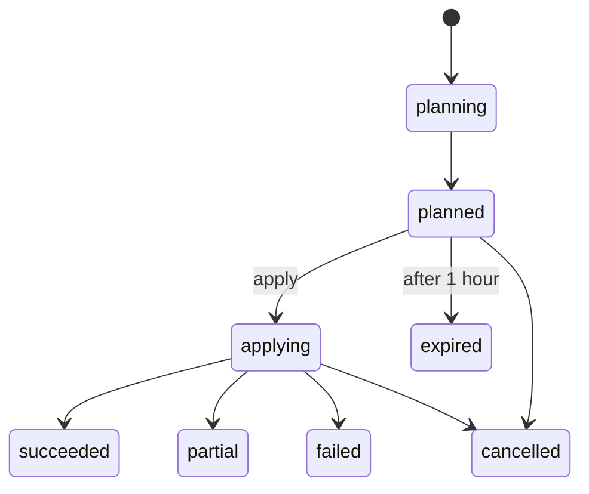

These commands work on many resources at once. `prune` cleans up orphaned data, `operations` inspects and steers the server-side runs that mass actions, prunes and blueprint applies create, `blueprint` declares a whole stack in one file, and `export` and `import` move an organisation's configuration between instances. For global options, environment variables and the general exit codes, see [the CLI overview](/clients/cli).

## How operations run

`yoal prune`, `yoal blueprint apply` and the bulk project commands (`yoal projects delete`, `restore` and `purge`) don't change anything from your machine. They ask the server to plan an **operation**, show you the plan, and only then apply it. The run continues on the server whether or not the CLI is still watching.



- **Plans expire after one hour.** A plan that nobody applies in that time becomes `expired`, and you scan or plan again.
- **Only the person who made a plan can apply it.**
- **Confirmation.** Before applying a fresh plan the CLI asks on the terminal. When stdin isn't a terminal (a pipe, CI), there is nobody to ask, so the command refuses unless you pass `--yes`. The refusal message names the command that applies the plan it kept.
- **Progress.** On a terminal, progress is redrawn in place on stderr, one bar per prune category or one bar for a bulk action, and failed items are printed as they happen. When stderr isn't a terminal, the CLI prints one plain line per phase change instead. If the live stream drops, the CLI reconnects and then falls back to polling, without reporting an item twice.
- **Ctrl-C detaches.** It stops following, prints `Still running: yoal operations watch <id>` and exits with `130`. The operation carries on; nothing is cancelled. Use [`yoal operations cancel`](#operations-cancel) to stop it.

### NDJSON events

With `--json`, a command that follows an operation prints one JSON object per line on stdout. Every event has a `type`:

| Type | Fields | When |
| --- | --- | --- |
| `plan` | `operation` (prune) or `plan` (blueprint) | The plan is ready to review. |
| `nothing_to_do` | `id` (prune) or `stack` (blueprint) | The plan is empty. The command ends here. |
| `declined` | `id` | You answered no to a prune prompt. |
| `progress` | `operation` | The operation's status, phase or counts changed. |
| `items` | `items` | Items finished, in order, each reported once. |
| `reconnecting` | `attempt`, `mode` (`stream` or `poll`) | The progress stream dropped. |
| `detached` | `id`, `hint` | You pressed Ctrl-C. |
| `planned` | `operation` | `operations watch` reached a plan waiting to be applied. |
| `done` | `operation` | The operation finished (prune, `operations watch`). |
| `run` | `run` | A blueprint run finished, with every resource step's result. |

```sh
yoal prune --apply --yes --json | jq -c 'select(.type == "done") | .operation.status'
```

### Exit codes

| Code | Meaning |
| --- | --- |
| `0` | The operation succeeded, there was nothing to do, or the command only planned. |
| `3` | The operation finished partially: some items succeeded and some failed. |
| `1` | The operation failed, was cancelled or expired; you declined; the confirmation was refused off a terminal; or the request itself failed. |
| `130` | You pressed Ctrl-C while following. The operation is still running. |

## prune

```sh
yoal prune [--apply] [--plan <op_id>] [--scope org|platform] [--only <categories>]
           [--older-than <days>] [--keep-tags <n>] [-y, --yes] [--json]
```

Finds and removes data that no live project references. Without `--apply` it's a dry run: it scans, prints what it found per category with item counts and sizes, and prints the command that applies exactly that plan. Nothing younger than 24 hours is ever pruned, so in-flight uploads and deploys are safe.

| Flag | Description |
| --- | --- |
| `--apply` | Delete what the scan found. With a fresh scan, asks `Prune N items (size)? This cannot be undone. [y/N]` first. |
| `--plan <op_id>` | Use an earlier scan instead of scanning again. If that scan is still running, the CLI follows it. With `--apply`, there's no prompt: you already reviewed that plan. |
| `--scope <scope>` | `org` (the default) prunes your organisation. `platform` covers every organisation and adds the `objects` category; it needs platform maintenance rights (a platform admin). Can't be combined with `--plan`. |
| `--only <categories>` | Comma-separated categories to scan, or with `--plan`, to show and apply. Unknown names are an error. |
| `--older-than <days>` | Override the retention window for every selected category. A whole number from 1 to 3650. Can't be combined with `--plan`. |
| `--keep-tags <n>` | Keep at least this many of the newest tags in each registry repository. A whole number from 0 to 1000; the default is the registry's own setting. Can't be combined with `--plan`. |
| `-y`, `--yes` | Don't ask. Required with `--apply` and a fresh scan when stdin isn't a terminal. |
| `--json` | NDJSON events on stdout (see [NDJSON events](#ndjson-events)). |

The categories, in the order they run:

| Category | What it removes |
| --- | --- |
| `project_rows` | Environments, workloads, builds, git sources, logs, share links, redirects and secrets of projects that no longer exist. |
| `domains` | Custom domains whose project is gone, including their managed Cloudflare records. |
| `workload_reservations` | Workloads of deleted projects still holding node memory budget. |
| `share_redemptions` | Redemptions of share links that are gone, or that expired more than 30 days ago. |
| `deployments` | Deployments deleted more than 30 days ago. |
| `upload_sessions` | Expired or failed upload sessions older than a day. |
| `config_snapshots` | Config snapshots no deployment references. |
| `releases` | Releases no live deployment references, and their stored artifacts. |
| `registry_images` | Registry tags older than the retention window beyond the newest tags kept per repository. Deployment pins and tags in use are never removed. |
| `runner_registrations` | GitHub Actions runner registrations for a deleted project or workload, a removed runner, or a replica beyond the pool's current size. |
| `volume_snapshots` | Unpinned app-volume snapshots older than the retention window, and snapshots of volumes that are gone. |
| `objects` | Platform scope only. Stored artifacts and uploads with no release or upload record, shared across organisations. |

Pruning needs the `project:delete` permission. API keys can prune; MCP clients can't. If you decline the prompt, the scan is cancelled and the command exits `1`. If the prompt is refused because stdin isn't a terminal, the scan is kept as a dry run you can apply by its id within the hour.

```sh
yoal prune
yoal prune --apply --plan op_01J9Z3K4M5N6P7Q8R9S0T1V2W3
yoal prune --apply --only releases,deployments --older-than 60
```

## operations

```sh
yoal operations [list|show|watch|cancel] [options]
```

Inspects and steers server-side operations: bulk project actions, prune runs and blueprint applies. With no subcommand, `list` runs.

Aliases: `ops`.

### operations list

```sh
yoal operations list [--kind bulk|prune] [--status <status>] [--limit <n>] [--scope platform] [--json]
```

Recent operations in your organisation, newest first, with their action, status, progress and creation time. Also `ls`. Needs `project:read`.

| Flag | Description |
| --- | --- |
| `--kind <kind>` | Only `bulk` (project actions and blueprint applies) or `prune`. |
| `--status <status>` | Only one status: `queued`, `planning`, `planned`, `applying`, `succeeded`, `partial`, `failed`, `cancelled` or `expired`. |
| `--limit <n>` | How many to show, from 1 to 200. The default is 50. |
| `--scope platform` | List platform-scope prunes instead of your organisation's operations. Platform admins only. |
| `--json` | Print the server response. |

```sh
yoal ops
yoal operations list --kind prune --status partial
```

### operations show

```sh
yoal operations show <id> [--json]
```

One operation: action and scope, status and phase, progress, failure count, created, started, finished and expiry times, and the outcome. For a bulk action it lists every item with its verdict, flags, status and detail. For a prune it prints the per-category table and only the failed items (up to 200). Also `get`.

`--json` prints `{ "operation": …, "items": [ … ] }`.

```sh
yoal operations show op_01J9Z3K4M5N6P7Q8R9S0T1V2W3
```

### operations watch

```sh
yoal operations watch <id> [--json]
```

Follows an operation's progress until it finishes, with the same live display as the command that started it. Also `follow`. Ctrl-C detaches and leaves the run going.

- A finished operation prints its outcome straight away.
- An operation that is `planned` and waiting to be applied prints how long it has left and how to apply it, then exits `0`. A prune plan is applied with `yoal prune --apply --plan <id>`; a bulk plan is applied only by the command that made it.
- An operation that is still being planned is followed until it's planned, or, if it was started as plan-and-apply, to its end.

Exits `0` when the operation succeeded, `3` when partial, and `1` when it failed, was cancelled or expired. `--json` prints [NDJSON events](#ndjson-events).

```sh
yoal operations watch op_01J9Z3K4M5N6P7Q8R9S0T1V2W3
```

### operations cancel

```sh
yoal operations cancel <id> [--json]
```

Stops an operation after the item it's working on; the remaining items become `cancelled`. A planned operation is cancelled outright. Cancelling an operation that has already finished changes nothing and says so. You can cancel your own operations; anyone else's needs `project:delete` or platform admin. `--json` prints the operation.

```sh
yoal operations cancel op_01J9Z3K4M5N6P7Q8R9S0T1V2W3
```

## blueprint

```sh
yoal blueprint <validate|plan|apply> [file] [options]
```

Declares a stack in one file (projects with their environments, domains and workload settings, plus databases, storage buckets, brokers and the attachments between them), then plans and applies it. Applying the same file twice changes nothing. Blueprints hold secret names, never values. For what the fields mean and how adoption, ordering and pruning behave, see [blueprints](/compute/apps-and-containers#blueprints).

Aliases: `blueprints`.

Blueprints are on by default; an operator can turn them off with `YOAL_FEATURE_BLUEPRINTS=0`, and then every subcommand fails with `feature_disabled`.

### The blueprint file

With no `file` argument, the CLI uses the first of these in the current directory: `yoal.blueprint.yaml`, `yoal.blueprint.yml`, `yoal.blueprint.json`. Pass a path to use another file, or `-` to read it from stdin. The file may be YAML or JSON and at most 512 KB. The server parses and validates it, and a problem is reported with its exact path, every problem on its own line.

| Key | Required | Contents |
| --- | --- | --- |
| `apiVersion` | Yes | Always `yoal/v1`. |
| `name` | Yes | The stack's name in your organisation: 3 to 40 lowercase letters, digits and single hyphens. `plan`, `apply`, `validate` and `schema` are reserved. |
| `projects` | No | A map from project slug to its settings. |
| `databases` | No | A map from database name to its engine, version and size. |
| `storage` | No | A map from storage instance name to its size and `buckets`. |
| `brokers` | No | A map from broker name to its engine, version and size. |
| `attachments` | No | A list, each joining one `project` to exactly one `database`, `storage` or `broker`. |

Every object is strict: an unknown field is an error.

```yaml
apiVersion: yoal/v1
name: shop
projects:
  shop-api:
    runtime: process
    command: [bun, run, start]
    port: 3000
    secrets: [STRIPE_KEY]
databases:
  shop-db: { engine: postgres, version: "18" }
attachments:
  - { project: shop-api, database: shop-db }
```

### blueprint validate

```sh
yoal blueprint validate [file] [--json]
```

Checks the file's schema, names and cross references (an attachment to an undeclared database, a grant on an undeclared bucket) without reading any live state. Prints the stack name and how many resources of each kind it declares. Also `check`. `--json` prints the server's validation result, including the parsed document.

```sh
yoal blueprint validate
yoal blueprint check infra/shop.yaml
```

### blueprint plan

```sh
yoal blueprint plan [file] [--prune] [--all] [--json]
```

Compares the file with what exists and shows what applying would do, changing nothing. Each resource is marked `+ create`, `~ update`, `- delete` or `= noop` (up to date), with one line per changed field. When there are changes, the command prints the plan hash, when it expires, and the exact command that applies it. Also `diff`.

The plan checks every step against your permissions, the secrets it names and the fields that can't change, and fails with a list of problems rather than producing a plan that would fail halfway.

| Flag | Description |
| --- | --- |
| `--prune` | Also plan to delete resources this stack manages that the file no longer lists. |
| `--all` | Also list resources that are up to date. |
| `--json` | Print the server's plan, including `planHash`, `operationId`, every resource diff, the summary and warnings. |

```sh
yoal blueprint plan
yoal blueprint plan --prune --all
```

### blueprint apply

```sh
yoal blueprint apply [file] [--prune] [--all] [-y, --yes] [--json]
yoal blueprint apply --plan <hash> [--confirm <stack>] [--json]
```

With a file, plans it, shows the plan, asks `Apply these changes to "<stack>"? [y/N]`, then applies it and follows the progress. When the plan deletes resources (`--prune`), you type the stack name back instead of answering yes. When nothing needs to change, it prints `Everything is up to date.` and exits `0`.

With `--plan`, it applies a plan you made earlier with `yoal blueprint plan`, without planning again or asking. The server re-reads live state first and refuses if anything the plan covers has changed since.

At the end it prints a table of every resource with its action, result and detail, then a one-line outcome. The first step that fails stops the run, and nothing is rolled back.

| Flag | Description |
| --- | --- |
| `--prune` | Also delete resources this stack manages that the file no longer lists. Asks you to type the stack name. |
| `--plan <hash>` | Apply this plan: the 64-character hash `yoal blueprint plan` printed. Can't be combined with a file argument. |
| `--confirm <stack>` | With `--plan`, the stack name, required when that plan deletes resources. |
| `--all` | Also list resources that are up to date in the plan. |
| `-y`, `--yes` | Don't ask. For a pruning plan, confirms the stack name for you. Required when stdin isn't a terminal, including when the file comes from stdin (`-`). |
| `--json` | NDJSON events on stdout: `plan`, then progress events, then `run` (see [NDJSON events](#ndjson-events)). |

Exits `0` when everything applied or nothing needed to change, `3` when the run stopped partway, and `1` when it failed, you declined or the plan was invalid. When you decline, the plan is cancelled. When the prompt is refused because stdin isn't a terminal, the plan is kept, and the message names the `--plan` command that applies it within the hour. Ctrl-C detaches and the run continues.

Applying needs `project:read` plus the permission of every step in the plan. AI agents can't apply a pruning plan.

```sh
yoal blueprint apply
cat shop.yaml | yoal blueprint apply - --yes
yoal blueprint apply --plan 3f9c2a7e1b4d8f6a0c5e9b2d7a1f4c8e3b6d0a9f2c5e8b1d4a7f0c3e6b9d2a5f --confirm shop
```

## export

```sh
yoal export [-o, --out <file>] [--format yaml|json] [-p, --project <slug>] [--force]
```

Writes your organisation's configuration to one file: every project's settings, environments, domains, workload spec, jobs, volumes, secrets (by name) and attachments, plus the managed databases, storage and brokers, IAM, service accounts, access keys, federation trusts, access policies, user pools and their clients, log drains, backup targets, event and alert rules, email, pipelines, registry logins, forge connections, shares and templates.

The file holds configuration only: no deployments, database rows, objects, logs or pool users, and no secret values. Each section is read with your own permissions. A section you can't read, or whose feature is off, is listed under `skipped` with the reason instead of failing the export. The same file is available from **Settings → Config export**. The export is not a backup; to recover a whole platform with its data, see [platform backups](/self-hosting/platform-backups).

After writing, the command prints the path, format and size, a table of sections with their item counts, and any skipped sections.

| Flag | Description |
| --- | --- |
| `-o`, `--out <file>` | Where to write. The default is `yoal-config-<org>-<date>.yaml` (or `.json`) in the current directory. `-` writes to stdout and prints nothing else. Files are created with mode `0600`. |
| `--format <format>` | `yaml` (or `yml`) or `json`. The default is YAML, or JSON when `--out` ends in `.json`. |
| `-p`, `--project <slug>` | Only these projects. Repeat the flag or separate slugs with commas. Organisation-level configuration is still exported, and a slug that doesn't exist is listed under `skipped`. |
| `--force` | Overwrite the file if it already exists. Without it, an existing file is an error. |

`export` has no `--json` flag; use `--format json`.

```sh
yoal export
yoal export --out yoal-config.json
yoal export --project shop-web,shop-api --out - | less
```

## import

```sh
yoal import <file> [--apply] [-y, --yes] [--secrets <file>] [--only <sections>] [--skip <sections>]
            [-p, --project <slug>] [--all] [--json]
```

Recreates the configuration in a `yoal export` file (YAML or JSON) on the platform you're signed in to, for example when moving to a new server. Without `--apply` it only shows the plan.

Import only creates. Each resource is matched by its name (project slug, database name, role name and so on); one that already exists is left exactly as it is, and nothing is updated or deleted. Running it again only creates what is still missing. Every step runs with your own permissions. A failed step skips the steps that depend on it, and everything else carries on.

The export holds no secret values and no data. Pass the values with `--secrets`, or set them afterwards and run the import again: workload settings that need a missing secret are skipped until it exists. Databases, buckets and volumes start empty, and each app needs a deploy. Anything the import can't recreate is listed under **By hand afterwards**, with what to do.

The output is a table of steps (`create`, `created`, `exists`, `skipped` or `FAILED`, with the kind, name and a note), then warnings, the manual steps and a summary line.

| Flag | Description |
| --- | --- |
| `--apply` | Create everything the plan lists. Asks `Create N resources on <url>? [y/N]` first. |
| `-y`, `--yes` | With `--apply`, don't ask. Required when stdin isn't a terminal. |
| `--secrets <file>` | Secret values, one per line, in dotenv style: `NAME=value` for the organisation or `project-slug/NAME=value` for one project. Blank lines, `#` comments and a leading `export` are ignored; values may be quoted. |
| `--only <sections>` | Only these top-level sections. Repeat the flag or separate names with commas. |
| `--skip <sections>` | Leave these sections out. Same format as `--only`. |
| `-p`, `--project <slug>` | Only these projects. Repeat or comma-separate. Organisation-level sections are still imported. |
| `--all` | Also list the resources that already exist. |
| `--json` | Print `{ "plan": … }` without `--apply`, and `{ "result": … }` after applying (`{ "plan": …, "result": null }` when there was nothing to create). The prompt, if any, still appears on the terminal. |

Section names are the export's top-level keys: `projects`, `secrets`, `databases`, `storage`, `brokers`, `iam`, `serviceAccounts`, `accessKeys`, `federationTrusts`, `accessPolicies`, `userPools`, `logDrains`, `backupTargets`, `eventRules`, `alertRules`, `email`, `pipelines`, `registryCredentials`, `forgeConnections`, `shares`, `templates` and `members`. An unknown name is ignored with a warning.

Exit codes: `0` when the plan or apply finished, including when you answer no at the prompt; `3` when any step failed; `1` when the file can't be read, the request fails, or `--apply` is used off a terminal without `--yes`.

```sh
yoal import yoal-config-acme-2026-11-09.yaml
yoal import yoal-config-acme-2026-11-09.yaml --only projects,databases --all
yoal import yoal-config-acme-2026-11-09.yaml --secrets secrets.env --apply
```
