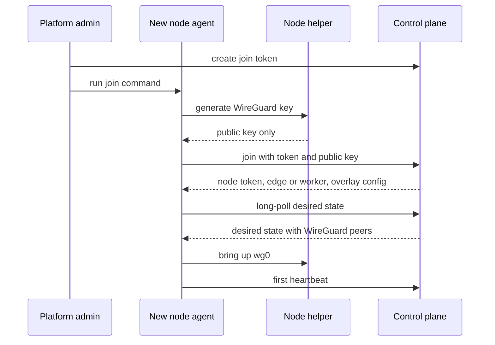
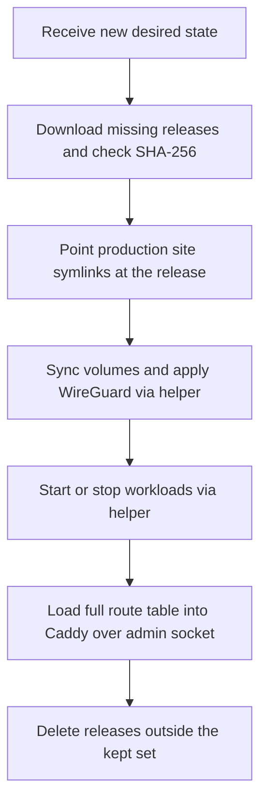

A Yoal install is one or more **nodes**: machines running `yoal-agent` and `yoal-helper`. The first node is the **edge**. It terminates public traffic for every site. Any later node is a **worker**, which runs apps, functions, databases and other workloads that you place on it. This page covers adding nodes, how they stay in step with the control plane, where workloads run, and how to drain or remove a machine. For a single machine, you can skip most of it.

## Node roles

Every node has a mode (`edge` or `worker`) and a set of roles that say what it may run. The mode is decided at join time: the first node to join becomes the edge, and every later node is a worker. You can change the edge later (see [Moving the edge](#moving-the-edge)).

| Role | Meaning |
| --- | --- |
| `ingress` | Public traffic ingress. Only the edge has it by default. |
| `control` | Edge-only by default. Removing it from the edge is refused. |
| `compute` | Runs app, function and broker workloads. Every node has it by default. |
| `data` | Runs managed databases and storage instances. Every node has it by default. |
| `build` | Claims git builds. Off by default; see [Builders](#builders). |

Roles are set per node on the **Nodes** page (**Edit node**). You cannot remove a role that is still in use: removing `compute` is refused while the node runs app workloads, and removing `data` is refused while it holds databases or storage instances.

## Adding a node

Adding a node takes three steps: generate a join token, run one command on the new machine, and wait for the node to appear.

1. Install the signed Yoal release bundle (`yoal-agent` and `yoal-helper`) on the new machine. See [installation](/self-hosting/installation).
2. In the dashboard, go to **Nodes → Add node**. Choose a network (below), tick the roles the node may take, and select **Generate join command**. Or run [`yoal nodes enrol`](/cli/platform#nodes-enrol) from a dashboard session.
3. Run the command on the new machine as root. The node appears on the **Nodes** page after its first heartbeat, usually within seconds.

A join token is single-use and expires one hour after you create it. Only a platform admin can create one, from their dashboard session.

A token also says which roles its join may take. `--roles` on the join command can ask for those or fewer; asking for more is refused, and the token stays unused. A token created with no roles ticked allows none, and the node joins as `compute` and `data`. An ingress receives the shared certificate and session secrets, so only allow `ingress` for a machine you trust with them.

A join token works once. Using it a second time is refused with a message that names the node the first join created. This happens even when the first attempt failed after the control plane accepted it. To try again, create a new join token. If that node never sent a heartbeat, remove it on the **Nodes** page first. The node's own credentials don't change, so a copied or leaked token can't take over a node. A join is also refused if another node already holds its WireGuard key, and that message names the node. The token is not used up in that case. To join that machine again, first remove the node on the **Nodes** page.

On a Yoal network, the join exchanges the token for a node identity and an overlay address before the agent starts converging:



### Yoal network (recommended)

The default. The node generates its WireGuard key locally and joins the managed overlay, so you do not plan addresses. The command the dashboard shows is:

```sh
curl -fsSL https://control.example.com/install/node.sh | sudo sh -s -- --token <token> --name <name>
```

To keep the token out of the process list and your shell history, save the script and pass the token in a file, or on standard input with `--token-file -`. Standard input does not work with `curl … | sh`, where it is the script itself. `--zone` and `--roles` set what **Nodes → Edit node** would, at join:

```sh
curl -fsSL https://control.example.com/install/node.sh -o node.sh
sudo sh node.sh --token-file /root/join-token --name node-b --zone uksouth-2 --roles ingress,compute,data,control
```

| Flag | Meaning |
| --- | --- |
| `--token <token>` or `--token-file <path\|->` | The single-use join token, from the command line, a file, or standard input. |
| `--name <name>` | The node's name. |
| `--endpoint <host[:port]>` | The address other nodes dial for WireGuard. Default: the machine's IPv4, port 51820. |
| `--zone <zone>` | The node's zone: lowercase letters, digits and single hyphens. Default `default`. |
| `--roles <list>` | Comma-separated: `ingress`, `compute`, `data`, `control`, `build`. Only roles the token allows. Default `compute,data`. |

The script checks that it runs as root and that `yoal-agent` is installed, starts `yoal-helper`, exchanges the token for the node's identity, writes `/etc/yoal/agent.env` (mode `0600`, keeping a timestamped backup of any earlier file), and enables `yoal-agent`. A rerun repairs the environment file rather than destroying it. The script needs systemd.

### Existing private network

Use this when the edge already reaches the machine over an address you manage, such as Tailscale, a VPC or a LAN. Yoal does not manage the tunnel. The dashboard shows:

```sh
sudo yoal-agent join https://control.example.com --token <token> --name <name> --public-address <tunnel-ip>:<port>
```

Redirect the output to `/etc/yoal/agent.env` as the install script does. For a NAT'd homelab machine, the dashboard's WireGuard worker guide (**Nodes → Add node → Existing private network**) walks through the tunnel and gives you the right `--public-address`.

### yoal-agent join

`yoal-agent join <controlUrl>` exchanges a join token for a node identity. It writes `node.json` into the data directory (mode `0600`) and prints the agent's environment file to stdout.

| Flag | Required | Meaning |
| --- | --- | --- |
| `--token <joinToken>` | Yes | The single-use token from the dashboard. At least 20 characters. |
| `--name <name>` | Yes | The node's name, up to 120 characters. |
| `--data-dir <dir>` | No | Where `node.json` is written. Defaults to `$YOAL_DATA_DIR`, or `/var/lib/yoal-agent`. |
| `--network-mode yoal\|external` | No | `yoal` joins the managed overlay. The default for the command line is `external`. |
| `--wireguard-public-key <key>` | No | A WireGuard public key for a `yoal` join. If omitted, the helper generates the key. |
| `--public-address <host:port>` | No | The address the edge proxies to. For a `yoal` join it defaults to the node's overlay address on port 8080. |
| `--zone <zone>` | No | The node's zone. A zone other nodes already use keeps their region. |
| `--roles <list>` | No | Comma-separated roles: `ingress`, `compute`, `data`, `control`, `build`. |

`--token` can be left out when `YOAL_JOIN_TOKEN` holds the token. An agent from a release before these flags refuses `--zone` and `--roles`; `node.sh` and the installer use the agent of the control plane's own release, so this only matters for an agent you installed yourself.

The control plane decides the mode, not the command.

## Private networking

Managed nodes are connected by WireGuard. The control plane gives each one a `/32` address from the overlay range, `10.47.0.0/22` by default (the first `/24` is reserved). You can change the range with `PATCH /api/v1/cluster/config` before you join nodes.

- **Keys stay on the node.** The helper generates the private key, stores it under `/etc/wireguard/yoal/`, and sends only the public key to the control plane.
- **The edge is the hub.** Worker traffic from the edge runs over WireGuard to each worker's overlay address. The interface is `wg0`, listening on UDP `51820`, with an MTU of `1420`.
- **NAT'd workers need no inbound port.** A worker without a reachable endpoint dials out and sends a keepalive every 25 seconds.
- **Same-zone workers can peer directly** when both have a LAN endpoint, so traffic between them does not pass through the edge.
- **The firewall is narrow.** The helper opens UDP `51820`. Where `ufw` or `firewalld` is active, it adds its rules to that firewall. Otherwise it writes its own `inet yoal` nftables table, which admits only TCP `8080` (the app proxy), `15432`–`16431` (database listeners for cross-node attachments and read replicas) and `19000`–`19999` (private storage listeners) on `wg0`, and drops everything else arriving there. Those listeners accept only nodes whose certificate they were told to trust. It never edits the host's own filter rules.

## How the agent works

`yoal-agent` runs as a systemd service on every node. It keeps the node in step with the control plane using three loops.

- **Desired state.** The agent asks `GET /api/agent/desired-state` with its node token. The control plane holds the request open and answers as soon as the state changes, or returns `304` after the wait if nothing changed. The state lists everything the node must run: the releases it must hold, its routes, its workloads and its certificates.
- **Heartbeats.** Every 10 seconds the agent posts its status to `/api/agent/heartbeat`. The heartbeat carries Caddy health, the capabilities it supports, resource statistics, its release inventory and the state of its workloads. Hardware facts are reported at start-up and about hourly. A node that misses heartbeats for 30 seconds is shown as offline, and it raises an alert after the delay set under **Alerts → System alerts**.
- **Reconciliation.** The agent makes the machine match the desired state. It downloads missing releases, checks each against its SHA-256, and extracts it into an immutable directory. It then points the site's symlink at the release (promotion is a symlink swap), and calls the workload helper to start or stop workloads.

Reconciliation runs in this order each time the desired state changes. The heartbeat runs on its own 10-second timer alongside it.



Local state lives in the agent's data directory, `/var/lib/yoal-agent` by default:

- `desired-state.json` and `desired-state.etag` hold the last state the agent received. If the control plane is unreachable, the node keeps serving from this copy.
- `releases/<sha256>/` holds extracted releases. After each reconcile the agent keeps every release in the desired state plus the two most recent others, and deletes the rest.

Caddy is configured through its admin API on a unix socket, `/var/lib/caddy/admin.sock` by default. The agent checks Caddy with `GET /config/` and loads the full route table with `POST /load`. Caddy's admin API is never open on TCP. The agent serves `/healthz` and `/metrics` on its own unix socket, `/run/yoal-agent/agent.sock`.

## Edge and worker sites

Where a site runs depends on its runtime and placement:

- **Static sites run on the edge.** The edge serves their files from its release cache. If the edge is draining or offline, new static deployments are refused.
- **Apps and functions run where they are placed.** A project's placement is `edge` (the default), `auto`, or a specific node's id. When the workload is on a worker, the edge proxies each request to that worker's Caddy over WireGuard.

If a worker cannot be reached, or answers `502`, `503` or `504`, visitors get a branded `503 Service Unavailable` page with `Retry-After: 30` in place of the worker's own error.

## Capacity and workload budgets

Each node has a memory budget for its workloads, applied to the systemd slice `yoal-workloads.slice`:

| Setting | Default | Range | Where |
| --- | --- | --- | --- |
| Workload slice memory | 1024 MB | 32 to 65,536 MB | **Edit node** |
| Slice CPU weight | 200 | 1 to 10,000 | **Edit node** |
| CPU budget | none | millicores | **Edit node** |

The budget cannot be lowered below the memory that workloads on the node already reserve. The **Nodes** page shows reserved and free memory for each node.

Placement admits a workload only where there is room for its memory, its disk and its CPU budget:

- **`auto`** picks the online worker with the most free memory, and falls back to the edge only when no worker has room.
- **A specific node** is refused if the node is offline, or if it has no room. The error names the shortfall rather than saying "no capacity".
- **`edge`** places the workload on the edge, with the same checks.

A placement can also carry hard constraints such as a zone, roles or labels. Nodes can be labelled on the **Nodes** page, and the agent reports hardware labels such as `yoal.io/arch`, `yoal.io/gpu` and `yoal.io/memory-gb`. Labels beginning with `yoal.io/` are reserved for those derived facts.

## Node tasks

Some operations must run on the node that holds the service. A broker or function host listens only on its node's loopback interface, so the control plane cannot reach it directly. Node tasks handle this. The control plane queues a typed task against the node. That node's agent leases it, runs one fixed operation and posts the result back.

The tasks are the queue and function tools:

| Task | What it does | Where you use it |
| --- | --- | --- |
| Create a queue stream | Creates a function queue's stream now | `yoal broker queue-create` |
| Send a test message | Publishes up to 100 copies of a message | `yoal broker send` |
| Peek | Reads up to 50 messages without consuming them | `yoal broker peek` |
| Redrive | Moves messages from a dead-letter queue to another queue, up to 1,000 at once | `yoal broker redrive` |
| Purge, delete, delete one message | Removes a stream's messages, the stream, or one message | `yoal broker queue-purge`, `queue-rm`, `message-rm` |
| Invoke | Sends one test request to a function | `yoal function invoke` |
| Run a cron | Runs a function's `scheduled()` handler once, for one of its crons | `yoal function cron` |

Each task needs a permission. Peeking, sending and redriving need `broker:update`. Purging, deleting and deleting a message need `broker:delete`. Invoking a function or running a cron needs `deployment:create`.

The flow has a few limits you may notice:

- A node runs tasks only when it hosts a broker or a function host. Other nodes never poll for them.
- The node must be online and must run an agent that advertises the `node-tasks` capability. Otherwise the request fails with a message that names the node and asks you to update it.
- The REST call waits up to 20 seconds for a result by default (up to 25 with `?wait=`). If the task is still running, it answers `202` with a `location` to poll at `GET /api/v1/node-tasks/:id`.
- A task that no node leases within 60 seconds fails. A lease lasts 90 seconds, after which an unfinished task counts as lost.
- A broker must be `running` to take queue tasks. Finished tasks are kept for an hour, because a peek result can contain message bodies. An organisation can have at most 50 pending tasks.

Message bodies are cut to 16 KiB in a peek. A test request to a function can carry up to 1 MiB of body, and the response is cut at 256 KiB.

## Disks

Yoal stores data on **disks**. A disk is one mounted filesystem on one node: a local drive or partition, an LVM volume, RAID array, ZFS dataset or LUKS device the OS has already set up, or a mounted [network share](#network-shares). Every node also has its **system disk**, the storage Yoal is installed on. It is always there and needs no setup.

Each disk is **fast** or **bulk**:

| Tier | Meant for | Yoal picks it for |
| --- | --- | --- |
| Fast | Databases, queues and app volumes | SSD and NVMe drives |
| Bulk | Object storage, builds and other large data | Spinning disks, network shares, and anything it cannot identify |

Setup ends with a **Storage** step that shows the same page as **Settings → Storage**, and you can change it at any time. If you skip it with **Use the system disk for now**, everything stays on each node's system disk, as before.

### Add a disk

1. Go to **Settings → Storage**. Under **Disks**, each node lists its system disk, the disks already added, and an **Add a disk** list of filesystems Yoal can use.
2. Select **Use this disk** on one. Give it a name and check the tier. Both are filled in for you.
3. A filesystem that is already mounted is added at once. An unmounted ext4, ext3, ext2, xfs, btrfs or f2fs filesystem is mounted by the node at `/mnt/yoal-disks/<name>` and shows **Mounting…** until the node reports it. The node mounts it again after a reboot. A node with an older agent lists such a filesystem under **Not usable** until you update it, or until you mount it yourself under `/mnt`.

Yoal never formats, partitions or assembles anything. Everything the node reports that cannot be used is folded under **Not usable** with the reason: the OS's own filesystems, swap, members of an LVM group, RAID array, ZFS pool or LUKS container (the assembled device is listed on its own), drives with no filesystem, Windows (vfat, NTFS or exFAT) filesystems, and filesystems with no UUID. To use a blank drive, create an ext4 or xfs filesystem on it yourself first. Yoal only ever creates its own `yoal/` folder on a disk.

**Edit** renames a disk or changes its tier. A new tier applies to services created afterwards; nothing already stored moves. The remove button stops using a disk. It is refused while anything is stored on the disk. A disk Yoal mounted is unmounted by its node, and the files on it stay.

### Defaults

Under **Defaults**, pick where each kind of service goes when its create form is left alone: **System disk**, **Fast disks** or **Bulk disks**. Select **Suggest** to fill in the usual choices, then select **Save defaults**. A kind with no default uses the system disk.

| Service | What it covers | Suggested |
| --- | --- | --- |
| Databases | Managed databases, read replicas and moved databases | Fast |
| Object storage | S3-compatible storage instances | Bulk |
| Queues | Message broker data | Fast |
| App volumes | Persistent directories mounted into apps | Fast |
| Builds | Builder scratch space. Local disks only. | Bulk |
| Site data | Agent state and the static release cache. Local disks only. | System disk |

You choose where a service is stored when you create it. The create forms for databases, object storage, queues and app volumes have a **Storage** field with the default already selected: the system disk, fast disks, bulk disks, or one disk by name. The CLI takes the same choice as `--disk` and the REST API as `storage`.

- **Fast** or **Bulk** places the service only on a node that has a ready disk of that tier with room for it, keeping 10 % of the disk free. On that node it uses the disk with the most free space.
- **A disk name** places the service on that disk's node.
- If no node qualifies, the service is not created, and the error says why for each node. Yoal never puts a service on the other tier instead.

Changing a default never moves anything that already exists. A service stays on the disk it was created on until you move it. A moved database or a new read replica keeps its tier on the new node unless you pick another target. Builds and site data have no create form, so they always use their default. Changing it moves those folders on each affected node, the same way as changing a node's storage paths. They skip network disks.

### Benchmark a disk

To see how fast a disk really is, select **Benchmark** on it. Yoal measures sequential read and write speed, random 4 KiB read and write IOPS, and the latency of a synced write, which is what a database commit waits for. A run takes about a minute and works the disk hard, so pick a quiet moment. The IOPS figures come from `fio`. The installer installs it, and nodes installed earlier get it when they next update. On a node without it you still get sequential speed and synced-write latency. Use the result to check the disk's tier.

## Network shares

A NAS or file server can give a node more storage. Yoal mounts an NFS export or SMB share on the nodes you choose. A read-write share then becomes a **bulk** disk on that node, marked *network*, and databases, storage instances and app volumes can be stored on it like any other disk. A read-only share is mounted for reading only and does not become a disk.

1. Install the mount tools on each node that will mount the share: `nfs-common` (Debian and Ubuntu) or `nfs-utils` for NFS, and `cifs-utils` for SMB.
2. Go to **Settings → Network shares → Add network share**. Enter the server and the export path. For SMB, enter the share name with a leading slash, such as `/media`, and a username and password. Leave **Mount read-only** off if Yoal should keep data on the share.
3. Select **Mount on node** and pick the node. The **Disk name** defaults to the share's name.

The node mounts the share at `/mnt/yoal-shares/<share name>`. About a minute later the disk appears under that node in **Settings → Storage**. To keep a share mounted without storing services on it, select **Stop using as disk** on the mount. **Use as disk** turns it back into a disk.

- **Credentials.** SMB passwords are encrypted. The node fetches them only to mount and they are never shown again. To change them, select **Credentials**. A mount that failed retries straight away with the new ones.
- **Failures.** A mount that fails shows the error on the mount, for example missing mount tools, a refused login, or a server the node cannot reach. Yoal retries after 5 s, 15 s and 45 s, then every 5 minutes. After a reboot the agent mounts the share again. Apps and databases on the share do not start until it is mounted, so they never write to the node's own disk instead.
- **Unmount.** Select **Unmount** on the mount. Yoal removes the disk first, and refuses while anything is still stored on it. It never forces an unmount and never deletes files on the share. A share's disk cannot be removed from **Settings → Storage**; unmount the share instead.
- **Changes.** You cannot change a share's server, export or read-only setting, or delete it, while it is mounted on any node.

> [!WARNING]
> A network share is slower than a local disk, and file locking depends on the server. Yoal does not back up what is stored on a share. Prefer local fast disks for databases. Export paths with spaces or `$` are not supported yet.

## Draining and removing nodes

Every action on a node is in the **Actions** menu on the **Nodes** page. Each one needs a platform admin.

- **Drain node** stops new placements on the node and moves what can move to other nodes: copies of multi-copy apps, single-copy HTTP apps (with no downtime) and workers. Static sites, databases, and apps pinned by their data stay and keep serving; a pinned app is reported as blocked. On a one-node install there is nowhere to move anything, so a drain only stops new placements. Draining is an operator decision: the agent's heartbeats do not clear it. **Resume placements** undoes it; nothing moves back on its own.
- **Edit node** changes the name, the address the edge proxies to, the zone, roles, labels, slice budget and storage paths.
- **Make this the edge** moves ingress to another online node. The new edge takes over every static site and the old edge becomes a worker that keeps what it hosts. Yoal does not move your DNS records or TLS for you, so point DNS at the new address yourself. Yoal refuses the change when `YOAL_EDGE_NODE_ID` pins the edge in the control plane's environment.
- **Rotate token** issues a new node token and shows it once. Put it in `YOAL_NODE_TOKEN` in `/etc/yoal/agent.env` and restart `yoal-agent`. The old token stops working at once.
- **Remove node** forgets a worker. Its token stops working, its disk registrations go, and any builds it had claimed return to the queue. Deployment and audit history keep the node's id. Removal is refused while the node still hosts projects, workloads, databases, storage instances, app volumes or a database move, and the error lists them. Removal never moves or deletes data. Move or delete those first. The edge cannot be removed. Removing a node changes nothing on the machine itself, so uninstall the agent there.

## Builders

Any node can be a Builder, which gives it the `build` role. Its `yoal-builder.service` claims one git build at a time and sits idle when the role is off. The build scratch directory is set separately from the data directory, and the two must not contain one another. Builds run in a sandboxed transient unit.

## Topology

**Topology** shows the fleet as a platform-level view. It is for platform admins only, because it names every node, zone and workload.

- **Zones** group nodes that share power, uplink and provider fate. Set a node's zone under **Edit node**. Nodes default to the `default` zone.
- **Nodes** lists each node's status, mode, roles, labels, hardware, disks, and its addresses on the public and overlay networks.
- **Blast radius** counts what an outage of that node would take down: apps, databases, storage instances and disks. The counts come from current placement, so they change when workloads move.

Topology is read-only. To change roles, zones or labels, use **Edit node** on the **Nodes** page.

## Fleet: capacity, rebalancing and links

**Fleet** shows how the nodes are used and how well they are connected. It is for platform admins.

### Capacity and rebalancing

Each node has a bar for the memory reserved by what is placed on it, against the most it will admit, with the memory the host reports in use underneath. Below the bars, **Rebalance** lists the moves that would even the fleet out and applies them when you ask.

```sh
yoal fleet status
yoal fleet rebalance           # preview
yoal fleet rebalance --apply
```

Two strategies decide where new work goes and what a rebalance aims for:

- **Spread** (the default) places on the emptiest node, which keeps headroom everywhere.
- **Pack** fills one node before opening the next, so a node can be emptied and switched off.

An HTTP app with nothing attached moves without downtime. An app whose data lives on its node is not moved by a rebalance; `yoal fleet status --pinned` lists those and why. To move one with its volumes, see [scaling](/compute/scaling#move-an-app-to-another-node).

**Settings → Clustering** has the rest under `scheduling`: `autoRebalance` moves one copy at a time on its own when the fleet drifts, and `memoryOvercommitPercent` lets a node admit more reservations than its budget.

> [!WARNING]
> Memory overcommit above 100 is a bet that apps do not all reach their limit at once. The limit on the host itself does not change, so if they do, the kernel kills something.

Reservations are not the only input. A node whose own memory is 90% full (`scheduling.memoryPressurePercent`) is the last choice for a new copy and receives nothing from a rebalance, whatever its reservations say.

### Single workers and run leases

When a node goes silent, Yoal restarts its HTTP apps elsewhere if failover is on, but leaves a single-copy worker alone: the node may only be cut off, with the worker still running, and a second copy would do its work twice.

Turning on `scheduling.workerRunLeases` changes that. Each node then stops its single-copy workers by itself once it has had no answer from the control plane for 60 seconds (`runLeaseSeconds`), and Yoal restarts them on another node after the failover grace.

> [!WARNING]
> A node cannot tell being cut off from the control plane being down. With run leases on, single-copy workers stop fleet-wide if the control plane is unreachable for longer than the lease, and start again when it returns. Leave it off unless a worker being down on a lost node costs you more than that.

### Private networks

Nodes that share a private network (a provider VPC, a vSwitch, a home LAN) can use it between themselves instead of their public addresses. Under **Edit node**, give each of them the same **Private network** name and its own **LAN endpoint** (its address and WireGuard port on that network). Traffic is still encrypted by WireGuard; it travels over the faster link. Nodes that are not on the network keep reaching the others through the hub.

### Links

The map on **Fleet** draws every pair of nodes. A thick line is a private network, a thin line a public endpoint, and a dashed line a pair that talks through a hub. Each link shows its latency, sampled about twice a minute, and selecting one shows the last hour.

**Test every link** measures throughput as well: for a few seconds in each direction one node pushes data to the other. A test loads the link while it runs, and each node takes part in one test at a time.

```sh
yoal fleet links
yoal fleet link-test --from edge --to edge-b --seconds 10
```

A link that stays silent for three minutes while both nodes are reporting raises an alert, and another when it answers again.

## Single-node installs

A single machine needs none of this. The installer enrols it as the edge, with the `ingress`, `control`, `compute` and `data` roles and no overlay. Every site and workload runs on it, and `auto` placement falls back to the edge. Add a worker only when you need more capacity or separate failure domains. See [installation](/self-hosting/installation) for the first node, [upgrades](/self-hosting/upgrades) for updating agents, and [troubleshooting](/self-hosting/troubleshooting) when a node stays offline.
