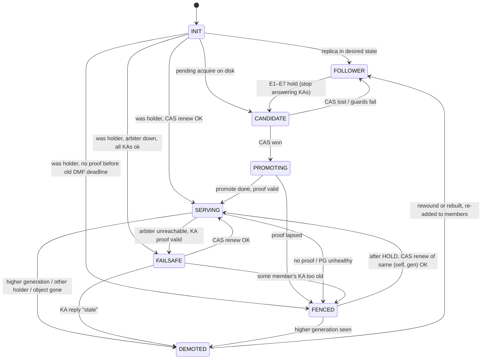

# S8 — Member-driven Postgres failover: the specification (H21 failsafe, H22, H23)

Status: **spec for human approval, 2026-11-20.** Branch `ha/w0-spike-s8`. This is step 1 of
HA-PLAN §6.4. It has no implementation and no model. A second agent builds a model (TLA+ with TLC,
or the W1 simulator) **from this file alone** and checks the properties in §7. Where this spec
differs from HA-PLAN H21–H23 or CLUSTERING §9, this spec is the proposal, and §12 lists each
difference. §11 lists every decision the plan left open; a human must approve them.

Normative words: **must**, **must not** and **never** are safety requirements, and the model
checks them. **should** means a liveness or operability requirement.

Contents: [1 Overview](#1-overview) · [2 Actors and state](#2-actors-and-the-state-each-holds) ·
[3 Timers](#3-timers-and-constants) · [4 Assumptions](#4-assumptions) ·
[5 State machines](#5-state-machines) · [6 Failsafe rule](#6-the-failsafe-rule-h21-stated-precisely) ·
[7 Properties](#7-properties) · [8 Failure model](#8-failure-model) ·
[9 Unsafe and why](#9-what-is-unsafe-and-why) · [10 Open questions](#10-open-questions) ·
[11 Decisions to approve](#11-decisions-this-spec-makes-that-the-plan-left-open) ·
[12 Corrections to the plan](#12-corrections-to-the-plan) · [13 Notes for the modeller](#13-notes-for-the-modeller)

---

## 1. Overview

One Postgres database has a set of **members**. Each member is a data node that runs a Yoal agent,
the root helper and one Postgres instance for this database. At any time one member is the
**primary** and the others are **replicas**. An **arbiter**, an object in an object store with
conditional writes, holds one **lease object** per database. The members decide failover among
themselves. The control plane sets policy and records the results, and failover works without it
(I11).

The rules in one place:

1. **Leadership is a generation.** Only a conditional write (CAS) on the lease object changes the
   holder, and each change of holder raises `generation` by exactly 1. Two members can never both
   win the same generation.
2. **The primary proves its lease or stops.** The primary may stay writable only while it holds a
   *proof*. A proof is either a successful CAS on the lease object (the **arbiter proof**, which
   lasts `Lp` = 9 s from when the request was sent) or, while the arbiter cannot be reached, a
   fresh keep-alive answer from **every** member (the **failsafe proof**, which lasts `W` = 5 s from
   when the keep-alive was sent). When neither proof is valid, Postgres is fenced. A node-local
   **dead-man fence** does this through systemd, so it works even when the agent is frozen or dead.
3. **A replica takes over only after five checks.** A replica acquires `generation + 1` only when
   all of these hold: its WAL stream is down; it has answered no keep-alive for `S` = 15 s; the
   lease object has not changed for `O` = 12 s on the replica's own monotonic clock; the lease has
   expired by the arbiter's clock; and it is **eligible**. In `sync`, eligible means the lease
   object names it as the synchronous replica. Once a replica decides to take over, it answers no
   more keep-alives.
4. **The synchronous set lives in the lease object** (H23). A member is removed from the recorded
   set **before** Postgres stops waiting for it. A member is added to the recorded set only
   **after** Postgres waits for it and it has caught up. The recorded set is therefore always a
   subset of the members that hold every acknowledged commit.
5. **Postgres starts fenced by default.** Postgres starts writable only when a token in `/run` says
   the agent holds a proof that has not expired. That covers reboots, unit restarts and a fence
   that races a promotion.
6. **Consumers follow the highest generation.** Each consumer endpoint asks every member for its
   role. It forwards to the member that answers `primary` at the highest generation, and never to
   a lower generation than one it has already seen.

Safety (I3, I12, I13, and no acknowledged write lost) depends on the arbiter's CAS and on local
monotonic clocks only. It does **not** depend on the arbiter's clock, on clock sync between nodes,
or on any bound on message delay (§6.3, §9). In `sync`, losing no acknowledged write does not depend
on timing at all (§7.4).

---

## 2. Actors and the state each holds

### 2.1 The arbiter

One object per database. The key is `yoal/ha/db/<databaseId>.json`, in the store that the cluster's
arbiter configuration names (backend `s3`, `azure-blob` or `gcs`; H21). Credentials reach the agent
through activation and never through desired state (build-plan invariant 5).

**Object schema** (version 1). Every write replaces the whole object.

```jsonc
{
  "v": 1,
  "databaseId": "db_01JD…",
  "generation": 7,                 // ≥ 1. Raised by exactly 1 on each change of holder (acquire).
  "holder": "nod_A",               // node id of the member that may be primary in this generation
  "seq": 1042,                     // raised by exactly 1 on EVERY write, by any writer (ABA guard, §2.1.3)
  "writer": { "node": "nod_A", "nonce": "b64url-16", "op": "renew" },
                                   // op ∈ create|renew|acquire|members|sync-remove|sync-add|downgrade|release
  "expiresAt": 1763620815000,      // store-clock ms = Date of the writer's preceding GET + TTL
  "members": ["nod_A", "nod_B", "nod_C"],
                                   // the only nodes that may acquire, and the nodes the holder must
                                   // keep alive in failsafe. Always contains holder.
  "slots": { "nod_B": "yoal_db01jd_nodb", "nod_C": "yoal_db01jd_nodc" },
                                   // member → Postgres application_name/slot, for rendering P (§5.5)
  "durability": "sync",            // configured: "sync" | "async" (copied from desired state by the holder)
  "sync": { "set": ["nod_B"], "pending": null },
                                   // set: the recorded synchronous set L (0 or 1 node; H23)
                                   // pending: informational only, never read for a decision
  "downgrade": null,               // or { "at": ms, "generation": 7, "reason": "sync_timeout"|"promoted"|"no_candidate",
                                   //       "lsn": "0/3000060" }
  "released": null,                // or { "successor": "nod_B", "lsn": "0/…" }  (planned switchover, §5.4.6)
  "lastPromotion": { "generation": 7, "from": "nod_C", "to": "nod_A", "acceptedDataLoss": false }
}
```

Derived from one object `o`:

- `L(o) = o.sync.set`, the recorded synchronous set.
- `effSync(o) = (o.durability = "sync" ∧ o.downgrade = null)`. This is the effective durability.
  `durability_effective` on surfaces is `sync` when `effSync(o)` holds and `async` otherwise.
- `eligible(r, o, policy)` (I12):
  - when `effSync(o)` holds: `r ∈ L(o)`.
  - otherwise: `policy.acceptDataLoss = true` and `r` passed the lag check (§5.3, E2).

#### 2.1.1 Operations and the semantics assumed (A1)

| Operation | Request | Possible answers |
|---|---|---|
| `GET(key)` | — | `200 {body, etag, date}` · `404 {date}` · `error` (5xx, 429, 503 SlowDown, timeout, network) |
| `PUT(key, body, If-Match: e)` | replace only if the current ETag is `e` | `200 {etag, date}` · `412` · `409` (concurrent conditional write) · `error` |
| `PUT(key, body, If-None-Match: *)` | create only if absent | `200` · `412` · `409` · `error` |

- **Linearizable conditional writes.** For one key, the arbiter applies successful PUTs in a total
  order. A conditional PUT succeeds exactly when its condition holds at the point it takes effect.
- **No ETag is reused.** A successful PUT gives an ETag that differs from every earlier ETag of the
  key. Some stores (S3, R2) derive the ETag from the content, so writers **must** raise `seq` on
  every write to keep the content unique.
- **Reads may be stale** (a fault, §8). A stale read can never make a conditional write succeed
  against a superseded version.
- **An `error` on a PUT has an unknown outcome.** The write may have been applied: the response was
  lost, or the store returned 5xx after applying it. The writer resolves the outcome on its next
  read by its `writer.nonce`.
- **409 and 412 both mean the CAS was lost.** The writer re-reads, and never retries blindly.
- **501, or a 200 with no ETag,** means the store has no conditional write. HA fails closed: no
  member becomes primary through this database's lease.
- **Per-key write rate.** R2 allows about one write per second per key. The holder sends at most one
  write per database at a time and waits ≥ 1 s between writes. A 429 counts as `error`.

#### 2.1.2 The clock used

`expiresAt` is in the **arbiter's clock**: `Date` of the writer's own preceding GET, plus `TTL`. The
`Date` header has 1 s resolution and is rounded down. Members never compare their wall clock with
`expiresAt`. Every elapsed-time decision uses the member's **local monotonic clock**, `mono()`.
Expiry by the arbiter's clock (E6) is one of the takeover conditions, but safety does not rest on
it (§6.3).

#### 2.1.3 Who writes the object

| Writer | Writes | Condition |
|---|---|---|
| The holder's agent | `create` (bootstrap), `renew`, `members`, `sync-remove`, `sync-add`, `downgrade`, `release` | `If-Match` on the version it just read, which names itself at its generation (`create` uses `If-None-Match: *`) |
| A replica's agent | `acquire`, at `generation + 1` | `If-Match` on the version that passed E1–E7 (§5.3) |
| The control plane | **nothing** on automatic paths. A manual promote is delivered as desired state and the target agent does the CAS (§5.8) | — |

### 2.2 The member agent

The member agent plays one of two roles: primary agent or replica agent. One machine covers both
(§5.2). Its state is kept per database.

| Variable | Kind | Meaning |
|---|---|---|
| `state` | volatile | `INIT`, `FOLLOWER`, `CANDIDATE`, `PROMOTING`, `SERVING`, `FAILSAFE`, `FENCED` or `DEMOTED` |
| `hg` | **persisted** (fsync and atomic rename, before any reply that depends on it) | highest generation seen from any source: arbiter, keep-alive, role answer or desired state |
| `gen` | **persisted** | the generation this node holds (set in `PROMOTING`, `SERVING`, `FAILSAFE` and `FENCED`; cleared in `DEMOTED` and `FOLLOWER`) |
| `pending` | **persisted** | map `nonce → {op, generation, t0}` of writes whose outcome is unknown. Acquire entries are persisted before the PUT is sent |
| `proofArb` | volatile | mono deadline: `t0 + Lp` of the latest successful holder write, where `t0` is when its GET was **sent** |
| `ackSend[k]` | volatile | per member `k`: mono **send** time of the latest keep-alive that `k` answered `ok` |
| `kaSet` | **persisted**, grown before the PUT that grows it | `members \ {self}` of every object this node wrote or tried to write in its generation (union) |
| `lastAnswered` | volatile, **set to `mono()` at agent start** | mono time this node last answered a keep-alive `ok` |
| `obs` | volatile | `{etag, seq, firstRecv}`: the latest observed object version and the mono time its first response was **received** |
| `last` | volatile | the latest arbiter read: `{object, etag, date, recvAt}` |
| `fenceSince` | volatile | mono time the node entered `FENCED` |
| `pg` | sampled every 1 s | local Postgres: up, `pg_is_in_recovery()`, WAL receiver status and its last message time, `pg_stat_replication` rows (`application_name`, `state`, `sync_state`, `flush_lsn`), `pg_current_wal_lsn()` |
| `P` | in Postgres config | the rendered `synchronous_standby_names`, as a set of member ids |

Read from **desired state** (control plane, cached on disk without secrets): the member list, the
members' overlay addresses and pinned certificates, and the policy:
`failover: auto|manual`, `durability`, `on_sync_loss: downgrade|block`, `sync_timeout`,
`accept_data_loss`, `fence: stop|readonly`, timers, and `promoteRequest` (manual, §5.8). Desired
state is never a source of authority to become primary. It can only cause a demotion: a desired
generation above `gen` sends the node to `DEMOTED`.

### 2.3 The dead-man fence and the start gate (node-local, no agent)

Two node-local mechanisms enforce I13 without the agent. Both are fixed helper verbs and systemd
units. Neither is a new always-on daemon.

- **Token.** `/run/yoal/db/<databaseId>/unfenced` = `{generation, deadlineMono}`. It is on tmpfs, so
  a reboot clears it. Only the agent writes it, through the helper verb `db.unfence`, and only with
  `deadlineMono ≤` its current proof.
- **Dead-man fence (DMF).** A transient systemd timer, `yoal-dbfence-<id>.timer`, with
  `OnActiveSec` on the monotonic clock and `AccuracySec=100ms`. The helper verb
  `db.fence.arm {databaseId, deadlineMono}` re-arms it. When the timer fires, it runs
  `db.fence.fire`: remove the token, write the persistent marker, then `SIGKILL` every process in
  the Postgres unit's cgroup.
- **Start gate.** The helper-rendered start script of every HA-managed member decides how Postgres
  starts:
  - A valid token (present, `deadlineMono > now`) starts Postgres as a primary.
  - With no valid token, a member whose desired role is replica starts as a standby following its
    link (today's `yoal-replica-start`).
  - With no valid token, any other member writes `standby.signal` and starts read-only
    (`fence: readonly`), or exits non-zero (`fence: stop`).

  So a crash, a reboot, a `Restart=` after a fence kill, or `pg_ctl promote` deleting
  `standby.signal` can never bring up a writable Postgres without a proof (§9, U5).

### 2.4 Postgres (abstract, for the model)

Each member `m` has `mode ∈ {down, standby, primary}`, a WAL log (a sequence of records, each with
an LSN and a timeline), `flushed` (a prefix length), `upstream` (for a standby) and `P` (for a
primary).

- **Writable.** `writable(m) ⇔ mode(m) = primary`.
- **Commit.** A commit appends a record at LSN `c` on the primary. It is **acknowledged** to the
  client when `P = ∅`, or when every `x ∈ P` reports `flush_lsn ≥ c`. The rendered value is a single
  name, or `ANY n (all n names)`, and never `ANY 1` of two or more (§12, C2).
- **Streaming.** A standby copies its upstream's log as an extension of its own log, if its log is a
  prefix of the upstream's. Otherwise it cannot follow and needs a rewind.
- **Promote.** The standby's mode becomes `primary` on a new timeline. Every record it has flushed
  stays in its history.
- **Fence.** `mode := down`. With `fence: readonly` the mode later becomes `standby` with no
  upstream.
- **Sync-wait cancel** (a Postgres behaviour, §9, U9). A query cancel during the sync wait returns
  success with a WARNING. This spec counts such a commit as **not acknowledged**, and the app
  guidance must say so.

### 2.5 The consumer endpoint

There is one per attachment on each consumer node: the agent's forwarder (H24). The same machine
also drives a replica's replication link (`/run/yoal-upstream`).

| Variable | Meaning |
|---|---|
| `members` | from desired state: node id, overlay address, pinned certificate |
| `highestSeen` | the highest generation reported by any member (memory only) |
| `target` | `none`, or `(member, generation)` |
| `conns` | the open proxied connections, tagged with their target |
| `lastOk[m]` | mono time of the last good role answer from `m` |

### 2.6 The control plane

It holds the `databases` row (`node_id`, `primary_generation`, `durability`, policy), the
`database_replicas` rows, `failover_events`, alerts, audit and desired state. It **reads** member
heartbeats, which carry each member's role report (§2.7), and optionally GETs the lease object. It
**writes** its own rows, desired state, events and alerts. It **never writes** the lease object on
any automatic path, and nothing in §5.2–§5.7 waits for it.

### 2.7 Messages between agents

All of them go agent to agent over the overlay with mutual TLS and pinned node certificates (the
same certificates as `apps/agent/src/endpoints.ts`), on a member-control listener.

| Message | Request | Reply |
|---|---|---|
| Keep-alive (KA) | `{db, generation g, holder h, seq}`, sent by the holder | `{status: ok \| stale \| refuse, hg, state}` |
| Role query | `{db}` | `{role: primary \| promoting \| replica \| candidate \| fenced \| demoted \| unknown, generation, timeline, lsn}` |
| Heartbeat (to the control plane) | the role report per database, plus `durability_effective`, `L`, `P`, lag and the last error | — |

`role = primary` is answered **only** in `SERVING` or `FAILSAFE`, and only while
`mono() < writableUntil` (§5.4.1) and `pg` shows `primary`.

---

## 3. Timers and constants

All durations are in seconds of the local monotonic clock, except `TTL`, which is added to an
arbiter `Date`.

| Name | Default | Meaning | Bound it must keep |
|---|---|---|---|
| `R` | 5 | renew interval (H22) | `R + A_to < Lp`, so a renewal can be retried once before the proof ends |
| `RETRY` | 1 | renew retry after a failure | — |
| `TTL` | 15 | `expiresAt = Date + TTL` (H22) | `TTL ≥ S`, for liveness parity |
| `Lp` | **9** | arbiter-proof window, from the GET's **send** time | (S1) |
| `A_to` | 2 | timeout for an arbiter request | — |
| `K` | 1 | keep-alive interval | `K ≤ W/3` |
| `K_to` | 1 | timeout for one keep-alive | — |
| `W` | **5** | failsafe window: each member's `ok` answer must be to a KA sent within the last `W` (H21 "each renew interval") | (S2) |
| `S` | **15** | KA silence a replica needs before it takes over (H21 "within one TTL") | (S2) |
| `O` | **12** | observation guard: the same lease version seen for `O`, from its first receipt | (S1) |
| `F` | 2 | bound from a proof deadline to Postgres being non-writable (DMF accuracy, kill and exit) | measured in W1; p99 ≤ 1 s |
| `ρ` | 5·10⁻⁴ | maximum monotonic clock drift rate | A3 |
| `ε_a` | 1 | arbiter `Date` error across store frontends (used for liveness only) | A2 |
| `Q_n` / `Q_s` | 5 / 1 | how often a replica polls the arbiter: normally / when suspect | — |
| `suspect` | — | stream down, or KA silence > 2 s, or the last read showed the lease expired | — |
| `S_down` | 10 | stream down = no WAL receiver message for this long (`wal_receiver_timeout = 10s`, `wal_receiver_status_interval = 1s`, `wal_sender_timeout = 10s`) | `S_down < S` |
| `H` / `H_fail` | 2 / 10 | primary Postgres health probe interval / how long unhealthy before the agent stops claiming the lease | — |
| `HOLD` | 30 | minimum time in `FENCED` before the node may resume with the same generation | `HOLD > S + Q_s + A_to` |
| `promote_timeout` | 10 | wait for `pg_is_in_recovery() = false` | — |
| `sync_switch` | 5 | time the sync member must lag (not `streaming`, or `flush_lsn` stalled while commits wait) before the primary replaces it | — |
| `sync_timeout` | 30 | then `on_sync_loss` (H23) | — |
| `D` | 1 | consumer role-probe interval (H22 "every 1–2 s") | — |
| `T_c` | 3 | a consumer drops a target that has not answered for this long | — |

**Safety inequalities.** The model and the implementation must both assert these at start-up and
refuse to run if either fails.

- **(S1)** `Lp/(1−ρ) + F < O/(1+ρ)`. With the defaults: 9.0045 + 2 = 11.0045 < 11.994, a margin
  of about 0.99 s.
- **(S2)** `W/(1−ρ) + F < S/(1+ρ)`. With the defaults: 5.0025 + 2 = 7.0025 < 14.9925, a margin of
  about 7.99 s.

**Liveness budget** for an unplanned primary loss, measured from the moment of failure (§7.6):

| Stage | Time |
|---|---|
| KA silence | `S` = 15 s |
| `Date` rounding and `ε_a` | ≤ 2 s |
| Poll granularity | ≤ `Q_s` = 1 s |
| Acquire CAS | ≤ `A_to` = 2 s |
| `pg_ctl promote` | ≤ 5 s |
| Consumer discovery | ≤ `D` + RTT ≈ 2 s |
| **Total** | **≈ 21 s typical, ≤ 27 s worst** |

The worst case stays inside the 30 s bound.

---

## 4. Assumptions

Safety rests on A1, A3, A4, A7, A8 and A9. Liveness also needs A2, A5, A6 and A10.

- **A1. Arbiter CAS.** Conditional writes on one key are linearizable, and ETags are never reused
  (§2.1.1). Reads may be stale. A PUT that returns an error may or may not have been applied.
- **A2. Arbiter clock (liveness only).** Any frontend's `Date` is within `ε_a` = 1 s of true time,
  rounded down to the second, and does not step. **No safety property depends on A2.**
- **A3. Monotonic clocks.** Each node has one monotonic clock, which the agent and systemd timers
  share. It never goes backwards, and it advances at a rate within `[1−ρ, 1+ρ]` of true time,
  including while a process is stopped (SIGSTOP). If a whole VM pauses, the guest's monotonic clock
  must advance by the paused time (or the pause must be detected, §9, U3).
- **A4. Fence bound.** A fence triggered at mono deadline `d` leaves Postgres non-writable by true
  time `d + F`. This holds whether the agent or the DMF triggers it, and whether the agent is
  running, frozen or dead. While no valid token exists, the start gate never starts a writable
  Postgres.
- **A5. Drift bound.** `ρ ≤ 5·10⁻⁴`. This is part of A3, stated on its own because (S1) uses it.
- **A6. Message delay (liveness only).** Messages between live, connected processes, including the
  arbiter, are delivered within `δ` = 1 s; requests time out at `A_to` and `K_to`. **Safety assumes
  no bound on delay.** Messages may be lost, duplicated, delayed without limit or reordered.
- **A7. Authenticated peers.** Keep-alive and role messages are authenticated by pinned mTLS. An
  authenticated agent follows this spec (crash and freeze faults only, no Byzantine members).
- **A8. Persistence.** `hg` and `pending` survive an agent crash and restart. The token does not
  survive a reboot. Postgres data and config (`P` via `postgresql.auto.conf`) survive both.
- **A9. Postgres semantics.**
  - With `synchronous_commit = on` and `P` rendered as one name (or `ANY n` of `n` names), a commit
    is acknowledged only after every name in `P` has flushed it.
  - `pg_stat_replication.sync_state` shows each walsender's view of `P`.
  - Promotion keeps every flushed record.
  - Clients do not lower `synchronous_commit`.
  - A commit returned with the sync-cancel WARNING is not an acknowledged write (U9).
- **A10. Liveness environment.** After the failure being measured there is no further failure. The
  eligible replica, its agent and its path to the arbiter work. Consumers can reach it.

---

## 5. State machines

### 5.1 Notation

- Each machine is listed as transitions `Tn` with columns: from state → to state, guard, what is
  **read** (and from where), and what is **written** (and where).
- "**AR**" means an arbiter read: `t0 := mono(); GET`. The read updates `last` (with
  `recvAt := mono()`), `obs` (if the ETag differs from `obs.etag`, then
  `obs := {etag, seq, firstRecv := recvAt}`) and `hg := max(hg, object.generation)`.
- "**HW(op, mutate)**" is the holder-write procedure in §5.4.2.
- Each step of one machine is atomic with respect to that machine (the agent is single-threaded
  per database). Actions of different machines interleave freely.

### 5.2 Member machine: overview



Writability by state:

- `SERVING` and `FAILSAFE` are the only states in which Postgres may be writable.
- `PROMOTING` becomes writable at the end of promotion, and only under a valid proof.
- In every other state the token is absent and Postgres is fenced or a standby.

### 5.3 Replica side: `INIT`, `FOLLOWER`, `CANDIDATE`

**The takeover conditions E1–E7.** Each one is evaluated on `last`, the latest arbiter read, whose
object we call `o`.

| # | Condition | Read from |
|---|---|---|
| E1 | `policy.failover = auto` ∧ `self ∈ o.members` ∧ `self ≠ o.holder` ∧ `o.released = null` | desired state; arbiter |
| E2 | `eligible(self, o, policy)`. When `effSync(o)`: `self ∈ o.sync.set`. Otherwise: `policy.acceptDataLoss` ∧ the WAL receiver was `streaming` with replay delay ≤ `maxLagSeconds` (default 60 s) at the moment the stream went down | arbiter; desired state; local Postgres history |
| E3 | Stream down: no WAL receiver message for ≥ `S_down`, measured on the agent's mono clock across 1 s samples | local Postgres (`pg_stat_wal_receiver`) |
| E4 | KA silence: `mono() − lastAnswered ≥ S` | local |
| E5 | Observation guard: `last.etag = obs.etag` ∧ `mono() − obs.firstRecv ≥ O` | local (fed by arbiter reads) |
| E6 | Expired by the arbiter's clock: `last.date ≥ o.expiresAt` | arbiter `Date` |
| E7 | Fresh read: `mono() − last.recvAt ≤ A_to` | local |

**Answering a keep-alive (`AnswerKA`, every state).** A KA `{g, h}` arrives from `h`:

| Receiver state | Action |
|---|---|
| `INIT`, `FOLLOWER`, `FENCED`, `DEMOTED`, with no unresolved acquire | If `g < hg`: reply `stale(hg)`. Else `hg := g` (persisted **before** the reply), `lastAnswered := mono()`, reply `ok`. A `FENCED` holder with `g > gen` first takes T24 |
| `CANDIDATE` (or any state with an unresolved acquire) | `hg := max(hg, g)` (persisted). Reply `refuse`. `lastAnswered` is unchanged |
| `PROMOTING`, `SERVING`, `FAILSAFE` | If `g > gen`: T24 (`DEMOTED`), then answer as `DEMOTED`. Else reply `refuse` (another node cannot hold `g ≤ gen`; a lower `g` gets `stale(hg)`) |

**Transitions.**

| T | From → To | Guard | Reads | Writes |
|---|---|---|---|---|
| T1 | `INIT` → `FOLLOWER` | Agent start; desired role is replica, or the object names another holder | persisted `hg`, `pending`; desired state; AR (optional) | `lastAnswered := mono()` (**rule R-START**). Point the link at the discovered primary (§5.7) |
| T2 | `INIT` → `CANDIDATE` | Agent start with a `pending` acquire entry | persisted `pending` | Refuse KAs until resolved (T8–T10) |
| T11 | `INIT` → `SERVING` | Agent start with persisted `gen` (it was a holder), HW(renew) → Ok, Postgres is up as primary, and the token is valid | persisted `gen`, `kaSet`; arbiter; local Postgres | Re-arm the DMF and the token at the new `writableUntil`. Start the KA sender. A plain agent restart therefore does not stop a healthy primary |
| T12 | `INIT` → `FAILSAFE` / `FENCED` / `DEMOTED` | Agent start with persisted `gen`; HW → Unreachable / Unknown | persisted `gen`, `kaSet`; peers | Start the KA sender at once. Postgres keeps running only under the DMF deadline the previous agent armed (the new agent never extends it without a proof). If every `k ∈ kaSet` answers `ok` before that deadline → `FAILSAFE` (re-arm to `proofKA`); otherwise `Fence()` → `FENCED`. HW → Negative → `DEMOTED` (T24) |
| T3 | `FOLLOWER` → `FOLLOWER` (poll) | Every `Q_n`, or every `Q_s` when `suspect` | AR | `obs`, `last`, `hg`. If `o.holder` names a different primary than the link's, re-point the link (§5.7) |
| T4 | `FOLLOWER` → `FOLLOWER` (answer KA) | KA `{g, h}` received from `h` | local `state`, `hg` | `AnswerKA` above |
| T5 | `FOLLOWER` → `CANDIDATE` | E1 ∧ E2 ∧ E3 ∧ E4 ∧ E5 ∧ E6 ∧ E7, checked **and** acted on in one atomic step | as in the E table | `state := CANDIDATE`. From this instant every KA gets `refuse`, and `lastAnswered` is never updated again in this state |
| T6 | `CANDIDATE` → (send acquire) | Immediately after T5 | `last` (`o`, `etag`, `date`; `t0` = the GET's send time) | `nonce := random`. Persist `pending[nonce] := {acquire, o.generation+1, t0}`. Then `PUT If-Match: last.etag` with `o' = {generation: o.generation+1, holder: self, seq: o.seq+1, writer: {self, nonce, "acquire"}, expiresAt: last.date + TTL, members: o.members \ {o.holder}, slots: (same, minus self), durability: policy.durability, sync: {set: [], pending: null}, downgrade: (policy.durability = sync ∧ policy.on_sync_loss = downgrade) ? {at: last.date, generation: o.generation+1, reason: "promoted", lsn: own replay LSN} : null, released: null, lastPromotion: {o.generation+1, from: o.holder, to: self, acceptedDataLoss: ¬effSync(o)}}` |
| T7 | `CANDIDATE` → `PROMOTING` | PUT → `200` | — | `gen := hg := o'.generation` (persisted). `proofArb := t0 + Lp`. Clear `pending[nonce]`. `kaSet := o'.members \ {self}` |
| T8 | `CANDIDATE` → `CANDIDATE` (resolve) | PUT → `error` or timeout, or start with `pending` (T2) | AR every `Q_s` | Apply the **resolution rule** below to every acquire entry. **Won** → T7 with `t0 := pending[nonce].t0`; if `t0 + Lp ≤ mono()`, first do HW(renew) at the won generation and take that proof (HW → Negative means the win was superseded: go to T9). **Unresolved**, and E1–E7 hold on this fresh read → retry T6 with a new `t0` and a new nonce. Every entry is conditioned on the same ETag, so at most one can apply. Old nonces stay in `pending` |
| T9 | `CANDIDATE` → `FOLLOWER` | Every acquire entry is resolved **lost** | AR | Clear `pending`. Resume answering KAs (from now on T4 applies) |
| T10 | `CANDIDATE` (stays) | Some acquire entry is still **unresolved**, whatever E1–E7 now say (including when the arbiter is unreachable) | — | Keep refusing KAs. **Never** return to `FOLLOWER` while an acquire PUT could still land: a delayed PUT conditioned on an ETag that is still current can win later (§9, U14) |

**Resolution rule** for an acquire entry `{generation: g+1, ifMatch: e, nonce}`, judged on a read
of object `o` with ETag `x`:

- **Won:** `o.generation = g+1` ∧ `o.holder = self`, whichever of our nonces wrote it.
- **Lost:** `o.generation ≥ g+1` with another holder; or `o.generation = g` ∧ `x ≠ e`. In the second
  case the precondition is gone for good, because an ETag is never reused (A1).
- **Unresolved:** `o.generation = g` ∧ `x = e`. The PUT may still be in flight.

### 5.4 Primary side: `PROMOTING`, `SERVING`, `FAILSAFE`, `FENCED`, `DEMOTED`

#### 5.4.1 The proofs

- `proofArb`: the mono deadline from the latest successful holder write. It is `t0 + Lp`, where
  `t0` is the send time of that write's GET.
- `proofKA`:
  - It counts only when the latest arbiter interaction was `error` (unreachable or slow). A
    definite negative answer (§5.4.2) cancels it.
  - It is `min over k ∈ kaSet of (ackSend[k]) + W`.
  - When `kaSet = ∅` it is `−∞`: a member with no peers has no failsafe.
- `writableUntil = max(proofArb, proofKA)`.
- The DMF and the token always carry a deadline `≤ writableUntil`.

#### 5.4.2 The holder-write procedure `HW(op, mutate)`

The holder uses HW for every write: renewal, membership and the sync set.

1. `t0 := mono()`; `GET`.
   - `error` → return **Unreachable**.
   - `404` → return **Negative(absent)**.
2. If `o.generation > gen` or `o.holder ≠ self`: `hg := o.generation` (persisted), return
   **Negative(superseded)**.
3. If `o.writer.nonce ∈ pending` (our earlier write landed but its response was lost):
   `proofArb := max(proofArb, pending[o.writer.nonce].t0 + Lp)`, and drop that entry and every
   older entry.
4. Build `o' := mutate(o)` with `seq := o.seq + 1`, `expiresAt := date + TTL` and
   `writer := {self, nonce, op}`. Record `pending[nonce] := {op, gen, t0}`. Add
   `o'.members \ {self}` to `kaSet`.
5. `PUT If-Match: etag`.
   - `200` → `proofArb := max(proofArb, t0 + Lp)`, clear `pending[nonce]`, return **Ok**.
   - `409`/`412` → one immediate re-read (steps 1–3 only). If superseded, return **Negative**.
     Otherwise return **Conflict** (try again at the next tick).
   - `error` → return **Unknown**. `pending[nonce]` stays, and nothing is extended.

Every return of Ok re-arms the DMF and rewrites the token to the new `writableUntil`. Calls to
`db.fence.arm` are limited to one per second.

#### 5.4.3 Transitions

| T | From → To | Guard | Reads | Writes |
|---|---|---|---|---|
| T20 | `PROMOTING` → `PROMOTING` | Entry (after T7) | `o'` | Render `P` before promoting, as Y20 says: `∅` if `o'.downgrade ≠ null` or `durability = async`, or `ANY 1 (members \ {self})` if `on_sync_loss = block`; write it into `postgresql.auto.conf` with the helper and reload. `db.unfence {gen, writableUntil}` (writes the token) and `db.fence.arm`. Start the KA sender (§5.4.4). Then `pg_ctl promote` (helper verb, `-w -t promote_timeout`) |
| T21 | `PROMOTING` → `SERVING` | `pg_is_in_recovery() = false` ∧ `mono() < writableUntil` | local Postgres | Start the renew loop. Report `role = primary` |
| T22 | `PROMOTING` → `FENCED` | `mono() ≥ writableUntil`, or the promote failed after `promote_timeout` and one retry | local | `Fence()` (§5.4.5). The DMF fires in any case. A failed promote is paged (`ha.promote_failed`) |
| T23 | `SERVING` → `SERVING` | Renew tick (every `R`; every `RETRY` after a failure): HW(renew, identity) → Ok | arbiter | `proofArb`, DMF, token |
| T24 | `SERVING`/`FAILSAFE`/`FENCED`/`PROMOTING` → `DEMOTED` | HW → Negative; or a KA reply `stale(g' > gen)`; or desired-state generation > `gen`; or a role answer from another member of `primary` at `g' > gen` | arbiter / peer / desired state | `hg := g'` (persisted). `Fence()`. Stop the KA sender. **Never** renew again |
| T25 | `SERVING` → `FAILSAFE` | HW → Unreachable/Unknown/Conflict ∧ `mono() ≥ proofArb` ∧ `mono() < proofKA` | local | Report `failsafe`. Keep renewing every `RETRY`. DMF and token deadline `:= proofKA` |
| T26 | `FAILSAFE` → `SERVING` | HW → Ok | arbiter | As in T23 |
| T27 | `FAILSAFE` → `FAILSAFE` | KA `ok` from `k` for a KA sent at `s` | peer | `ackSend[k] := max(ackSend[k], s)`. DMF and token deadline `:= writableUntil` |
| T28 | `SERVING`/`FAILSAFE` → `FENCED` | `mono() ≥ writableUntil`, checked at least every 100 ms and **before** every action that relies on being primary | local | `Fence()`. Stop the KA sender. `fenceSince := mono()` |
| T29 | `SERVING`/`FAILSAFE` → `FENCED` | The local Postgres health probe has failed for `H_fail` (a frozen or broken Postgres) | local Postgres | `Fence()`. Stop renewing and stop sending KAs (abdicate) |
| T30 | `FENCED` → `FENCED` | Not yet `mono() − fenceSince ≥ HOLD` | — | No writes to the arbiter, no KAs. Answer KAs from others per T4 rules (it may answer `ok` to a higher generation; it answers `stale` to a lower one) |
| T31 | `FENCED` → `SERVING` | `mono() − fenceSince ≥ HOLD` ∧ HW(renew) → Ok (proves that no one acquired) ∧ the local Postgres health probe passes | arbiter; local | `db.unfence {gen, writableUntil}`. Remove `standby.signal`, then restart Postgres (the start gate sees the token). Restart the KA sender. Alert `ha.primary_resumed` |
| T32 | `DEMOTED` → `FOLLOWER` | Desired state or role discovery names a primary at `g' > gen`; heal finished (`pg_rewind` to it, or a rebuild, W10); the holder has re-added self to `members` | desired state; peers | Disarm the DMF. Start Postgres as a standby (start gate: replica path). `lastAnswered := mono()` |

#### 5.4.4 The KA sender (in `PROMOTING`, `SERVING` and `FAILSAFE` only)

Every `K`, for each `k ∈ kaSet`:

- Send `KA {db, gen, self, seq}` and record `sent[seq] := mono()`.
- On `ok` → `ackSend[k] := max(ackSend[k], sent[seq])`. An answer is matched to its **send** time,
  so a late answer can never extend the window past `sent + W`.
- On `stale(g')` → T24.
- On `refuse` → nothing; the window for `k` runs out.

A node in `FENCED` or `DEMOTED` **must not** send KAs. Otherwise a replica that keeps answering
would never take over.

#### 5.4.5 `Fence()`

1. Helper verb `db.fence.fire`: remove the token, then `SIGKILL` the Postgres unit's cgroup
   (`fence: stop` also stops the unit).
2. The agent stops answering `role = primary` immediately, and closes provider-side forwarding for
   this database.
3. Consumers notice within `D` (§5.7).

The start gate keeps Postgres non-writable from then on (§2.3).

#### 5.4.6 Planned switchover (W10; optional in the model)

The holder `p` hands over to `t ∈ members` like this:

1. Remove the token, then stop Postgres cleanly (`pg_ctl stop -m fast`), so the walsenders send
   everything up to the shutdown checkpoint.
2. Wait until `t` has flushed up to the shutdown checkpoint LSN (from `pg_controldata`). Refuse the
   switchover if that does not happen within 10 s.
3. HW(release): `released := {successor: t, lsn}`, `expiresAt := date`. `p` still holds the lease,
   so it can write, and it is no longer writable.
4. `t` acquires at once. It skips E3–E6, because the holder stopped writing before it released,
   but it must satisfy E1 (with `o.released.successor = self` replacing `o.released = null`) and E7.
   No other member may acquire a released lease.
5. `p` goes to `DEMOTED`, then to `FOLLOWER` without a rewind, because its history is a prefix of
   `t`'s.

### 5.5 The sync-set sub-machine on the primary (H23)

**Variables.**

- `L` = the recorded set in the object.
- `P` = the rendered `synchronous_standby_names`.
- `G` = the set of members known to hold every commit acknowledged so far in this generation. `G`
  is a model-level ghost variable, not something the agent stores.

**Rules.** These hold in every state, and the model checks them as invariants.

- **(Y1) Remove first.** A name is removed from `P` only after an HW that removed it from `L` has
  returned Ok.
- **(Y2) Add last.** A name `y` is added to `L` only after four steps, in order:
  1. `P = {y}`, as one name, has been rendered and reloaded.
  2. `pg_stat_replication` shows `y` with `sync_state = 'sync'`, and every other walsender shows
     `async` or `potential` (so every walsender has reloaded).
  3. `W_y := pg_current_wal_lsn()` was read **after** step 2.
  4. `flush_lsn(y) ≥ W_y`.
- **(Y3) Only the holder changes L or P, and only through HW.** If an HW returns Unknown, no step
  that depends on it runs until a read resolves it. A failed CAS cannot change `L`.
- **(Y4) P survives restarts.** `P` is persisted in `postgresql.auto.conf`. A restarted agent never
  re-renders `P` with fewer names unless (Y1) has been met.

These rules make `L ⊆ P` and `L ⊆ G` invariant within a generation (§7.4).

**States** (shown with three members: primary `A`, members `B` and `C`):

| State | `L` | `P` | Meaning |
|---|---|---|---|
| `SYNC_OK(x)` | `[x]` | `{x}` | Normal |
| `SYNC_REPLACING(x→y)` | `[]` | `{y}` (or still `{x}` before step 2) | Replacing a lost or bad sync member |
| `SYNC_ADDING(y)` | `[]` | `{y}` | After a promotion, or upgrading from a downgrade |
| `SYNC_WAITING` | `[]` (or `[x]` while `x` is lost but not yet removed) | `{x}` or `ANY 1(…)` | No streaming candidate; commits block |
| `DOWNGRADED` | `[]` | `∅` | `downgrade ≠ null`; commits acknowledged without a replica (recorded and alerted) |

**Transitions.**

| T | From → To | Guard | Reads | Writes |
|---|---|---|---|---|
| Y10 | `SYNC_OK(x)` → `SYNC_REPLACING(x→y)` | `x` lagging for `sync_switch` (not `streaming`, or `flush_lsn` stalled while backends wait) ∧ some `y ∈ members`, `y ≠ x`, is `streaming` | `pg_stat_replication` | 1. HW(sync-remove): `sync := {set: [], pending: y}`. 2. On Ok: render `P := {y}` and reload |
| Y11 | `SYNC_REPLACING(x→y)` → `SYNC_OK(y)` | (Y2) holds for `y` | `pg_stat_replication`; `pg_current_wal_lsn()` | HW(sync-add): `sync := {set: [y], pending: null}`, `downgrade := null` |
| Y12 | `SYNC_OK(x)` → `SYNC_WAITING` | `x` lagging for `sync_switch` ∧ no other member streaming | local | Nothing. Commits block. Timer `syncLostAt := mono()` |
| Y13 | `SYNC_WAITING` → `SYNC_REPLACING(x→y)` | Some `y` starts streaming before `sync_timeout` | local | As in Y10 |
| Y14 | `SYNC_WAITING` → `DOWNGRADED` | `mono() − syncLostAt ≥ sync_timeout` ∧ `on_sync_loss = downgrade` | local | 1. HW(downgrade): `sync := {set: []}`, `downgrade := {at: date, generation: gen, reason: "sync_timeout", lsn: pg_current_wal_lsn()}`. 2. On Ok: `P := ∅`, reload. Alert `ha.sync_downgraded` (page) |
| Y15 | `SYNC_WAITING` (stays) | `on_sync_loss = block` | — | Commits stay blocked. Page |
| Y16 | `DOWNGRADED` → `SYNC_ADDING(y)` | Some `y ∈ members` is `streaming` | local | `P := {y}`, reload |
| Y17 | `SYNC_ADDING(y)` → `SYNC_OK(y)` | (Y2) holds for `y` | as in Y11 | As in Y11, which clears `downgrade` |
| Y18 | `SYNC_OK(x)` → `SYNC_REPLACING(x→y)` | Operator rebalance, or desired state removes `x` | desired state | As in Y10 |
| Y19 | any → (same) | HW in Y10, Y11 or Y14 returns Unknown or Conflict | — | Do not change `P`. Retry the same step next tick (holder writes are ≥ 1 s apart) |
| Y20 | (entry after promotion) | T20 | `o'` | `on_sync_loss = downgrade`: start in `DOWNGRADED` (`reason: promoted`, already in `o'`), then Y16 as soon as a member streams. `on_sync_loss = block`: start in `SYNC_ADDING` with `P = ANY 1 (members \ {self})`; when one `y` streams, `P := {y}` and continue to Y17 |

**Membership changes** (desired state adds or removes a member):

- **Add:** one HW(members) with `members ∪ {m}` and its slot. `kaSet` grows **before** the PUT is
  sent (step 4 of §5.4.2).
- **Remove `m`:**
  1. If `m ∈ L`, Y18 first.
  2. HW(members) with `members \ {m}`.
  3. Drop `m` from `kaSet` only after that HW returns Ok.

### 5.6 The dead-man fence machine (per node, per database; run by systemd)

| T | From → To | Guard | Writes |
|---|---|---|---|
| D1 | `DISARMED` → `ARMED(d)` | `db.fence.arm(d)` from the agent | Timer to fire at mono `d` |
| D2 | `ARMED(d)` → `ARMED(d')` | `db.fence.arm(d')` | Re-armed. `d'` may be earlier or later; the agent guarantees `d' ≤ writableUntil` |
| D3 | `ARMED(d)` → `FIRED` | `mono() ≥ d` | `db.fence.fire`: remove the token, then `SIGKILL` the Postgres cgroup |
| D4 | `FIRED`/`ARMED` → `DISARMED` | `db.fence.disarm` from the agent, only when the member is a standby (T32) or the database left HA | — |

The DMF runs in systemd, so a frozen, crashed or restarting agent does not stop it. If the helper is
down, the agent cannot re-arm, the timer fires at the old deadline, and Postgres stops. That costs
availability but is safe.

### 5.7 The consumer endpoint machine

One machine per consumer endpoint, and one more on each replica for its replication link.

| T | From → To | Guard | Reads | Writes |
|---|---|---|---|---|
| C1 | any → (same) | Every `D`, a role query to every member in parallel (timeout 1 s) | member role answers | `highestSeen := max(highestSeen, every generation reported, in any role)`. `lastOk[m]` |
| C2 | `NO_TARGET` → `TARGET(m, g)` | `m` answered `primary` at `g` ∧ `g = highestSeen` ∧ no other member answered `primary` at `g` | as in C1 | Forward new connections to `m` |
| C3 | `TARGET(m, g)` → `NO_TARGET` | `m` answered anything other than `primary(g)`; or `highestSeen > g`; or `mono() − lastOk[m] ≥ T_c` | as in C1 | **Close every connection in `conns` to `m`**. Refuse new connections: accept, then close at once, as in CLUSTERING §9.5 |
| C4 | `TARGET(m, g)` → `TARGET(m', g')` | `g' > g`, and C2 holds for `m'` | as in C1 | As in C3, then as in C2 |
| C5 | `NO_TARGET` (stays) | Two members answer `primary` at the same generation (impossible under I3a) | — | Alert `ha.two_primaries` (critical). Forward to neither |

On a replica, the replication link targets the same `(m, g)`. After C4 the replica's walreceiver
reconnects, and its timeline follows if its log is a prefix of the new primary's. If not, the
replica marks itself `needs-rewind`. While its WAL receiver is not streaming at `g'`, E2's lag check
fails in non-sync modes, and it is not in `L` in sync mode.

### 5.8 The control plane machine (per database; observer only)

| T | From → To | Guard | Reads | Writes |
|---|---|---|---|---|
| P1 | `STEADY` → `STEADY` | Heartbeat | member role reports; optional arbiter GET | Lag, `durability_effective`, `L` and `P` into its rows; alerts on a downgrade or failsafe |
| P2 | `STEADY` → `FAILOVER_OBSERVED` | A member reports `primary` at `g > databases.primary_generation` | heartbeats | `failover_events` row (kind `database`, automatic). Audit `database.failover.promote`. Alert (info) |
| P3 | `FAILOVER_OBSERVED` → `HEALING` | The report persists for two heartbeats | heartbeats | `databases.node_id := new holder`. `primary_generation := g`, which may only go up. Desired state: the old primary becomes a replica to heal (W10). Generation `g` rides desired state (a demotion signal only) |
| P4 | `HEALING` → `STEADY` | The old primary reports `FOLLOWER` streaming at `g`, or the operator removes it | heartbeats | Close the event |
| P5 | (operator) | `POST /databases/:name/promote` with `If-Match: <generation>` | its rows | Desired state `promoteRequest {target, generation: g+1, acceptDataLoss, force}`. The **target agent** runs T6 with E3 skipped, E2 relaxed by `acceptDataLoss`, and E4, E5 and E6 kept. With `force` (typed confirmation that the old primary is powered off, CLUSTERING §9.6) E4, E5 and E6 are skipped too. **`force` is outside the safety envelope** and is not modelled |
| P6 | (enable `failover: auto`) | Policy change | — | Desired state only. The primary's agent creates the object (`If-None-Match: *`, `generation := desired primary_generation`, `members` from desired state, `sync.set := []`). A replica's agent never creates it. If the create returns `412` with another holder: refuse and report `ha.lease_conflict` |

If the control plane is down, none of §5.2–§5.7 changes. It catches up from heartbeats (I11).

---

## 6. The failsafe rule (H21), stated precisely

### 6.1 The rule

**F1 (primary).** A primary `p` holding generation `g` may be writable at local time `t` only if
either of these holds:

- (a) `t < proofArb`, where `proofArb = t0 + Lp` and `t0` is the send time of the GET that preceded
  `p`'s latest successful write to the lease object at generation `g`; or
- (b) `p`'s latest arbiter interaction did not return a definite negative, and for **every**
  `k ∈ kaSet`, `p` has received `ok` from `k` for a KA that `p` sent at local time `s ≥ t − W`.
  `kaSet` covers the members of every object `p` has written or tried to write in generation `g`.

If neither holds, Postgres on `p` is non-writable by `t + F` (A4).

**F2 (member).** A member `r` that has answered `ok` to any keep-alive within the last `S` on its
local clock **does not acquire the lease**, even if it can reach the arbiter and the lease has
expired. `r` stops answering `ok` to keep-alives at the instant it decides to acquire (T5), and does
not answer `ok` again until it is `FOLLOWER` with no unresolved acquire.

**F3 (promotion needs the arbiter).** No member becomes primary except through T7, which is a
successful CAS. With the arbiter unreachable, no member is promoted.

**F4 (restart).** An agent that starts treats itself as having just answered a keep-alive
(`lastAnswered := mono()`), and treats `hg` from disk as already seen.

### 6.2 Consequences (for §7.6)

- An arbiter outage alone causes no failover and no stop: every member keeps answering, so (b)
  stays true and F3 stops promotion.
- An arbiter outage plus one unreachable member stops the primary within `W + F` of the last `ok`
  from that member, as today.
- The primary losing only the arbiter causes no stop. The members can reach the arbiter, but F2
  stops them taking over.

### 6.3 Why it is safe (proof sketch; the model checks it)

Suppose member `r` acquires `g+1` with a CAS that lands at true time `T_a`, and `r` sent it at true
time `T_s ≤ T_a`. We show that `p`, the holder of `g`, is non-writable by `T_s`.

1. **Arbiter proof, (a).** The CAS was `If-Match e`, where `e` is the ETag of the version `r`
   observed (A1).
   - So `e` was written by `p`'s latest successful write. Any later write by `p` would have changed
     the ETag, because `seq` changes the content.
   - That write's GET was sent at `t0`, before the write landed. The write landed before the arbiter
     answered `r`'s first read that returned `e`, and that answer reached `r` at `f`. So
     `true(t0) < true(f)`.
   - E5 makes `r` send at local time `≥ f + O`, so `T_s ≥ true(f) + O/(1+ρ) > true(t0) + O/(1+ρ)`.
   - `p` is non-writable by `true(t0) + Lp/(1−ρ) + F`, and (S1) makes that earlier than `T_s`.

   No arbiter `Date`, wall clock or message-delay bound was used.
2. **Failsafe proof, (b).** `r ∈ kaSet` of `p`:
   - The `members` of `e` include `r` (E1), and only `p` wrote `members` in generation `g`.
   - Let `s` be the send time of the latest KA that `r` answered `ok`, and `T_ans ≥ s` the time of
     that answer.
   - E4 at T5 and F2 give `T_s ≥ T_ans + S/(1+ρ)`.
   - (b) for `r` ends by `true(s) + W/(1−ρ)`, and `p` is non-writable by that time plus `F`. (S2)
     makes that earlier than `T_s`.

   Late or duplicate KA answers are matched to their send time, so delay does not help them. A
   restart of `r`'s agent resets `lastAnswered` (F4), so a lost `lastAnswered` cannot shorten the
   silence.
3. **Both proofs gone.** Once neither holds, `p`'s Postgres is non-writable by A4 (DMF or agent),
   and stays so by the start gate until `p` gets a new proof.
   - A new proof at generation `g` needs a successful CAS on an object at generation `g`.
   - After `T_a` the object is at `g+1`, so that CAS is impossible (A1). `p` can only reach
     `DEMOTED`.

---

## 7. Properties

Notation:

- `writable(m, t)`: Postgres on member `m` is writable at true time `t` (§2.4).
- `holderOf(g)`: the member that won the CAS creating generation `g`.
- `acked(c)`: commit `c` was acknowledged to a client without the sync-cancel WARNING.
- `lin(m)`: the WAL history of member `m`.

### 7.1 I3: at most one primary

- **I3a (per generation).** `∀ g: |{m : m won a CAS creating or acquiring generation g}| ≤ 1`.
  Also, every acquire raises `generation` by exactly 1. *(A1 alone.)*
- **I3b (at most one writable Postgres at any instant).** `∀ t: |{m : writable(m, t)}| ≤ 1`.
  - The stated bound is **zero overlap** under A1, A3, A4, A5, A7 and A8, with margins of 0.99 s
    from (S1) and 7.99 s from (S2).
  - If A4 fails by `x` seconds (a fence slower than `F`), the overlap is at most
    `max(0, x − 0.99)` seconds.
  - If A3 fails for a paused VM whose monotonic clock stopped, the overlap is bounded by the
    detection in U3. The model treats that case as out of the envelope.
- **I3c (writable only under a proof).**
  `writable(m, t) ⇒ m ∈ {SERVING, FAILSAFE, PROMOTING} ∧ t < writableUntil(m) + F`.

### 7.2 I12: auto-promotion only of a recorded synchronous replica

For every T7 by `r` over object version `o` (the version its CAS replaced):
`effSync(o) ⇒ r ∈ L(o)`, and `¬effSync(o) ⇒ policy.acceptDataLoss ∨ o.durability = async`.
Manual promotion (P5) obeys the same rule unless `acceptDataLoss` is set. `force` is out of scope.

### 7.3 I13: a primary that cannot prove its lease stops accepting writes within one TTL

`∀ m, t: writable(m, t) ⇒ (proofArb(m) > t − F) ∨ (proofKA(m) > t − F)`, in local time converted
by A3.

Consequently, from `p`'s last successful lease write (GET sent at `t0`) and with no failsafe proof,
`p` is non-writable by `t0 + Lp/(1−ρ) + F ≈ t0 + 11 s < t0 + TTL`. In failsafe, `p` is
non-writable by `W/(1−ρ) + F ≈ 7 s` after the send time of the oldest member's latest answered KA.

### 7.4 No acknowledged write lost in `sync`

Auxiliary invariants within one generation `g` held by `p`:

- **Inv-LP:** `L ⊆ P`.
- **Inv-LG:** `∀ x ∈ L, ∀ c: acked(c) ∧ c on p's timeline in g ⇒ c ∈ flushed(x)`.

**NoLostAck.** For every acknowledged commit `c` made by `holderOf(g)`:

- **(i)** if `effSync` held for the object version current when `c` was acknowledged, then for
  every later generation `g' > g` reached without `acceptDataLoss`, `c ∈ lin(holderOf(g'))`; and
- **(ii)** the same holds if `c` was acknowledged while downgraded (`effSync` false), as long as no
  promotion between `g` and `g'` used `acceptDataLoss`. A downgraded object has `L = []`, so no
  automatic promotion can happen until a member is re-added under (Y2), and (Y2) requires that
  member to have every acknowledged commit up to `W_y`.

Why it holds without timing: by Inv-LP, `r ∈ L` implies `r ∈ P` on the old primary.

- The old primary acknowledges a commit only after `r` flushes it.
- After `r` promotes, its walreceiver has stopped, so the old primary can acknowledge only commits
  `r` had already flushed. Promotion keeps every one of them (A9).

The model must check NoLostAck **with the DMF disabled and the timing inequalities violated**, to
confirm it rests on Y1–Y4 and the CAS only.

### 7.5 Further safety properties the model should check

- **Mono-gen.** `hg` on every member, and `highestSeen` on every consumer, never decreases.
- **No-route-back.** A consumer never forwards a new connection to `(m, g)` with
  `g < highestSeen`.
- **One-answer.** At most one member answers `primary` at any instant, up to message delay. It
  follows from I3c.
- **No-KA-when-fenced.** A member in `FENCED`, `DEMOTED`, `FOLLOWER` or `CANDIDATE` never sends a
  KA.
- **Candidate-silence.** A member in `CANDIDATE`, or with an unresolved acquire, never answers a KA
  `ok`.

### 7.6 Liveness (under A2, A6 and A10, with weak fairness on every enabled transition)

| # | Scenario | Property | Bound |
|---|---|---|---|
| L1 | Primary node crashes, or is cut off from every member and the arbiter; `r ∈ L` is up and reaches the arbiter | Some member is `SERVING` at `g+1`, and every live consumer is in `TARGET(r, g+1)` | Within **27 s** (≈ 21 s typical): `S` + rounding + `Q_s` + `A_to` + promote + `D` |
| L2 | Arbiter unreachable from every node for 10 min, all members up | The primary never leaves `SERVING`/`FAILSAFE`; no member enters `CANDIDATE` | Whole outage |
| L3 | Primary cut off from the arbiter only | No failover and no stop (`FAILSAFE`) | Whole partition |
| L4 | Primary cut off from every replica, arbiter reachable by all | No failover (E5 fails, because `p` renews every `R < O`). In `sync`: writes resume after `sync_timeout` through Y14 with `downgrade`; with `block` they stay blocked and page | `sync_timeout + A_to` ≈ 32 s |
| L5 | All healthy | No transition to `CANDIDATE`, ever | — |
| L6 | After L1, another member streams from the new primary | `L` becomes `[y]` | `sync_switch` + catch-up + `2·A_to` |
| L7 | The holder froze or was fenced, and no one acquired | It resumes through T31 | `HOLD` + `A_to` |

---

## 8. Failure model

What each fault is and does in the model, and the outcome the spec requires.

| Family | Fault | How it is modelled | Required outcome |
|---|---|---|---|
| Crash | Node power-off (agent, Postgres, DMF and token all lost; disk kept) | Every process on the node stops. On restart: `INIT`, no token, `hg` and `pending` from disk | Primary: L1. Replica: no effect. On reboot the start gate keeps Postgres fenced until T31 or T32 |
| Crash | Agent crash and restart | The agent's volatile state is lost; Postgres, the DMF and the token persist | DMF covers I13. R-START delays any takeover by `S`. `pending` resolves through T8 |
| Crash | Postgres crash | `mode := down`; systemd restarts it through the start gate | Primary with a valid token comes back writable on the same generation; otherwise fenced |
| Crash | Helper down | `db.*` verbs fail | Primary: the DMF fires at its last deadline (stops, safe). Promotion is impossible (liveness) |
| Partition | Symmetric, any subset of {members, arbiter, consumers} | Messages between the two sides are dropped | I3, I12, I13 always. The side with the arbiter and an `L` member fails over (L1). Otherwise no promotion |
| Partition | Primary ↔ arbiter only | Arbiter calls from `p` return `error` | L3 (failsafe) |
| Partition | Primary ↔ all replicas only | KA and WAL dropped | L4 |
| Partition | Asymmetric `p → r` works, `r → p` drops | `r` answers KAs (and counts them) but `p` never gets the `ok` | `p` loses (b) for `r`. Arbiter reachable: renewals continue. Arbiter unreachable: `p` fences at `W + F`. `r` never takes over while `p` still sends KAs (it keeps answering). Once `p` is fenced it stops sending, and `r` may take over after `S` |
| Partition | Asymmetric `r → p` works, `p → r` drops | `r` gets no KAs | `p` fences (arbiter unreachable) or keeps renewing. `r` takes over only if E5 also holds |
| Messages | Loss, duplication, reordering, unbounded delay (KA, role, WAL, arbiter requests and responses) | Any message may be dropped, duplicated or delivered late | Safety holds without any delay bound (§6.3). Liveness only under A6 |
| Messages | Arbiter response lost on an applied write | PUT applied, client sees `error` | Resolved by nonce (T8, HW step 3). A candidate keeps refusing KAs until resolved (T10) |
| Freeze | Primary's agent SIGSTOP for 60 s, then resume | The agent takes no steps; mono time advances (A3); Postgres keeps running | DMF fires by `proof + F`. A replica takes over at ≥ `S`. On resume, T28 or T24 runs first (proof expired, or a higher generation): **the stale-leader case** |
| Freeze | Primary's Postgres SIGSTOP | Postgres takes no steps; commits stall | T29 after `H_fail`, then the DMF kill (SIGKILL works on a stopped process). L1 follows from the abdication |
| Freeze | Replica agent SIGSTOP in `FOLLOWER`, `CANDIDATE` (CAS in flight) or `PROMOTING` | No steps; mono time advances | The CAS precondition and E7 make stale decisions harmless. In `PROMOTING` the proof is checked before promote, and the DMF covers a stale win (§9, U11) |
| Freeze | Whole VM paused | Every process on the node stops; whether mono time advances depends on A3 | Covered if A3 holds. Otherwise U3 |
| Clock | Wall-clock skew ±5 s or ±60 s, or a step back on any node | The wall clock is not an input to any transition | No effect (only the `skew` report changes) |
| Clock | Monotonic drift up to `ρ` | Each local clock runs at a rate in `[1−ρ, 1+ρ]` | Covered by (S1) and (S2) |
| Clock | Arbiter `Date` skewed across frontends, or stepped | `date` = true time ± arbitrary | Safety unaffected (E5 carries it). E6 can delay or advance only the *permission*, and E5 still binds |
| Arbiter | Unreachable for 10 min | Every call returns `error` | L2; no promotion |
| Arbiter | 5xx, or 5xx after applying the write | `error` or applied-plus-`error` | As unreachable; nonce resolution |
| Arbiter | Slow (responses up to 10 s) | Responses delayed | Renewals that miss `Lp` → `FAILSAFE`. Never unsafe |
| Arbiter | Throttling (429 or 503 SlowDown) | `error` | As unreachable. The holder spaces its writes ≥ 1 s apart |
| Arbiter | Stale reads | A GET returns an older version | Every CAS based on it fails (A1). E5 resets |
| Arbiter | Object deleted | GET → 404 | Holder → `DEMOTED` (fail closed). Replicas never take over (E1 fails). Page `ha.lease_missing`; the operator re-runs P6 |
| Arbiter | No conditional write (501, missing ETag) | — | HA refuses to start (P6). A running holder → `FENCED`, and pages |
| Disk | Primary's data or WAL disk full | Postgres errors; the health probe fails | T29, then L1 |
| Operator | Promote with a stale generation | P5 `If-Match` mismatch | 409. Nothing is written |

---

## 9. What is unsafe and why

Every place the design depends on timing, or on an ordering that is easy to break, with the hazard
it guards against. "Safety" in the third column means a violation of I3, I12, I13 or NoLostAck.

| # | Dependency | Hazard it guards against | If it is broken |
|---|---|---|---|
| U1 | **(S1)** `Lp/(1−ρ) + F < O/(1+ρ)`. The primary's proof is measured from the GET's **send** time, and the observation guard from the first **receipt** | A stale primary still writable when the successor's CAS lands (split brain, two writers) | Safety. Margin 0.99 s at the defaults. Measuring the proof from the write's *response*, or the guard from a read's *send*, removes that margin (§12, C6) |
| U2 | **(S2)** `W/(1−ρ) + F < S/(1+ρ)`, with KA answers matched to their **send** time and the member silent from T5 on | A primary in failsafe writing after a member that lost contact takes over | Safety. Margin 7.99 s |
| U3 | **Monotonic time across freezes (A3).** The agent's proof checks and the DMF timer both use `CLOCK_MONOTONIC` | A frozen process wakes believing its proof is valid. A VM pause that stops the guest's monotonic clock lets Postgres resume writable after its successor took over | Safety for whole-VM pauses. Mitigation to build and test: on each tick, compare elapsed `CLOCK_BOOTTIME` and wall time against mono; a forward jump of more than 1 s fences at once. In `sync`, no acknowledged write is at risk (§7.4), only I3b |
| U4 | **DMF accuracy and kill time (A4, `F`).** `AccuracySec=100ms`; SIGKILL to the cgroup, not SIGTERM | A frozen or dead agent leaves Postgres acknowledging writes (`async`, `downgraded`) after the lease is gone | Safety in `async`. systemd's default `AccuracySec` is **1 min**, which would break (S1) |
| U5 | **Start gate on a `/run` token**, not on `standby.signal` | (a) A reboot or `Restart=` brings up a writable primary with no proof. (b) `pg_ctl promote` deletes `standby.signal` between the fence's write and its kill. (c) A Quadlet `Restart=always` revives a fenced Postgres as writable | Safety. This is the most likely implementation bug: the existing primary unit starts writable unconditionally |
| U6 | **Restarted agents (F4).** `lastAnswered := mono()` at start; `hg` and `pending` persisted before replies | A replica that answered a KA 1 s ago, crashed and restarted takes over while the primary still counts that answer. A restarted agent answers `ok` to a stale primary because it forgot a higher generation | Safety |
| U7 | **E6, expiry by the arbiter's `Date`**, rounded down to 1 s, with frontends that may disagree | — (not relied on) | Liveness only. Kept because H22 states it and so that `expiresAt` means something to people and to the control plane. The model must show safety holds with E6 removed |
| U8 | **`seq` raised on every write** | ETag ABA on content-hashed stores. Two renewals in the same second with the same `expiresAt` produce the same body and ETag, and a replica wrongly sees the lease as unchanged | Safety (E5 is defeated) |
| U9 | **Postgres sync-wait cancel.** A query cancel, such as `statement_timeout` (CLUSTERING §9.5 recommends 30 s) or `pg_cancel_backend`, during the sync wait returns COMMIT success with a WARNING | A commit acknowledged locally only, then lost by a promotion of `L`. No timer in this spec can prevent it | NoLostAck as the client sees it. The app guidance and the checker must treat a WARNING-acknowledged commit as unacknowledged. The platform should not set a role-level `statement_timeout` shorter than `sync_timeout` for HA databases. Fault tests must assert no such WARNING occurred |
| U10 | **Walsender reload window** when `P` changes. Each walsender reloads `synchronous_standby_names` on its own schedule | A commit released by the old sync standby's walsender after `P` changed. Y2 waits for `sync_state` on every walsender and captures `W_y` after that | NoLostAck, if `W_y` is captured before every walsender has reloaded |
| U11 | **Proof check before `pg_ctl promote`, and the DMF armed before it** | A candidate that won the CAS, froze for longer than `Lp`, and then promotes on a stale win while a later generation exists (possible with `acceptDataLoss`) | Safety |
| U12 | **Fence `HOLD` before resuming** | A fenced primary renewing right away and starving the eligible replica (flapping) | Liveness only. The CAS still makes resuming safe |
| U13 | **R2 per-key write rate** (~1/s) | Sync-set changes colliding with renewals and getting 429 | Liveness only |
| U14 | **A candidate never returns to `FOLLOWER` with an unresolved acquire** (the resolution rule in §5.3) | Its PUT was applied with the response lost, or is still in flight and lands later. It then answers KAs as a follower and refreshes the old primary's failsafe proof. When it later learns of the win and promotes, the old primary still holds a fresh failsafe proof: two writers. The price is liveness: a candidate stuck with an unresolved entry refuses KAs, so a primary in failsafe fences | Safety |
| U15 | **Consumer timers `D` and `T_c`** | Exposure to a fenced primary, for connections only | No invariant. Writes to a fenced Postgres fail |
| U16 | **`S_down` and the WAL timeouts** | Taking over from a primary that is still streaming | Liveness or flapping only. E4 and E5 carry safety |

---

## 10. Open questions

**O3. One arbiter object per database, or one per cluster with a map? Recommendation: one per
database** (`yoal/ha/db/<databaseId>.json`), which is also the plan's default. The reasons:

1. **Write rate.** A cluster object takes `N_db / R` renewals per second plus every sync-set change,
   and R2 throttles a key above about 1 write/s. Ten databases would hit 429s, and a 429 drives
   primaries into failsafe.
2. **Contention.** Every renewal of one database would race every other database's renewals and
   acquires. 409s and 412s would become routine, and a holder that loses a race has to re-read and
   retry. That costs liveness for unrelated databases and makes the model far larger.
3. **Blast radius.** A corrupt or deleted object fails one database closed, not all of them.
4. **The proofs stay per database.** `seq`, `members`, `L` and `downgrade` are per database anyway.

The cost is more objects and more GETs (about 0.2 holder writes per second and about 0.6 replica
GETs per second per database). The control plane lists `yoal/ha/db/` to show them. The control-plane
lease stays its own object (`yoal/ha/control-lease.json`).

**Other questions this spec does not settle:**

- **Q-S8-1.** Does `async` with `failover: auto` require `accept_data_loss` explicitly, or does
  choosing `async` imply it? The spec treats `async` as implying it (E2, I12), bounded by
  `maxLagSeconds`.
- **Q-S8-2.** Should the start gate's token deadline be checked again while Postgres runs (a second
  timer), or is the DMF enough? The spec says the DMF is enough.
- **Q-S8-3.** U3: is the boottime/wall-clock jump detector good enough for hypervisor pauses, or does
  `auto` need a hardware watchdog (`/dev/watchdog`, as Patroni uses) on VMs? W1 must measure
  guest-monotonic behaviour across `virsh suspend`, Lima and cloud live migration.

---

## 11. Decisions this spec makes that the plan left open

These need human approval (HA-PLAN §6.4 step 1).

| # | Decision | Plan reference |
|---|---|---|
| D-S8-1 | One lease object per database (O3) | HA-PLAN §11 O3 |
| D-S8-2 | `Lp = 9 s`, measured from the renewal GET's send time | H22 says only "before the TTL ends" |
| D-S8-3 | **Observation guard** `O = 12 s` on the replica's monotonic clock, from the first receipt of an unchanged version. Safety does not depend on the arbiter's clock | H22 relies on "expired by the arbiter's clock" |
| D-S8-4 | Keep-alive interval `K = 1 s`; failsafe window `W = 5 s` (= R); member silence `S = 15 s` (= TTL); KA answers matched to their send time; a candidate stops answering at the decision | H21 |
| D-S8-5 | **`members` recorded in the lease object.** Only recorded members may take over, and they are the keep-alive set. An acquire removes the old holder | H21 says "every member" without saying whose list |
| D-S8-6 | **Dead-man fence** (transient systemd monotonic timer plus a SIGKILL helper verb) and a **start gate** on a `/run` token | H22 says "it stops Postgres"; nothing covers a frozen agent or a reboot |
| D-S8-7 | Fence by SIGKILL. `fence: readonly` restarts Postgres as a standby with no upstream (a hard read-only), not `default_transaction_read_only` | H22 "per `fence`" |
| D-S8-8 | The sync set holds exactly one name; `ANY 1 (a, b)` is never used | H23 vs CLUSTERING §9.2 |
| D-S8-9 | Sync-set change ordering Y1/Y2 (remove-record first, add-record last), with `sync_state` and `W_y` checks | H23 "record the new set, then change the setting" |
| D-S8-10 | After a promotion with `on_sync_loss: downgrade`, the new primary starts **downgraded** (`reason: promoted`, recorded and alerted) and adds a sync member as soon as one streams. With `block`, it waits for a member. Starting with `P = {y}` would miss the 30 s budget whenever `y` needs a rewind | H22 budget, H23 |
| D-S8-11 | `sync_switch = 5 s` before replacing a lagging sync member; `sync_timeout = 30 s` before `on_sync_loss` | H23 |
| D-S8-12 | A fenced primary may resume the same generation after `HOLD = 30 s` with a successful CAS renewal. A demoted one never resumes | CLUSTERING §6.6 says control-plane fencing never resumes |
| D-S8-13 | The primary abdicates (stops renewing and fences) when its own Postgres is unhealthy for 10 s | H22 detection signals |
| D-S8-14 | WAL settings for HA databases: `wal_receiver_timeout = 10s`, `wal_receiver_status_interval = 1s`, `wal_sender_timeout = 10s` (instead of 60 s) | CLUSTERING §9.2 |
| D-S8-15 | The control plane never writes the lease object. Manual promote and switchover are desired-state requests that the target agent carries out with the same CAS | H22 "control plane sets policy and records" |
| D-S8-16 | Desired-state generation can only demote, never promote | CLUSTERING §9.3 "the generation also rides desired state" |
| D-S8-17 | A replica polls the arbiter every 5 s, and every 1 s while suspect | — |

---

## 12. Corrections to the plan

| # | Correction |
|---|---|
| C1 | **H23's literal order is unsafe for additions.** "Record the new set, then change the setting" makes the new member eligible while Postgres still waits only for the old one. A commit acknowledged by the old member alone is then lost if the new member is promoted. The safe order is: removals record first, then change the setting; additions change the setting, catch up past `W_y`, then record (Y1/Y2). |
| C2 | **CLUSTERING §9.2's `ANY 1 (<slot a>, <slot b>)` cannot satisfy I12.** No single replica is guaranteed to hold every acknowledged commit. H23's single name supersedes it, and §9.2 should be amended. |
| C3 | **H21 needs a recorded member list.** Without `members` in the arbiter, a member added through desired state during an arbiter outage is outside the keep-alive rule and could take over. H21 also needs the timing details of F2 and F4 (send and receive times, a candidate's silence, restart). |
| C4 | **H22's "expired by the arbiter's clock" alone makes safety depend on store frontends' clocks** (S7 measures exactly that). The observation guard removes the dependency at no liveness cost (§3 budget). |
| C5 | **H22 "stops Postgres before the TTL ends" is not enforceable by the agent alone.** A frozen agent, a reboot or a restart policy each defeat it. The DMF and the start gate are needed (U4, U5). |
| C6 | **`ControlLease` (`packages/core/src/ha-lease.ts`) measures `lastConfirmedAt` at the write's *response*.** That is acceptable for its 20 s, 30 s and 40 s margins, but reusing the class for database leases must change it to the GET's *send* time (U1). The class also has no `seq`, so on R2 (content-hash ETags) two renewals in the same second are an ABA risk (U8). |
| C7 | **CLUSTERING §9.5 recommends `statement_timeout = 30 s`.** In `sync` that turns a stalled sync standby into WARNING-acknowledged local-only commits (U9). The app guidance must change. |
| C8 | **The 25 s budget assumes the new primary does not wait for a sync replica** (D-S8-10). With `on_sync_loss: block`, the 30 s bound is not guaranteed. |
| C9 | **Detection is a fixed ≈ 15 s.** Because of F2, a failover always waits `S` after the last keep-alive the replica answered, not "up to 15 s". The budget in §3 accounts for this. |

---

## 13. Notes for the modeller

These are suggestions. The spec above is the contract.

### Scope

- Three members, one arbiter key and two consumers.
- Generations up to 3–4.
- Commits as a small counter.
- WAL as a sequence of commit ids per member.

### Time

Use integer ticks of 0.5 s or 1 s of true time, with one local clock per node.

- Drift can be modelled by shrinking the safety margins. Check with constants scaled so that (S1)
  and (S2) hold with **integer** margins: for example `Lp = 9, F = 2, O = 12, W = 5, S = 15` in
  ticks, and allow a fence to complete at any tick in `[deadline, deadline + F]`.
- Then find the smallest `Lp` that breaks I3b with `O = 12` and `F = 2`. Confirm it matches (S1)
  for the tick granularity used. For example, with "first receipt at least one tick after the send"
  the discrete condition is `Lp + F ≤ O`. The margin is tight on purpose; a model that never breaks
  is not exercising the timing.

### Nondeterminism to include

- Message loss, duplication and delay, without a bound.
- PUT applied but the response lost.
- 409 and 412 races.
- Stale GETs.
- A process freeze: no steps for N ticks while clocks advance.
- Node crash and restart with persisted `hg` and `pending`.
- DMF disabled (the agent alone) as a separate configuration.
- A `Date` error of `±ε` per response.

### Planted mutations the model must catch

Each one should give a counterexample:

| Mutation | Should break |
|---|---|
| (1) Remove E5 and add `Date` skew | I3b |
| (2) Remove E4 / F2 | I3b in failsafe |
| (3) Candidate keeps answering KAs after T5 | I3b |
| (4) KA answers matched to receive time instead of send time, with unbounded delay | I3b |
| (5) `lastAnswered` not reset on restart | I3b |
| (6) H23 literal order (record `y` before `P := {y}`) | NoLostAck |
| (7) `P` rendered `ANY 1 (B, C)` with `L = [B]` | NoLostAck |
| (8) Start gate on `standby.signal` with a promote racing a fence | I3b |
| (9) No `seq` with content-hash ETags | I3b |
| (10) Proof measured from the PUT response | I3b with large delays |
| (11) Candidate returns to `FOLLOWER` while its acquire is unresolved (a delayed PUT lands later) | I3b |
| (12) Holder's `kaSet` not grown before the PUT that adds a member | I3b in failsafe |

### Checks that must pass without timing

- NoLostAck with the DMF removed and with any constants.
- I3a with any constants.
